# Decision モデルへの画像入力を活用しロボットアームを操作する試み

## 1. 概要

Decision モデル (Jev) にカメラ画像とロボット自身の状態を入力し、その回答でシミュレータ上のロボットアームを動かして、ベンチマーク LIBERO の物を運ぶタスクを解けるか試した。

Jev の公開直後、Web 上では様々な領域での活用が探られた。ロボットアームの操作に適用する事例もいくつかあったが、公開当初は画像入力に対応しておらず、シミュレータから取得した物体の座標などを入力するものが多かった。興味深くはあるが、実環境ではこのような値を得ることは難しい。本課題では、シミュレータが持つ対象物の座標の真値 (ground-truth state) を実行中に使わず、画像から物体の位置を推定する別個の処理も設けずに、固定カメラと手首カメラの画像およびグリッパーの高さ・開閉状態といったロボット自身のデータのみを Jev に入力してロボットの操作を試みた。

LIBERO からタスクを選択し、シミュレータから取得した対象物と配置先 (トレイ) の位置をテキストで渡す公開事例の形を追試すると 10/10 で成功したが、位置を外して画像で世界座標の向きを問うと 0/10 だった。そこで、カメラ画像にグリッパーの真下を示す印 (手首カメラには赤い ×、固定カメラにはグリッパーから真下のテーブル面へ下ろした黄色い線と点) を描き、その印を画像内の左右・上下のどちらへ動かすかを問う形に変えた。さらに、対象物を掴んで別の場所に置くまでの流れと各段階での問いを、スケルトン (制御プログラムの骨格) として人が定義した。プリンの箱をトレイへ運ぶタスクは 10/10 で解け、スケルトンを左の黒いボウルをトレイへ運ぶタスクへ転用して修正すると 8/10 だった。修正後のスケルトンを変えずに右のボウルを左のボウルに重ねるタスクへ転用すると、掴む対象を指示文だけで指定して 10/10 で右のボウルを掴めたが、左のボウルに重ねられたのは 4/10 だった。スケルトンを人が定義せず、Code as Policies で LLM に生成させると 4/10〜8/10 だった。

画像内の向きで問い、手順と動作の切り替えをコードが支えれば、実行中に対象物の位置を渡さずに物を運ぶことができた。一方で、グリッパーを閉じるタイミングは、グリッパーを下ろして当たって止まった後にコード側で選択肢を `close` と `open` の 2 つに絞り込んだときにしか選ばれず、置き場所が小さいときや画角から外れたときの位置合わせは Jev の回答だけでは決まらなかった。この課題の範囲では、Jev には画像内の向きや閉じるか開くかといった画像から判断できる問いに絞り、段階の順序、世界座標への変換、物理的な状況に応じた選択肢の絞り込みはスケルトンのコードが担う役割分担が有効だった。

## 2. 背景

### Jev

Jev は TypeSafe AI が 2026-09-15 に公開したモデルである[1]。状態と型付きの問いを受け取り、型付きの回答と各選択肢の確率を返す。また 2026-10-14 には、`typesafe/jev-1.14` (preview) の公開とともに、画像を入力できることが公表された[2]。このレポートでは、Jev のように状態と型付きの問いから回答を返すモデルを Decision モデルと呼ぶ。

Decision モデルは LLM と同様に自然言語や画像を解釈できる一方、文章を生成せずに回答を返すため高速に応答する。本課題では、この能力をロボットアームの方策の一部として利用する。

本課題の測定では、448 px の画像 1 枚と短い問いを送る。ローカル環境からの 1 回の呼び出しのレイテンシは 400〜500 ms ほどだった。OpenRouter[3] を利用しており、国外でホストされているためやや遅い。


### ロボットアームを操作する先行事例

Jev をロボット制御に使った公開事例 (TarunTomar122/jev-askable-arm [4]、Dmytro Hrybov による MuJoCo での事例 [5]、openroboto-ai/jev-robot-control [6] など) は、初期の Jev がテキスト入力のみだったこともあり、カメラ画像をそのまま Jev に渡していない。

多くの事例では、シミュレータから取得した物体の位置や外部の処理で抽出した位置から構造化テキストを作り、Jev が選んだ行動を別のコードが実行していることが見て取れる。TarunTomar122/jev-askable-arm や Hrybov による MuJoCo での事例では、作者自身が「No images go to Jev」「Jev doesn't accept images, it gets simplified geometry and contacts as text here」などと記している。たとえば openroboto-ai/jev-robot-control では、軸ごとの目標位置とグリッパー位置の差 (目標 − グリッパー) を問いの文中に書き、「差が正なら positive」という選び方も同じ文中に明記している。この形では、Jev はテキストに書かれた数値の符号を読めば答えられる。

## 3. 実験環境

### タスクと環境

LIBERO[7] の `libero_90` から、同一のシーン (`LIVING_ROOM_SCENE4`) を使う 4 つのタスクを選んだ。ロボットアームは Franka Panda で、グリッパーは最大 8 cm 開き、y 軸方向に開閉する。4 つのタスクはシーン、置き場所 (トレイ)、カメラ配置が共通であり、タスクを替えると運ぶ対象物と指示文だけが変わる。

固定カメラは LIBERO の既定の位置 (`agentview`、ロボットの正面から斜めに見下ろす) から動かし、ロボットの正面と左の間 (方位 45°) の斜め上 (仰角 40°) から作業域を見下ろすクオータービューの画角とした。正面からの画像では前後の移動が画像の上下の動きと重なるのに対し、クオータービューでは前後、左右、上下が画像上で別々の方向に写るためである。

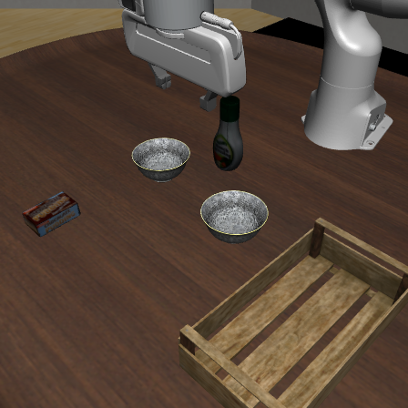

図 1: 固定カメラ (クオータービュー) から見たシーン (プリンの箱のタスク、init 0)

| タスク | LIBERO の指示文 | 使った実験 |
| --- | --- | --- |
| プリンの箱をトレイへ (task 61) | pick up the chocolate pudding and put it in the tray | 1〜6 |
| 左の黒いボウルをトレイへ (task 60) | pick up the black bowl on the left and put it in the tray | 3、5、6 |
| 右のボウルを左のボウルに重ねる (task 64) | stack the right bowl on the left bowl and place them in the tray | 5 |
| ドレッシングの瓶をトレイへ (task 62) | pick up the salad dressing and put it in the tray | 3 のみ |

各タスクを選んだ理由は次のとおりである。

- プリンの箱をトレイへ: 本課題の本筋としたタスクである。箱はシーン内に 1 つしかなく、y 方向の幅 (4.6 cm) がグリッパーの最大開き幅 (8 cm) より小さいため、箱の中心への向きがほぼそのまま掴む場所への向きになる。掴む位置の補正なしに、Jev の回答をロボットの移動に使えるかを確かめられる。
- 左の黒いボウルをトレイへ: 黒いボウルは直径 10.7 cm でグリッパーの最大開き幅より大きく、中心の上からでは掴めず縁を挟む必要がある。さらに同じ形のボウルが y 方向に約 18 cm 離れてもう 1 つ置かれており、指示文の「左」「右」で区別しなければならない。
- 右のボウルを左のボウルに重ねる: 2 つあるボウルの一方を他方の上に重ねるタスクで、作成した手順を別のタスクへそのまま転用できるかを確かめるために追加した。
- ドレッシングの瓶をトレイへ: 背の高い対象物として選んだが、実験 3 の把持の検証で 175 回中 11 回しか掴めず、以降の実験から外した。


### 方策の構成と Jev への入力

方策は dora-rs[8] を使い、シミュレータ (`sim`)、記録と評価 (`evaluator`) とは別のノード (`policy`) として実装し、20 Hz で動かした。方策ノードは、指示文、2 つのカメラの画像、グリッパーの位置と開き幅を受け取る。シミュレータから取得した物体の位置は、基準となる実験 1 を除き `evaluator` ノードだけに配線し、実行中は採点と失敗の分析にだけ使った。

固定カメラはテーブルを斜め上から見下ろしたクオータービューで、運ぶ物と置き場所の両方を写す。手首カメラはグリッパーから真下を向く。手首カメラの画像は、固定カメラの画像と上下の印象が近くなるよう 180° 回転して渡す。画像はどちらのカメラも 448 px の正方形にした。事前の検証で、プリンの箱が写った固定カメラの画像を 280〜1120 px で渡して比べたところ、入力トークン数は画素数にほぼ比例し (448 px で画像 1 枚と短い問い 2 つが約 870 トークン)、レイテンシは 896 px まで 1 秒未満で変わらなかった。448 px で箱の輪郭がはっきりと写り、「箱が写っているか」の確信度が 0.92〜0.94 に達したため、それ以上大きくしても見え方はほとんど変わらないと判断して 448 px を採用した。

| (a) 固定カメラ | (b) 手首カメラ |
| --- | --- |
|  | 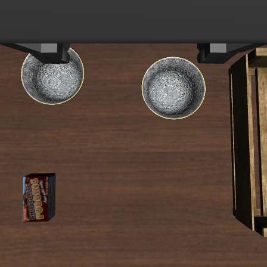 |

図 2: Jev に渡す画像の例 (プリンの箱のタスク、init 0)

方策は、直前の命令の実行結果と、その後の画像およびロボットの状態が揃うと、Jev を呼んで次の命令を 1 つ返す。この 1 サイクルを判断と呼ぶ。命令はグリッパーの相対移動、絶対位置への移動、グリッパーの開閉の 3 種類で、`sim` ノードの制御器が実行する。グリッパーは常に真下を向け、手首の回転は扱わないものとした。

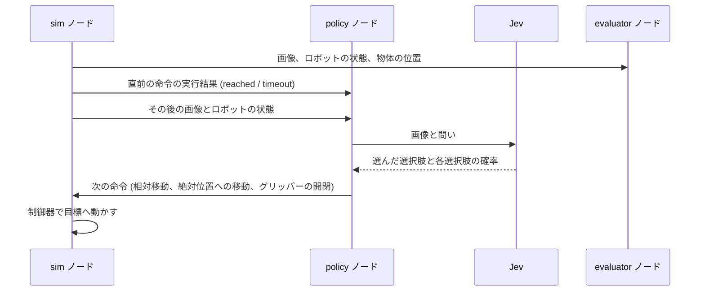

図 3: 1 回の判断におけるノード間のやり取り

## 4. 実験の全体像

各実験での取り組みの概要と知見を短く述べる。

### 実験 1: 対象物の位置をテキストで渡す

公開事例の再現を試みた。シミュレータから取得した対象物と配置先 (トレイ) の位置を、`pudding_box_mm: [103.5, -181.4, 449.8]` (プリンの箱の位置) や `pudding_box_grasp_minus_tcp_mm: [119.2, -138.7, -240.2]` (掴む位置とグリッパーの位置の差) のようなテキストにして Jev に渡す。1 回の判断で Jev を 2 回呼び、1 回目で `approach` や `grasp` などの意図を、2 回目で軸ごとの向き (`negative`、`hold`、`positive`) とグリッパーの開閉を選ばせる。行き先までの差や位置が合ったかの真偽値はコード側で計算して渡すため、Jev はテキストに書かれた数値の符号を読めば答えられる。この形で、プリンの箱をトレイへ運ぶタスクは 10/10 で解けた。

### 実験 2: 画像で世界座標の向きを問う

画像の入力からそのまま解けるか、解けなければどこを分けて問えばよいかを探る出発点として、実験 1 の形から対象物と配置先の位置だけを画像に置き換えた。固定カメラと手首カメラの画像を渡し、座標系の説明をテキストで添えて、x、y、z の各軸をどちらへ動かすか (`plus`、`stay`、`minus`)、グリッパーを開くか閉じるか、タスクが完了したかを 1 回の呼び出しで問うた。段階の判断も含めてすべて Jev に任せたところ 0/10 だった。回答の多くは箱から遠ざかる向きで、最初からグリッパーを閉じてテーブルに押し付けたまま動かし続けた。

### 実験 3: 画像内の向きで問う

実験 2 では、テキストで説明した座標系を画像に当てはめて向きを答えることと、どの段階にいるかの判断を、1 回の問いでまとめて Jev に求めていた。これがタスク難度を上げていると考え、段階ごとの小さな作業に分け、画像から向きを正しく答えられる問い方を探した。画像にグリッパーの位置を示す印を描き、印を対象物に重ねるには画像の横方向 `h` (`left`、`none`、`right`) と縦方向 `v` (`up`、`none`、`down`) のどれへ動かすかを問う形に変えた。静止画で検証すると、手首カメラの画像では遠ざかる向きをほとんど答えなかった。固定カメラは対象物の近くで `none` と答えるため、粗く寄せる段階にのみ使うことにした。行き先の言い方で回答が変わることや、ボウルは中心ではなく縁を掴む必要があることもここで確かめた。

### 実験 4: スケルトンを定義する

実験 3 で、画像内の向きで問えば段階ごとの位置合わせに Jev の回答を使えることが分かったので、この問い方を組み込んでタスク全体を解く。物を掴んで別の場所に置くタスクを次の段階に分け、段階ごとに Jev に問う内容を決めた手順 (スケルトン) を定義した。

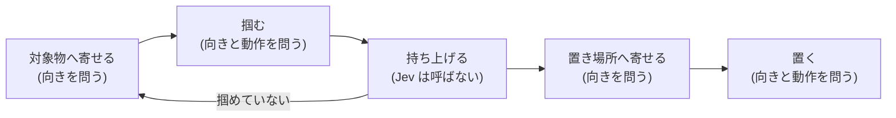

図 4: スケルトンの段階と、各段階で Jev に問う内容

寄せる段階では、固定カメラの画像で行き先への向き (`h`、`v`) を問う。掴む段階と置く段階では、手首カメラの画像とグリッパーの状態を渡し、向きと次の動作 (`action`) を 1 回の呼び出しで問う。

コードは、向きの回答を世界座標に変換して 2 cm ずつ動かし、`action` で選ばれた動作を実行する。対象物や置き場所の名前はタスクごとに差し替える。スケルトンはプリンの箱を試行しながら 3 回修正し、修正後は 10/10 で成功した。

### 実験 5: スケルトンを別のタスクへ転用する

名前などタスクごとの値だけを差し替えて、左の黒いボウルをトレイへ運ぶタスクに転用すると、縁まで下りても `close` を選ばずに失敗した。下ろす動作が当たって止まった直後は選択肢を `close` と `open` に絞るなどの修正を加え、プリンの箱は 10/10、左の黒いボウルは 8/10 になった。同じスケルトンを右のボウルを左のボウルに重ねるタスクに使うと、指示文だけで右のボウルを掴み分けたが (10/10)、重ねられたのは 4/10 だった。

### 実験 6: LLM にスケルトンを書かせる

スケルトンを人が書く代わりに、Code as Policies の手法で LLM に制御プログラムを生成させた。プロンプトに渡す知見を 2 通り用意し、プリンの箱で 5/10 と 8/10、左の黒いボウルで 6/10 と 4/10 だった。成否はループの上限回数など生成ごとの実装の違いで分かれ、知見を追加した効果は生成のばらつきと切り分けられなかった。

なお、実験 6 は実験 4 のスケルトンを作る前に実施した。実験 6 で LLM に渡した知見は、それ以前の実装 (置き場所の位置を先に記憶してから運ぶスケルトン) で測定したものであり、実験 4 のスケルトンとその結果は LLM には渡していない。

## 5. 各実験の結果

### 5.1 実験 1: 対象物の位置をテキストで渡す

公開事例 (OpenRoboto の `jev-robot-control`[6]) の問いの形を、プリンの箱をトレイへ運ぶタスクに当てはめた。各軸の問いの文には現在の座標、目標の座標、その差を書き、位置が合ったか (`grasp_pose_reached` など) の真偽値もコードがシミュレータから取得した位置から判定して渡す。

1 回の判断ごとに Jev の API を 2 回呼ぶ。1 回目の呼び出しでは、指示文と状態を渡して意図を問い、2 回目の呼び出しでは、同じ状態に 1 回目で選んだ意図を加えて、軸ごとの向きとグリッパーの開閉を問う。

次の図 5 は、init 0 の 4 回目の判断で Jev に送ったリクエストと、返ってきたレスポンスの実際のデータを YAML で表現したものである。このようなリクエストとレスポンスを繰り返してタスクを解く。

```yaml
# リクエスト (1 回目)
state:
  task: pick up the chocolate pudding and put it in the tray
  source: LIBERO simulator ground-truth object positions, not camera vision
  units: millimetres; robot base coordinates; +Z is up
  tcp_mm: [-15.7, -42.7, 690.0]
  pudding_box_mm: [103.5, -181.4, 449.8]
  grasp_tcp_mm: [103.5, -181.4, 449.8]
  tray_center_mm: [5.2, 264.9, 437.4]
  release_tcp_mm: [5.2, 264.9, 487.4]
  pudding_box_grasp_minus_tcp_mm: [119.2, -138.7, -240.2]
  tray_release_minus_tcp_mm: [20.9, 307.6, -202.6]
  alignment:
    grasp_x_error_mm: 119.2
    grasp_y_error_mm: -138.7
    grasp_z_error_mm: -240.2
    grasp_pose_reached: false
    over_tray: false
    at_travel_height: true
    at_release_height: false
  travel_tcp_z_mm: 599.8
  gripper_command: open
  finger_width_mm: 79.8
  held: false
  pudding_box_in_tray: false
  previous_intent: approach
  feedback: move_delta reached
questions:
  intent:
    instructions: |-
      Choose the next immediate INTENT for this robot from the actual current geometry.
      There is one pudding box to pick up and one tray. A held pudding box has a closed gripper command and a finger width above 3 mm; closed fingers alone do not imply held.
      Use the option conditions. They define a feedback policy, not an obligation to stay in the previous intent.
      The alignment fields are measured geometric checks, not previous commands. If grasp_pose_reached is false and the pudding box is not held, APPROACH rather than GRASP. If the gripper is closed but the pudding box is not held, APPROACH (it opens the gripper). If over_tray is false, do not LOWER or RELEASE.
      When the pudding box is already released in the tray, withdraw then finish; do not approach or regrasp it.
      After a grasp, lift at the source, carry at travel height, then lower at the tray.
      When held AND already aligned over the tray, lower/release takes priority over lifting back to travel height.
      Relative errors are desired position MINUS current TCP, in millimetres. Conditions use absolute magnitudes.
      No teleportation or complete pick/place skill exists. Each update only executes a small Cartesian increment.
    criteria:
      approach: >-
        Pudding box not held and not already released in the tray.
        Open the gripper and align with the pudding box grasp pose. Descend only after XY alignment.
      grasp: >-
        Pudding box not held, gripper open, AND alignment.grasp_pose_reached is TRUE.
        Hold all XYZ and close the fingers. Do not close early above the pudding box.
      lift: >-
        Pudding box held, away from the tray, and at_travel_height is FALSE.
        Keep fingers closed and lift vertically to travel height before moving sideways.
      carry: >-
        Pudding box held, at_travel_height is TRUE, and over_tray is FALSE.
        Carry horizontally above the release pose with fingers closed.
      lower: >-
        Pudding box held AND alignment.over_tray is TRUE AND at_release_height is FALSE.
        Lower vertically with fingers closed. Never lower when away from the tray.
      release: >-
        Pudding box held AND alignment.over_tray is TRUE AND alignment.at_release_height is TRUE.
        Open the fingers; hold XYZ. Never release away from the tray.
      withdraw: >-
        Pudding box already released inside the tray, gripper open, at_travel_height is FALSE.
        Raise the open gripper vertically without regrasping.
      finish: >-
        Pudding box released in the tray, gripper open, and at_travel_height is TRUE.
        The task is physically complete.

---

# レスポンス (1 回目)
choices:
  intent:
    choice: approach
    probabilities: {approach: 1.0, grasp: 0.0, lift: 0.0, carry: 0.0, lower: 0.0, release: 0.0, withdraw: 0.0, finish: 0.0}

---

# リクエスト (2 回目)
state:
  # 1 回目の state の項目は省略
  selected_intent: approach
questions:
  x:
    instructions: |-
      Choose the next small motor increment for the given intent and current geometry.
      Axis labels refer to the robot base frame. positive increases that coordinate; negative decreases it; hold leaves it unchanged.
      Read the signed target-minus-TCP errors. A positive error requires positive motion; a negative error requires negative motion. Within 5 mm of the target, hold that axis.
      APPROACH: open fingers; correct X and Y using pudding_box_grasp_minus_tcp_mm. If either XY error exceeds 8 mm, HOLD Z; once aligned, correct Z toward grasp_tcp.
      GRASP: HOLD all XYZ and CLOSE fingers.
      LIFT: HOLD X/Y, keep fingers CLOSED, increase Z to travel_tcp_z_mm.
      CARRY: keep fingers CLOSED, correct X/Y toward release_tcp_mm; maintain Z at travel_tcp_z_mm.
      LOWER: keep fingers CLOSED, correct X/Y toward release_tcp_mm if necessary; decrease Z toward release_tcp_mm[2].
      RELEASE: HOLD XYZ and OPEN fingers.
      WITHDRAW: HOLD X/Y, keep fingers OPEN, raise Z to travel height.
      FINISH: HOLD all XYZ and keep fingers OPEN.
      The motion must follow the selected intent. Do not keep descending once the grasp or release height is reached.
      CURRENT INTENT: APPROACH. This question controls ONLY X. Current X=-15.7 mm. Pudding box grasp X=103.5 mm. Pudding box grasp minus current on this axis=119.2 mm. Tray release X=5.2 mm. Tray release minus current on this axis=20.9 mm. Use ONLY this axis for this answer; do not answer for another axis.
    criteria:
      negative: >-
        Move X toward a SMALLER coordinate. Correct when the relevant target X is below current X
        beyond tolerance, and intent permits motion on this axis.
      hold: >-
        Do not move X. Correct if intent requires holding this axis or relevant target error is
        within tolerance.
      positive: >-
        Move X toward a LARGER coordinate. Correct when the relevant target X is above current X
        beyond tolerance, and intent permits motion on this axis.
  # y、z、gripper は省略

---

# レスポンス (2 回目)
choices:
  x: {choice: positive}
  y: {choice: negative}
  z: {choice: hold}
  gripper: {choice: hold}
```

図 5: 実験 1 のリクエストとレスポンスの例 (プリンの箱のタスク、init 0 の 4 回目の判断)

初期状態 (init state) 0〜9 の 10 エピソードで実行し、LIBERO の成功判定で成功数を数えた。以降の実験も同じ 10 エピソードで評価する。

#### 結果: プリンの箱をトレイへ運ぶ 10/10

10 回すべて成功し、行き先から 2 cm 以上ずれた軸で遠ざかる向きを選んだことは一度もなかった。1 エピソードあたり Jev を平均 164 回呼び、入力は 30.2 万トークン、1 回の判断 (2 回の呼び出しの合計) は平均 727 ms だった。ただし、行き先、条件の真偽、意図を選ぶ条件はすべてコードが対象物と配置先の位置から計算しており、Jev は数値の符号と真偽値を読んでいるだけで、画像の知覚は担っていない。

### 5.2 実験 2: 画像で世界座標の向きを問う

実験 1 から対象物と配置先の位置を外し、固定カメラと手首カメラの画像を渡した。1 回の判断で Jev の API を 1 回呼び、`state` と `questions` を渡す。`state` はテキストと画像を順に並べたリストである。`questions` には、問いの文 (`instructions`) と選択肢ごとの条件文 (`criteria`) の組を項目名ごとに並べる。問いの型には、選択肢から 1 つを選ぶ `Choice` と、0〜1 の値で答える `Noul` を使った。


| 引数 | 項目 | 内容 |
| --- | --- | --- |
| `state` | 指示文 | LIBERO の指示文 |
| `state` | 座標系の説明 | ロボットの正面に立ってロボットの方を向いた人から見た、x、y、z の正の向き |
| `state` | ロボットの状態 | 上の座標系でのグリッパーの位置 (m) と、グリッパーの開き幅 (m) |
| `state` | 直前の判断 | 直前 5 回の判断とその結果 (Jev は前の判断を覚えていないため) |
| `state` | 画像 | 固定カメラと手首カメラの画像。それぞれ、画像上で +x、+y、+z がどちらに写るかの説明を添える |
| `questions` | `x`、`y`、`z` (`Choice`) | 次の 1 歩 (2 cm) で、その軸の + へ動かすか (`plus`)、動かさないか (`stay`)、- へ動かすか (`minus`) |
| `questions` | `gripper` (`Choice`) | 次の 1 歩の後に、グリッパーが開いているべきか (`open`)、閉じているべきか (`closed`) |
| `questions` | `done` (`Noul`) | タスクが完了したか |

図 6 は、init 0 の最初の判断で Jev に送ったリクエストと、返ってきたレスポンスの実際のデータを YAML で表現したものである。

```yaml
# リクエスト
state:
  - >-
    Task: pick up the chocolate pudding and put it in the tray

    Coordinate system, as seen by a viewer standing in front of the robot and facing it:
    +x points to the viewer's right (the robot's left), -x to the viewer's left.
    +y points toward the viewer (away from the robot base), -y away from the viewer (toward the robot base).
    +z points up, away from the table, -z down toward the table.
    x and y are parallel to the table.

    Robot state (meters, in the coordinate system above): gripper position [-0.003, -0.055, 0.69],
    finger opening 0.0774 m (0.08 fully open, 0 closed).
  - >-
    Fixed camera, looking down diagonally at the table from the viewer's right (the robot's front left).
    In this image, +x points to the lower right, +y points to the lower left, and +z points up:
  - {type: image_url, image_url: {url: "data:image/png;base64,..."}}  # 図 2 (a)
  - >-
    Wrist camera, looking straight down (-z) from the gripper.
    In this image, +x points right and +y points down:
  - {type: image_url, image_url: {url: "data:image/png;base64,..."}}  # 図 2 (b)
questions:
  x:
    instructions: >-
      Task: pick up the chocolate pudding and put it in the tray.
      The robot moves its gripper 2.0 cm per step.
      Which way should the gripper move along the x axis in the next step?
    criteria:
      plus: "+x: move to the viewer's right (the robot's left)"
      stay: do not move along x
      minus: "-x: move to the viewer's left (the robot's right)"
  # y、z、gripper、done は省略

---

# レスポンス
choices:
  x: {choice: minus, probabilities: {plus: 0.19, stay: 0.14, minus: 0.67}}
  y: {choice: minus, probabilities: {plus: 0.33, stay: 0.14, minus: 0.53}}
  z: {choice: minus, probabilities: {plus: 0.12, stay: 0.05, minus: 0.83}}
  gripper: {choice: closed, probabilities: {open: 0.25, closed: 0.75}}
nouls:
  done: {noul: 0.06}
```

図 6: 実験 2 のリクエストとレスポンスの例 (プリンの箱のタスク、init 0 の最初の判断)

Jev が `done` に 0.8 以上を返すか、判断が 120 回に達したらエピソードを終える。終了時にプリンの箱がトレイの中にあれば (LIBERO の判定)、成功とした。

#### 結果: プリンの箱をトレイへ運ぶ 0/10

10 回すべて失敗した。どのエピソードも最初の判断でグリッパーを閉じ、z は 1,200 回中 1,197 回で `minus` を選び、テーブルに押し付けたまま横へ引きずり続けた。行き先から 2 cm 以上ずれた軸の回答では、x の 76%、y の 71% が箱から遠ざかる向きだった。

実験 1 との違いは入力を画像に替えたことだけではなく、段階の判断や行き先までの距離もすべて Jev に任せている。そのため、失敗の原因が座標系の解釈にあるのか、段階や対象の判断にあるのかはこの実験だけでは切り分けられなかった。


### 5.3 実験 3: 画像内の向きで問う

実験 2 の失敗には、向きの回答の誤り、グリッパーを閉じるタイミングの誤り、手順の破綻が混ざっている。そこでエピソードを実行せず、シミュレータから取得した対象物の位置を基準にグリッパーをその周りの決まった位置に置いた静止画を使い、Jev の向きの回答の正確さと、上から掴めるかを別々に調べた。

#### 向きの回答の検証

Jev に座標系を解釈させるのをやめ、画像に描いた印を画像内のどちらへ動かすかを問う形に変えた。手首カメラの画像ではグリッパーの真下の点に赤い × を描く。画像を 180° 回転させているため、画像の右が +y、下が +x に固定で対応する。固定カメラの画像ではグリッパーの位置に赤い丸を描き、そこから真下のテーブル面まで黄色い線を引いて、その先に黄色い点を描く。向きの回答は、黄色い点の位置での射影のヤコビアンで世界座標の向きに変換する。

印の位置は対象物の位置を使わず、グリッパーの位置、カメラの位置と画角、テーブル面の高さだけから計算している。実機でも、カメラをキャリブレーションしておけば、関節角から求めたグリッパーの位置を画像上に射影して同じ印を描けるという想定のもと、このようなアノテーションを行った。また、画像処理で描く代わりに、グリッパーに目印を付けたり、レーザーポインタで真下に光点を投影したりして物理的に印を写し込む方法も考えられる。

| (a) 固定カメラ | (b) 手首カメラ |
| --- | --- |
| 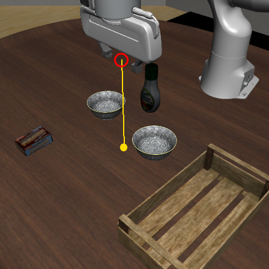 |  |

図 7: 印を描いた画像の例 (図 2 と同じ観測)

グリッパーを対象物からずらした静止画 (21 か所 × init 5 つ) で、行き先の言い方だけを替えて回答を比較した。回答は、軸ごとにグリッパーから行き先までの差が 2 cm 以上なら「近づく / 動かさない / 遠ざかる」の 3 つに分けて数え、差が 1 cm 未満なら `none` を正解とした。位置合わせに使えるかは、ずれた軸で遠ざかる向きを答えないか (遠ざかる割合がほぼ 0%) で判断した。

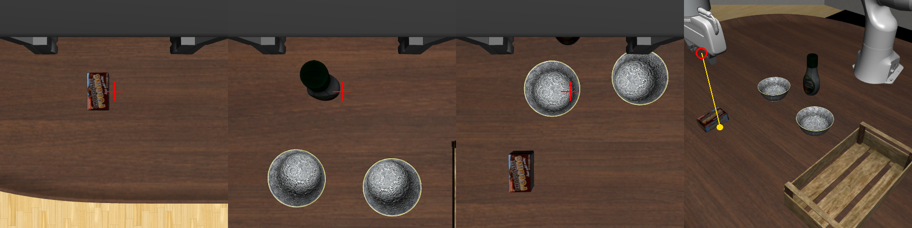

図 8: グリッパーを対象物から +y に 4 cm ずらしたときの画像。左から、プリンの箱、ドレッシングの瓶、左の黒いボウルの各タスクの手首カメラ画像と、プリンの箱のタスクの固定カメラ画像。対象物は × の左に写っており、横方向の正しい回答は `left` である

それぞれの静止画で、印を行き先に重ねるには画像内でどちらへ動かすかを `h` と `v` で問い、その回答を採点した。図 9 は、図 8 の左端の画像 (プリンの箱のタスク、init 0) で問うたときのリクエストとレスポンスである。

```yaml
# リクエスト
state:
  - "Task: pick up the chocolate pudding and put it in the tray"
  - >-
    Wrist camera, looking straight down from the gripper.
    The red cross marks the point directly below the gripper:
  - {type: image_url, image_url: {url: "data:image/png;base64,..."}}  # 図 8 左端
questions:
  h:
    instructions: >-
      Task: pick up the chocolate pudding and put it in the tray.
      In the wrist camera image, to move the red cross onto the chocolate pudding box,
      which way should it move horizontally?
    criteria:
      left: null
      none: the red cross is already horizontally at the chocolate pudding box
      right: null
  v:
    instructions: >-
      Task: pick up the chocolate pudding and put it in the tray.
      In the wrist camera image, to move the red cross onto the chocolate pudding box,
      which way should it move vertically?
    criteria:
      up: null
      none: the red cross is already vertically at the chocolate pudding box
      down: null

---

# レスポンス
choices:
  h: {choice: left, probabilities: {left: 0.81, none: 0.18, right: 0.01}}
  v: {choice: none, probabilities: {up: 0.09, none: 0.89, down: 0.02}}
```

図 9: 実験 3 のリクエストとレスポンスの例 (プリンの箱のタスク、init 0、+y に 4 cm ずらした手首カメラの画像)

##### 結果: 手首カメラでは遠ざかる向きをほとんど答えない

| タスク | カメラ | 行き先の言い方 | x: 近づく / 動かさない / 遠ざかる | y: 近づく / 動かさない / 遠ざかる |
| --- | --- | --- | --- | --- |
| プリンの箱 | 手首 | the chocolate pudding box | 67% / 33% / 0% | 93% / 7% / 0% |
| プリンの箱 | 手首 | the box | 57% / 43% / 0% | 93% / 7% / 0% |
| プリンの箱 | 固定 | the chocolate pudding box | 9% / 91% / 0% | 11% / 89% / 0% |
| 左の黒いボウル | 手首 | the black bowl on the left | 23% / 39% / 39% | 35% / 60% / 5% |
| 左の黒いボウル | 手首 | the center of the bowl to pick up | 66% / 34% / 0% | 83% / 17% / 0% |

この検証から次の 3 点が分かった。

1. 手首カメラの画像では遠ざかる向きをほとんど答えない: プリンの箱では、試した 5 つの言い方のいずれでも y の 92〜100% が近づく向きで、遠ざかる回答は x、y とも 0% だった。
2. 固定カメラは粗く寄せる段階にしか使えない: グリッパーが箱から 4〜6 cm に入ると約 9 割が `none` と答えた。そこで固定カメラは、対象物が手首カメラの画角に入るまで寄せる段階にだけ使うことにした。
3. 行き先の言い方で回答が変わる: 左の黒いボウルを「the black bowl on the left」と指定すると、4 cm ずれていても多くは `none` と答えた (init 0 で +y に 4 cm ずらした画像では `left` 0.12、`none` 0.85)。「the center of the bowl to pick up」では同じ画像で `left` 0.46、`none` 0.52 となり、全体でも y の 83% が近づく向きだったため、ボウルにはこの言い方を使うことにした (どの語が効いたかは切り分けていない)。

#### 把持の検証

Jev を使わず、シミュレータから取得した対象物の位置を基準に、グリッパーを対象物の真上から決まった量だけずらして置き、3 cm ずつ下ろして止まった位置から 1.5 cm 上げ、グリッパーを閉じて持ち上げた (35 か所 × init 5 つ = 175 回)。対象物が 5 cm 以上持ち上がり、グリッパーの開き幅が 0.3 cm より大きければ掴めたと定義した。

##### 結果: プリンの箱は中心、ボウルは縁で掴める

- プリンの箱: 中心からの y のずれが -2〜+1 cm ならほぼ掴め、±3 cm では一度も掴めなかった (x は ±4 cm ずれても掴めた)。箱の中心に合わせてそのまま下ろせばよい。
- 黒いボウル: 中心から -y に 6 cm ずらした縁の点を基準にすると、そこから x に ±2 cm、y に ±3 cm ずれても 105 回中 102 回掴めた。ボウルでは中心に合わせてから縁へ 6 cm ずらす必要がある。
- ドレッシングの瓶: 175 回中 11 回しか掴めなかった。瓶と同じ x 座標では、瓶から y に 20 cm 離れた物のない場所でも高さ 0.62 m (テーブル面から約 18 cm 上) より下へ下りられなかった。この把持手順では安定して掴めないため、以降の実験から外した。

### 5.4 実験 4: スケルトンを定義し、Jev の細かい判断でタスクを進行する

#### 段階

対象物を掴んで別の場所へ置く pick-and-place のタスクは次の段階からなると考え、段階ごとの動作を定義した。

1. 対象物へ寄せる: 初期高さで、固定カメラの回答に従って 2 cm ずつ寄せる。`h`、`v` とも `none` と答えたら手首カメラの回答で細かく合わせる。
2. 掴む: 判断ごとに手首カメラの画像で向きと次の動作を問う。
3. 持ち上げる: グリッパーを閉じた後の開き幅で掴めたかを確かめ、初期高さへ上げる。掴めていなければ 1 からやり直す (最大 3 回)。
4. 置き場所へ寄せる: 物を持ったまま、固定カメラの回答に従って 2 cm ずつ寄せる。
5. 置く: 掴む段階と同じく問い、グリッパーを開いたら上げる。
6. 完了判定の記録: 最後にタスクが完了したかを問うて記録する (動作には使わない)。

置き場所の位置は事前に記憶せず、寄せる動きは毎回その時点の画像への回答だけで決まる。掴む段階と置く段階では、手首カメラの画像とともに、グリッパーのテーブルからの高さ、グリッパーが開いているか、直前の下ろす命令が止まったかをテキストで渡し、向きと次の動作を 1 回の呼び出し (`wrist_step`) で問う。

#### タスクに固有の値

スケルトンの先頭にタスクに固有の値を結合して 1 つのプログラムにする。プリンの箱では次の 5 つの値を設定する。

```python
OBJECT = "the chocolate pudding box"          # 初期高さで寄せる行き先
GRASP_TARGET = "the chocolate pudding box"     # 掴む段階の行き先
HELD = "chocolate pudding box in the gripper"  # 置く段階で、置き場所へ寄せる印
PLACE = "the center of the tray"
DONE_QUESTION = "Is the chocolate pudding box in the tray?"
```

#### Jev への問い

プリンの箱のタスク (init 0) でのリクエストとレスポンスの例を示す。図 10 は、寄せる段階で固定カメラに最初に問うときである。

```yaml
# リクエスト
state:
  - "Task: pick up the chocolate pudding and put it in the tray"
  - >-
    Fixed camera, looking down diagonally at the table. The red circle marks the gripper.
    The yellow dot marks the point on the table directly below the gripper (the yellow line connects them):
  - {type: image_url, image_url: {url: "data:image/png;base64,..."}}  # 図 7 (a)
questions:
  h:
    instructions: >-
      Task: pick up the chocolate pudding and put it in the tray.
      In the fixed camera image, to move the yellow dot onto the chocolate pudding box,
      which way should it move horizontally?
    criteria:
      left: null
      none: the yellow dot is already horizontally at the chocolate pudding box
      right: null
  # v は省略

---

# レスポンス
choices:
  h: {choice: left, probabilities: {left: 1.0, none: 0.0, right: 0.0}}
  v: {choice: none, probabilities: {up: 0.19, none: 0.63, down: 0.18}}
```

図 10: 実験 4 の寄せる段階のリクエストとレスポンスの例 (プリンの箱のタスク、init 0 の最初の判断)

図 11 は、掴む段階で最初に問うときである。

```yaml
# リクエスト
state:
  - "Task: pick up the chocolate pudding and put it in the tray"
  - The gripper is 26 cm above the table. The fingers are open.
  - >-
    Wrist camera, looking straight down from the gripper.
    The red cross marks the point on the table directly below the gripper:
  - {type: image_url, image_url: {url: "data:image/png;base64,..."}}  # 手首カメラの画像
questions:
  # h、v は省略
  action:
    instructions: >-
      Task: pick up the chocolate pudding and put it in the tray.
      What should the gripper do next?
    criteria:
      move: the red cross is not over the chocolate pudding box yet
      lower: the red cross is over the chocolate pudding box, and the gripper can still go down
      close: the fingers are open, around the object to pick up, and low enough to grip it
      open: the fingers are closed, and the held object is on the chocolate pudding box

---

# レスポンス
choices:
  h: {choice: none, probabilities: {left: 0.1, none: 0.76, right: 0.14}}
  v: {choice: none, probabilities: {up: 0.14, none: 0.83, down: 0.03}}
  action: {choice: lower, probabilities: {move: 0.0, lower: 0.97, close: 0.03, open: 0.0}}
```

図 11: 実験 4 の掴む段階のリクエストとレスポンスの例 (プリンの箱のタスク、init 0)

| 動作 | 選ぶ条件 (`criteria`) | コードが行うこと |
| --- | --- | --- |
| `move` | the {mark} is not over {target} yet | `h`、`v` の向きへ 2 cm 動く |
| `lower` | the {mark} is over {target}, and the gripper can still go down | 真下へ 3 cm 下ろす |
| `close` | the fingers are open, around the object to pick up, and low enough to grip it | グリッパーを閉じる |
| `open` | the fingers are closed, and the held object is on {target} | グリッパーを開く |

表中の `{mark}` と `{target}` には、掴む段階では `"red cross"` と `GRASP_TARGET`、置く段階では `HELD` と `PLACE` が入る。

#### プリンの箱での修正

実験 4 のスケルトンは、プリンの箱のタスクを実行して失敗を調べ、次のように 3 回修正して得た。

- `lower` のときにも向きの回答の分だけ横へ動かしていたため、置く段階でトレイの縁に当たってトレイを傾けた。
  - 修正: `lower` は真下への移動だけにした。
- 真上から見ると高い位置でも対象物がグリッパーの間に写るため、テーブルから約 12 cm 上で `close` を選んで空振りした。
  - 修正: `close` の条件文に `low enough to grip it` を加えた。
- 下りきっても `lower` を選び続け、10 回中 3 回はグリッパーを閉じずに失敗した。
  - 修正: `lower` の条件文を `the gripper should go down` から `the gripper can still go down` に変えた。

#### 結果: プリンの箱をトレイへ運ぶ 10/10

3 回目の修正の後、10 回すべて成功し、10 回とも下りきった所でグリッパーを閉じた。ただし、下りきった所での判断 134 回のうち `close` を選んだのは 10 回だけで、残りの 124 回は `lower` だった。

### 5.5 実験 5: スケルトンを別のタスクへ転用する

実験 4 のスケルトンを、タスクに固有の値だけを差し替えて、左の黒いボウルをトレイへ運ぶタスクへ転用し、失敗した点を修正した。修正後のスケルトンで、プリンの箱と左の黒いボウルをそれぞれトレイへ運ぶ 2 つのタスクを改めて実行し、さらにスケルトンを変えずに右のボウルを左のボウルに重ねるタスクへ転用した。

#### 左の黒いボウルを運ぶタスクへの転用とスケルトンの修正

黒いボウルは直径 10.7 cm で、グリッパーの最大開き幅 (8 cm) より大きい。そのため、プリンの箱のようにボウル全体をグリッパーで挟むことはできず、ボウルの縁 (側面の壁) の一か所を挟んで持ち上げる。実験 3 では、ボウルの中心から -y に 6 cm ずらした縁の位置で下ろせば掴めることを確かめた。そこで、ボウルの中心に合わせた後に縁までずらす量 `GRASP_SHIFT` をタスク固有の値に加え、置き場所に寄せた後も同じだけずらすようにした (プリンの箱では 0)。各値は実験 3 の結果に基づいて次のように差し替えた。

```python
OBJECT = "the center of the bowl to pick up"    # 「the black bowl on the left」ではボウルの近くで向きを答えない
GRASP_SHIFT = (0.0, -0.06)                      # 中心から -y に 6 cm の縁を挟む
GRASP_TARGET = "the left edge of the bowl to pick up"  # 手首カメラの画像の左が -y
HELD = "black bowl in the gripper"
PLACE = "the center of the tray"
DONE_QUESTION = "Is the black bowl in the tray?"
```

実験 4 のスケルトンのままでは init 0、1 とも失敗した。ボウルの縁まで下りても一度も `close` を選ばず (確率は最大 0.16)、開いたグリッパーのままボウルを 30 cm 引きずった。下りきっても `lower` を選んだ判断を記録から取り出して問い直すと、「The last downward move was blocked.」と伝えても条件文を変えても `lower` の確率は 0.8 前後で残った。一方、`lower` を選択肢から外すと `close` の確率はボウルで 0.56〜0.65、プリンの箱で 0.85〜0.91 に上がった。

そこでスケルトンをさらに 2 回修正した。

- 下りきっても `close` を選ばなかった。
  - 修正: `close` の条件文の行き先を、掴む物 (`the object to pick up`) からその段階の行き先 (`{target}`) に変えた。また、下ろす命令が止まった直後は `lower` を選択肢から外した。
- 置く段階でトレイに当たって止まった後も `move` を選び、持った物でトレイを 3〜30 cm 押した (プリンの箱のタスクでも init 1 で約 31 cm 押して失敗した)。
  - 修正: 下ろす命令が止まった直後は、選択肢を `close` と `open` に絞り込んだ。それ以上は下りられず、横に動くと当たっている物を引きずるためである。

#### 結果: プリンの箱をトレイへ運ぶ 10/10

LIBERO の判定が成功でも、グリッパーを開いた後に上げるとトレイが引っかかって持ち上がったまま終わることがあるため、ここからはトレイがテーブルの上に残った回数も別に数えた。

10 回すべて成功し、10 回とも 1 回目の試行で箱を掴んだ。トレイがテーブルの上に残ったのは 8/10 で、残りの 2 回はトレイに当たって止まった直後にグリッパーを開いたためトレイを押し、上げたときにトレイごと 21 cm 持ち上がった。

| (a) 掴む段階の始め (テーブルから 26 cm) | (b) 下りきって `close` を選んだ判断 |
| --- | --- |
| 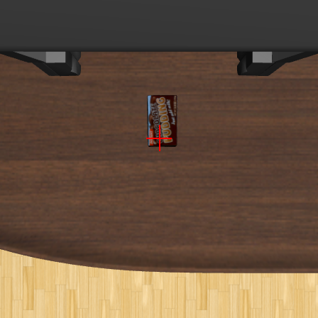 |  |

図 12: プリンの箱のタスク (init 0) の手首カメラ画像

| 指標 (1 エピソード平均) | 実験 1 (位置のテキスト) | 実験 5 (修正後のスケルトン + 画像) | 比率 (実験 5 / 実験 1) |
| --- | --- | --- | --- |
| 成功率 | 10/10 | 10/10 | - |
| Jev の呼び出し回数 | 164.2 回 | 54.7 回 | 0.33 倍 |
| 入力トークン数 | 30.2 万 | 6.1 万 | 0.20 倍 |
| 1 回の判断のレイテンシ | 727 ms (2 回呼び出し) | 412〜444 ms (1 回呼び出し) | 約 0.6 倍 |
| エピソード長 | 1,708 step (85 秒) | 885 step (44 秒) | 0.52 倍 |

掴む段階の `close` は、10 回すべてで、下ろす命令が止まり選択肢を `close` と `open` に絞り込んだ直後に選ばれた (確率 0.96〜0.99)。`lower` を含む 4 択から `close` を選んだことは一度もない。つまり Jev は閉じるか開くかは選べたが、いつ閉じるかは、グリッパーが当たって止まったことをコードが検出して決めている。一方、置く段階の `open` は、10 回中 8 回が 4 択の中からトレイの 4.7〜17.4 cm 上で選ばれた (確率 0.34〜0.56)。トレイが大きいため、その高さから落としても箱はトレイに入った。

#### 結果: 左の黒いボウルをトレイへ運ぶ 8/10

掴む段階は 10 回とも 1 回目にボウルの縁を掴んだ。LIBERO の判定では 8/10 が成功だったが、うち 2 回はトレイがボウルごと持ち上がって終わり、トレイがテーブルの上に残ったのは 6/10 だった。置く段階では次の 3 つの失敗パターンが見られた。

- 当たった直後に開く (2 回): トレイに当たって止まった直後にグリッパーを開いたためトレイを押し、上げるとトレイごと持ち上がった。
- 閉じたグリッパーに `close` を選ぶ (2 回): 止まった直後の 2 択で、物を持ってすでに閉じているのに `close` を選んだ判断が 6 回あった。絞り込みは止まった直後の 1 回だけなので、次の判断では `move` と `lower` が選択肢に戻り、6 回のうち 2 回は横に動いてトレイを押した (うち 1 回は上限回数まで開かずに終わり、LIBERO の判定でも失敗)。
- 運ぶ途中の落下に気づかない (1 回): 把持判定は持ち上げた直後にしか行わないため、運ぶ途中でボウルが落ちても空のグリッパーのまま置く段階を続けた。

また、物を持つと向きの回答に偏りが出た。持ったまま固定カメラで寄せ終えた位置は、プリンの箱ではトレイの中心から x に 0.4〜3.7 cm だったが、ボウルでは -8.5〜-14.6 cm の手前で止まった。続く置く段階では手首カメラへの回答で +x へ行き過ぎ、ボウルは中心から x に +7.3〜+8.7 cm の位置に置かれた。トレイの x 方向の幅は 29.7 cm あるため、行き過ぎても中に収まった。Jev の呼び出しは平均 62.4 回、入力は 7.2 万トークンで、置く段階で `move` を選んだ回数が増えた分、プリンの箱より多くなった。

#### 結果: 右のボウルを左のボウルに重ねる 4/10

修正後のスケルトンを変えずに、右のボウルを掴んで左のボウルの上に重ねるタスクへ適用した。値は左の黒いボウルと同じく左右を含めない言い方 (`OBJECT = "the center of the bowl to pick up"`) とし、`PLACE = "the center of the other black bowl"` と `DONE_QUESTION` だけを替えた。どちらのボウルを掴むかの手がかりは、毎回の問いに添える指示文 (`Task: stack the right bowl on the left bowl...`) だけである。スケルトンは 1 回運んで置く手順なので、左のボウルに重ねるところまでを実行し、記録した 2 つのボウルの位置から「どちらのボウルを掴んだか」と「左のボウルに重なったか」を評価した。

##### 掴む段階: 指示文で右のボウルを掴み分けた (10/10)

10 回すべてで右のボウルを掴んだ。ただし、グリッパーの初期位置は右のボウルから 3〜7 cm、左のボウルから 13〜16 cm で、近い方へ向かっただけとも解釈できる。そこで、同じシーンで同じ言い方を使う左の黒いボウルのタスクと、最初の判断での固定カメラへの回答を比較した (別タスクのため、物の初期位置は init ごとに数 cm 異なる)。

| (a) 左の黒いボウルのタスク、init 0 の最初の判断 | (b) 右のボウルを重ねるタスク、init 7 の最初の判断 |
| --- | --- |
| 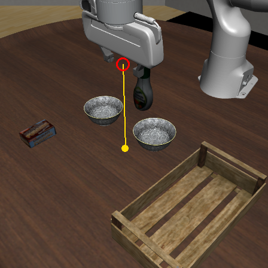 | 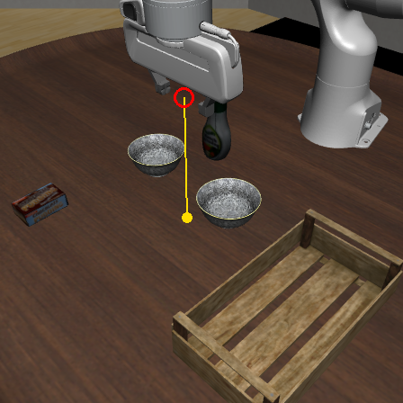 |
| h: left 0.76、none 0.09、right 0.15 | h: left 0.19、none 0.14、right 0.67 |

図 13: 最初の判断での固定カメラ画像と、`h` の回答の確率

図 13 の 2 枚はほぼ同じ配置で、黄色い点は右下のボウルのすぐ脇にある。左の黒いボウルのタスクでは 10 回すべてで `h: left` (確率 0.55〜0.95) と答えて遠い左のボウルへ向かい、10 回とも左のボウルを掴んだ。右のボウルを重ねるタスクでは `right` が 7 回、`left` が 2 回、`none` が 1 回で、10 回とも右のボウルを掴んだ。指示文によって掴む方のボウルが変わっている (グリッパーが左のボウルの近くから始まる配置は試していない)。

##### 置く段階: 左のボウルに重ねられた (4/10)

重ねられたのは 4/10 だった。持ったまま固定カメラで寄せる段階では `up` (-x) を答え続けて左のボウルを通り越し、左のボウルの中心から x に -14.5〜-41.5 cm の位置で止まった。続く置く段階では、手首カメラへの `v` の回答が 214 回中 200 回で `down` (+x) だった。重なった 4 回は、+x へ戻る途中で左のボウルの上に来たときに `lower` を選んで下り、当たったところで開いた。残りの 6 回は、左のボウルを再び通り越すか、-y へもずれて離れた位置で開くか、上限回数まで開かずに終わった。

失敗した init 4 の手首カメラ画像を時系列で見ると (画像で確かめたのは init 4 のみ)、置く段階の始めには左のボウルが画像の下端に写っており、`down` (+x) は正しい回答だった。しかし同時に `left` (-y) へ動いたことで左のボウルは画像の右下へ外れ、画角から消えた後も Jev は `left` と `down` を答え続けた。

| (a) 置く段階の始め | (b) 3 回後 (右下へずれる) | (c) 9 回後 (左のボウルは写っていない) |
| --- | --- | --- |
| 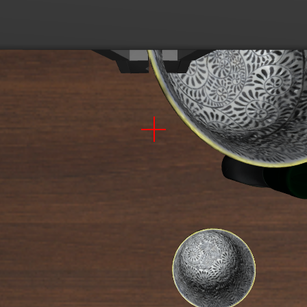 | 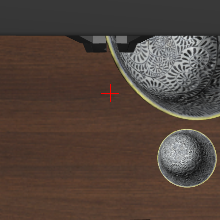 | 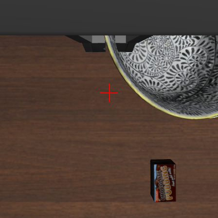 |

図 14: 右のボウルを重ねるタスク (init 4) の置く段階での手首カメラ画像

トレイ (x 幅 29.7 cm) なら多少行き過ぎても中に収まるが、左のボウル (直径 10.7 cm) では外れる。また、この実験でも `close` (計 12 回) と `open` (計 8 回) はすべて選択肢を 2 つに絞り込んだ直後に選ばれた。

### 5.6 実験 6: LLM にスケルトンを書かせる

Code as Policies (CaP)[9] は、利用できる関数群と数個の例を LLM に与え、自然言語の指示から制御プログラムを生成させる手法である。ここでは、Jev に画像で問う関数を LLM (DeepSeek V4.1 Flash[10]) に渡してプログラム全体を書かせ、スケルトンを人が定義しなくてもタスクを解けるかを試した。実行中は、プログラムが関数を呼ぶたびに Jev が画像への問いに答える。

#### 生成と実行の手順

条件は次のとおりである。

- プロンプトには、指示文、座標系、初期姿勢、関数の説明、事前に測った知見、呼び出しの上限 (Jev 360 回、移動 120 回) を書いた。スケルトン、タスクに固有の値、物体の位置や物体間の距離、コード例は書いていない。
- プロンプトは init によらず同じテキストで、init ごとに 1 本ずつプログラムを書かせた。10 本の違いは LLM の生成のばらつきから来る。
- 生成されたプログラムは、渡した関数と一部の組み込み関数だけを使える名前空間で 1 回だけ実行した。物体の位置を返す関数はないため、プログラムから物体の位置は参照できない。実行結果を LLM に見せて書き直させることはしない。
- 実験 6 は実験 4 より前に実施したため、渡した関数は実験 4 より前のスケルトンで使っていたものである。`wrist_step` は含まず、下ろす、閉じる、開くのタイミングは生成されたプログラムが決める。


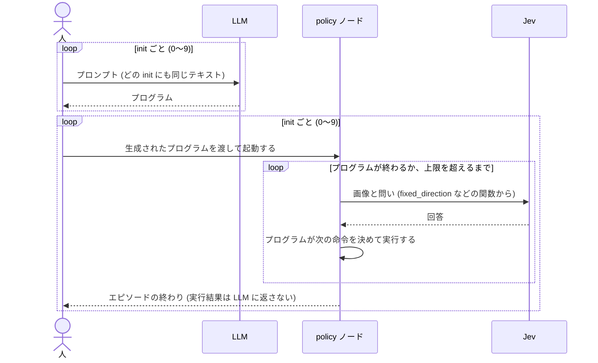

図 15: プログラムを生成してから実行するまでの流れ

LLM には次の関数を渡した。プロンプトには、それぞれの引数と戻り値を英語で説明した。

| 種類 | 関数 | 行うこと |
| --- | --- | --- |
| 状態 | `gripper_position()` | グリッパーの位置 (x, y, z) [m] を返す |
| 状態 | `gripper_opening()` | グリッパーの開き幅 [m] を返す (開いた状態で約 0.08) |
| 移動 | `move_by(dx, dy, dz)` | グリッパーを下向きのまま相対移動し、届いたかを返す (テーブルや物に当たると `False`) |
| 移動 | `move_to(x, y, z)` | グリッパーを下向きのまま指定した絶対位置へ移動し、届いたかを返す |
| 移動 | `close_gripper()`、`open_gripper()` | グリッパーを閉じる、開く |
| 画像への問い | `wrist_direction(target)` | 手首カメラの画像で、赤い × を `target` に重ねる x、y の向きを (-1、0、1) で返す |
| 画像への問い | `fixed_direction(target)` | 固定カメラの画像で、黄色い点を `target` に重ねる x、y の向きを同じ形で返す |
| 画像への問い | `in_wrist_view(target)` | `target` が手首カメラの画像に写っている確率を返す |
| 画像への問い | `check(question)` | 2 つのカメラの画像について、yes/no で答える問いが yes である確率を返す |

`wrist_direction` と `fixed_direction` は、実験 3 と同じ印を描いた画像で `h`、`v` を Jev に問い、回答を世界座標の向きに変換して返す。`in_wrist_view` と `check` は、Jev に 0〜1 の値 (`Noul`) で問う。

#### プロンプトに書いた知見

知見は、シミュレータから取得した物体の位置を使って事前に測った結果から、次の 2 通りを用意した。

1. 実験 3 の結果のみ: 行き先の言い方ごとの回答の正確さ、固定カメラは対象物の近くで (0, 0) と答えること、対象物ごとの掴めるずれの範囲 (ボウルは縁を掴むこと)。
2. 1 に、実験 4 より前のスケルトン (置き場所の位置を先に記憶してから運ぶ手順) をプリンの箱と左の黒いボウルで最後まで実行して分かったことを追加: 当たった位置で開くとトレイを持ち上げること (3 cm 上げてから開けば起きない)、物を持つと手首カメラの x の回答がトレイから離れる向きに偏ること、ボウルを持つと固定カメラの回答がトレイの手前で (0, 0) になること。

知見はプロンプトの中に英語の箇条書きで書いた。次は、プリンの箱のタスクのプロンプトからの抜粋である。

```text
## Reliability of the vision answers (measured on this task)
- Pudding box, wrist_direction, y toward the box when 2 cm or more away / 0 when within 1 cm:
  "the chocolate pudding box" 93% / 87%, "the box" 93% / 100%,
  "the center of the chocolate pudding box" 100% / 53%.
- fixed_direction answered (0, 0) in about 90% of cases when the gripper was 4 to 6 cm from the
  pudding box. Use it only to come near; finish with wrist_direction.
- Black bowl: it is wider than the open fingers, so grip its rim. With the gripper 6 cm in -y
  from the bowl center, it held in 156 of 175 trials. ...
  # 175 回は縁の点の周り 35 か所 × init 5 つの合計 (5.3 の 105 回は、そのうち x に ±2 cm、y に ±3 cm の範囲)

# 以下は 2 の条件でだけ加えた
- When placing the pudding box in the tray, ... Moving up 3 cm from where the downward move
  stopped before opening did not raise the tray in 20 runs.
- Holding the pudding box (20 runs): ... After that, wrist_direction toward the tray answered
  x away from the tray in 71 of 102 cases (toward it in 8, 0 in 23), and y toward it in 23,
  0 in 29, never away.
- Holding the black bowl by its rim (10 runs): fixed_direction answered (0, 0) for the center of
  the tray with the gripper -6.7 to -15.0 cm in x and -6.0 to -9.8 cm in y from it. ...
```

図 16: プロンプトに書いた知見 (抜粋)

#### 結果: プリンの箱をトレイへ運ぶ 5/10 (知見 1)、8/10 (知見 2)

どのプログラムも、固定カメラで粗く寄せてから手首カメラで細かく合わせ、下ろして掴み、トレイへ運ぶ順に書かれた。知見 2 の条件では、追加した知見を 10 本すべてが取り入れ、持っている間は手首カメラの x の回答を使わず、開く前にグリッパーを 3 cm 上げた。次は、その条件の init 0 で生成されたプログラムの、置く部分の抜粋である。

```python
    # Fine y alignment with the wrist camera. Ignore wrist x answers while holding.
    stable = 0
    for _ in range(12):
        wx, wy = wrist_direction("the center of the tray")
        if wy == 0:
            stable += 1
            if stable >= 2:
                break
        else:
            stable = 0
            move_by(0, wy * 0.015, 0)
...
    # Lower until blocked, back up 3 cm, then release.
    descend_until_block()
    move_by(0, 0, 0.03)
    open_gripper()
```

図 17: 生成されたプログラムの抜粋 (知見 2、プリンの箱のタスク、init 0)

失敗パターンは次の 3 つだった。

- ループ上限の不足 (知見 1 で 2 回、知見 2 で 2 回): 箱からトレイまでは y に約 44 cm あるが、最大移動量が 24〜40 cm にしかならないループで寄せた。回答がまだ +y を指しているのに上限に達し、トレイの手前に置いた。LLM には物体間の距離を渡していないため、必要な反復回数を逆算できない。
- 掴む前の位置合わせの上限 (知見 1 で 2 回): 手首カメラで箱に合わせるループが 8 回の上限に達し、箱の中心から y に 3.7〜5.7 cm ずれた所で閉じて掴めなかった。
- 置き場所の記憶の失敗 (知見 1 で 1 回): 掴む前にトレイの位置を記憶しようとしたが、手首カメラの回答が (0, 0) にならず、続く箱への位置合わせでグリッパーがトレイの上に残り、トレイの縁を掴んで持ち上げた。

#### 結果: 左の黒いボウルをトレイへ運ぶ 6/10 (知見 1)、4/10 (知見 2)

LIBERO の判定では知見 1 で 6/10、知見 2 で 4/10 が成功したが、それぞれ 1 回はトレイがボウルごと持ち上がって終わった (除くと 5/10、3/10)。掴む段階は、どのプログラムもボウルの中心に合わせてから -y に 6 cm ずらして縁を掴んだ。成否を分けたのは置く段階の書き方で、次の 2 通りに分かれた。

- 掴む前にトレイの位置を記憶する手順 (知見 1 で 5 本、知見 2 で 7 本): 何も持たずにトレイに合わせると中心の 5〜8 cm 手前で (0, 0) になる。これは知見に書いていない。記憶した位置で縁を掴んだ分 (-y に 6 cm) をずらして置いたプログラムでは、ボウルがトレイの縁に掛かった (知見 2 で 3 本)。ずらさなかったプログラムは、手前で止まったずれと打ち消し合って成功した。また知見 2 の 2 本は、トレイの上から `in_wrist_view("the center of the bowl to pick up")` を問うて 0.63、0.71 が返ったため、固定カメラでの接近を飛ばした。手首カメラの回答だけで寄せたループは上限に達して右のボウルの近くで止まり、右のボウルを運んだ。
- ボウルを持ったままトレイへ寄せる手順 (知見 1 で 5 本、知見 2 で 3 本): 知見 1 では、固定カメラの回答がトレイの手前で止まってトレイの外に置く、手首カメラの回答が向きを変え続けて上限に達する、などで 3 本が失敗した。知見 2 では 3 本とも、ボウルを持つと固定カメラの回答が手前で止まるという知見を、(0, 0) の後に x に +10〜11 cm 動かす固定の補正量として使った。ループが (0, 0) まで届いた 2 本は、ボウルをトレイの中心から 2 cm 以内に置いた。

#### 人が定義したスケルトンとの比較

| 手順の作り方 | プリンの箱 | 左の黒いボウル |
| --- | --- | --- |
| LLM が生成 (知見 1) | 5/10 | 6/10 (トレイごと持ち上げた 1 回を除くと 5/10) |
| LLM が生成 (知見 2) | 8/10 | 4/10 (同じく除くと 3/10) |
| 実験 4 より前のスケルトン (人が定義、同じ関数) | 10/10 | 3/10 |

LLM は渡された知見をほぼそのままプログラムに取り込んだが、成否を分けたのは、ループの上限回数、置き場所に合わせるタイミング、置くときの位置の補正といった生成ごとの実装の違いだった。各条件 10 本の比較であるため、知見を追加した効果は生成のばらつきと切り分けられない。同じ関数を使う実験 4 より前のスケルトンと比べると、プリンの箱では人が定義したスケルトンが上回り、左の黒いボウルでは同程度だった。Jev の呼び出しは 1 エピソードあたり平均 32.6〜55.1 回だった。

## 6. 工夫した点

### 方策に物体の位置を渡さない構成

シミュレータ (`sim`)、方策 (`policy`)、記録と評価 (`evaluator`) を dora-rs の別々のノードに分けた。データフローの定義 (YAML) で、物体の位置を含む `sim` の出力 (`ground_truth`) は `evaluator` ノードの入力にだけつなぎ、`policy` ノードの入力にはつながない (基準の実験 1 を除く)。そのため、方策の実装が物体の位置を参照していないことは、データフローの定義を見れば確かめられる。実験 6 で LLM が生成したプログラムも、渡した関数と一部の組み込み関数だけを使える名前空間で実行するため、物体の位置を参照する手段がない (5.6)。

### 画像に印を描いて、画像内の向きで問う

座標系をテキストで説明して世界座標の向きを問うと 0/10 だったため、画像にグリッパーの位置を示す印を描き、印を画像内のどちらへ動かすか (`h`、`v`) を問う形に変えた。世界座標の向きへの変換はコードが担う (5.3)。

### 静止画の検証で、知覚の精度を他の失敗から切り分ける

エピソード全体の成功率だけでは、向きの回答の誤りと、グリッパーを閉じるタイミングや手順の誤りを切り分けられない。そこで実験 3 では、グリッパーを決まった位置に置いた静止画で回答の正確さを測り、上から掴めるずれの範囲も Jev を使わずに測った。ここで決めた行き先の言い方、ずらす量、カメラの使い分けを、スケルトンの値と実験 6 で LLM に渡す知見に使った (5.3)。

### スケルトンで手順を制御し、Jev には段階ごとの小さな判断だけを問う

段階の順序と切り替え (寄せる、掴む、持ち上げる、寄せる、置く) はスケルトンのコードが決め、Jev には各段階で、画像内の向きと次の動作を限られた選択肢から選ばせた。選択肢もその時点の状況に合わせてコードが決める。下りきっても Jev は `lower` を選び続け、下ろす命令が止まったことをテキストで伝えても変わらなかったため、止まった直後の判断では選択肢を `close` と `open` に絞り込んだ。これにより、グリッパーを閉じる動作が選ばれるようになった。スケルトンにはタスク名や物体名を書かず、タスクに固有の値を先頭に結合するため、タスクを替えるときに書き換えるのはこの値だけである (5.4 5.5)。

### すべての判断と確率を記録し、動画に重ねる

判断ごとに、Jev に渡した問い、全選択肢の確率、送った命令、シミュレータの状態を記録し、記録から問いと確率をカメラ画像の横に並べた動画を再構成できるようにした。`close` が絞り込みの直後にしか選ばれないことや、置き場所が画角から外れた後も同じ向きを答え続けることは、この記録から見つけた。

## 7. 考察

### Jev の回答が動作に使えた範囲

画像を入力した Jev の回答から、ロボットの動作に使えた判断は次の 2 点である。

- 画像内の印を行き先へ寄せる向き: 手首カメラの画像にグリッパーの位置を示す印を描いて画像の左右・上下で問うと、対象物から遠ざかる向きをほとんど答えず、位置合わせに使えた (実験 3、4)。
- 指示文に応じた対象物の選択: 同じ形のボウルが 2 つある場面で、行き先の言い方に左右を書かなくても、タスクの指示文から掴むべき方のボウルを選べた (実験 5)。

一方、次の 4 点は Jev の回答だけではうまく行えなかった。いずれも今回の問い方と入力の渡し方での結果であり、Jev の能力の限界とは限らない。

- 世界座標の軸の向きによる直接制御: 座標系の定義をテキストで説明し、次の動きを x、y、z の向きで直接問う形では解けなかった (実験 2。原因が座標系の解釈か、段階や対象の判断かは切り分けていない)。画像に軸を描くなど、座標系の別の伝え方は試していない。
- 固定カメラでの細かい位置合わせ: 対象物から 4〜6 cm まで近づくと約 9 割で「動かさない」と答えるため、グリッパーを対象物の真上に合わせる用途には使えなかった (実験 3)。固定カメラの画像では数 cm のずれが小さくしか写らないことが一因と考えられるが、画像の一部を拡大して渡すなどは試していない。
- 下ろすのを止めてグリッパーを閉じるタイミング: 下りられないことをテキストで伝えても、条件文を変えても `lower` を選び続け、コード側が選択肢を絞り込んで初めて `close` が選ばれた (実験 4、5)。試した伝え方はテキストでの状態と条件文の変更だけである。
- 対象物が画角から外れたときの判断: 置き場所が手首カメラの画像から外れた後も、「写っていない」ことを回答に反映せず、直前と同じ向きを答え続けた (実験 5)。これについては、先に対象物が写っているかを問い、写っていなければ固定カメラで寄せ直すといった構成は試していない。

また、回答は問いの言い回しにも大きく左右された。「the black bowl on the left」と「the center of the bowl to pick up」では同じ画像に対する回答が一変したため、Jev を知覚に使う際は、問いの表現自体も方策のパラメータの一部として事前に測定して決める必要がある。逆に言えば、問いの言い回しを調整すれば (プロンプトチューニング)、今回うまく行えなかった項目も改善する余地があると考えられる。

### 段階の切り替えと座標変換はスケルトンのコードが担う

実行中に Jev が答えるのは、画像内の向きと次の動作の選択だけである。次の 3 点はスケルトンのコードが担った。

1. 座標変換と画像に描く印: カメラの校正値を用いたグリッパー真下の印の描画、および画像上の向きから世界座標の向きへの変換。
2. 手順の構造と制御パラメータ: 段階の順序 (寄せる → 掴む → 持ち上げる → 寄せる → 置く)、1 歩の移動量 (横 2 cm、下 3 cm)、各段階のループ上限、グリッパーの開き幅による把持判定。
3. 選択肢の絞り込み: 下ろす命令が止まった直後は、選択肢を `close` と `open` のみに制限する。

Jev が担う判断の範囲を実験 1 (対象物の位置のテキスト入力) と比べると、実験 1 では「どの段階か (意図)」も Jev が選んでいたのに対し、実験 4 ではそれをスケルトンのコードが決めている。その代わり、実験 1 ではコードが対象物と配置先の位置から計算していた「行き先への向き」を、実験 4 では Jev が画像から判断している。

### スケルトンの修正とタスクに固有の値は人が決めた

本課題の実装は、全体を通してコーディングエージェントの Claude Code で行った。人は、実行の記録を見て失敗を調べ、スケルトンの修正方針を決めて Claude Code に実装させた。スケルトンはプリンの箱で 3 回 (実験 4)、左の黒いボウルを運ぶタスクへの転用で 2 回 (実験 5) 修正した。また、実験 3 の静止画の検証から、行き先の言い方や掴む位置へずらす量 (ボウルは -y に 6 cm) など、タスクに固有の 6 つの値を決めた。実験 6 の LLM と違い、人は実行結果を見ながらスケルトンを何度も直している。

修正後のスケルトンでは、タスクを替える際に書き直したのはタスクに固有の値だけだった。プリンの箱と左の黒いボウルは 6 つの値の差し替えだけで実行でき、掴む段階は 10 回とも 1 回目で成功した。右のボウルを左のボウルに重ねるタスクへは `PLACE` と `DONE_QUESTION` の 2 つの値を替えただけで、掴む対象は指示文から選ばれた。ただし、プリンの箱と左の黒いボウルはスケルトンの修正に使ったため、未知のテストタスクではない。スケルトンの修正に一切使っていない純粋な転用先は、右のボウルを左のボウルに重ねるタスクだけである。

### Code as Policies で生成した手順は実装の揺れで成否が分かれる

スケルトンを渡さず、Jev の得意・不得意を知見としてプロンプトで渡すと、LLM はその知見をほぼ取り入れ、人が定義したスケルトンとよく似た段階のプログラムを生成した。しかし成功数は 4/10〜8/10 にとどまった。

失敗の多くは、Jev の回答精度ではなく、ループの反復上限や置き場所に合わせるタイミングといった、LLM が書くプログラムごとの実装の揺れから生じていた。人がスケルトンを定義する際には、実際のシーンを見てループ上限を決め、置く段階の手順を実行結果を見ながら修正していた。一方、LLM にはシーン内の物体間の距離も実行結果も渡していない。したがって LLM に手順を書かせるなら、1 回の生成で済ませず、シーンの寸法をプロンプトで渡したうえで、実行の記録を見せて書き直させるループに組み込むべきだと考える (今回は試していない)。

ただし、実験 6 は限定的な実験である。LLM は 1 種類で、init ごとに 1 回だけ生成し、実行結果を返して直させてもいない。また、実験 4 のスケルトンより前に実施したため、実験 4、5 で作った `wrist_step` や選択肢を絞り込む規則は LLM に渡していない。したがって、実験 4、5 と実験 6 の成功数を並べても、同じ関数と知見のもとで人と LLM を比べたことにはならない。

### スケルトンは想定外の状況から立て直せない

実験 5 の置く段階では、スケルトンの進行が想定した流れから外れる失敗が 3 つ残った。(1) 当たった直後に開いて置き場所を持ち上げる、(2) 閉じたグリッパーに `close` を選んで選択肢の絞り込みが解ける、(3) 運ぶ途中に落としても気づかない、の 3 つである。いずれも対象物によらないスケルトン側の規則 (当たった後の選択肢に「少し上げる」を追加する、グリッパーが閉じているときは `close` を選択肢から外す、運ぶ途中でもグリッパーの開き幅を確認する) で防げる見込みがあるが、未実装である。

つまり、今のスケルトンは想定した流れから外れた状況を検出して立て直す仕組みを持たず、予期しないトラブルに弱い。上の 3 つの規則も、起きた失敗を見てから足すものであり、未知のタスクで起きるトラブルを前もってすべて塞ぐことはできない。物を持っているか、置けたかといった状況の確認自体を Jev に問い、その回答に応じて段階を戻す構成が必要だと考えるが、今回は試していない。

## 8. まとめ

実行中の方策にシミュレータから取得した物体の位置を渡さず、カメラ画像とロボット自身の状態だけから Jev の回答でアームを動かし、LIBERO の物を運ぶタスクを解くことができた。そのために必要だったのは、(1) 画像にグリッパーの位置を示す印を描いて画像内の向きで問うこと、(2) 行き先の言い方を事前に測って選ぶこと、(3) 段階の順序や動作の切り替え条件をスケルトンのコードで支えることの 3 点である。

この構成において Jev が実際に担ったのは、「行き先が画像に写っているときの移動の向き」「指示文から掴む対象を選ぶこと」「選択肢を絞った後に閉じるか開くかを選ぶこと」「置く段階でグリッパーを開くタイミング (置き場所が大きい場合)」であった。人が定義したスケルトンは、左の黒いボウルを運ぶタスクへの転用で失敗した点を修正した後は、タスク固有の 6 つの値を差し替えるだけでプリンの箱と黒いボウルの両方に使えた。さらに、スケルトンの修正に使っていない右のボウルを左のボウルに重ねるタスクでも、掴む対象を指示文だけで伝えて 10 回すべてで右のボウルを掴んだ。

一方で、置き場所が小さいときや画角から外れたときの位置合わせと、グリッパーを閉じるタイミング自体は、Jev の回答だけでは決まらなかった。また、スケルトンを渡さずに LLM にプログラム全体を書かせると、Jev の特性に関する知見はうまくコードに取り込むものの、シーンの距離感から決まるループ上限などを適切に設定できず、実験 4、5 のスケルトンより成功が少なかった (ただし渡した関数と知見の条件はそろっていない)。この課題の範囲では、Decision モデルである Jev を画像入力でロボット制御に使うには、座標変換や物理的な制約に基づく選択肢の絞り込みをコード側で担い、Jev が安定して答えられる視覚的な問いに問題を切り分ける設計が有効であった。

## 参考文献

[1] TypeSafe AI. "Introducing System One Models & Jev". TypeSafe AI Blog, 2026-09-15. https://typesafe.ai/blog/introducing-system-one-models-and-jev

[2] TypeSafe AI. "Jev: For the builders AND dreamers". TypeSafe AI Blog, 2026-10-14. https://typesafe.ai/blog/jev-1-14

[3] OpenRouter. "Jev Documentation". https://openrouter.ai/docs/guides/community/jev

[4] TarunTomar122. jev-askable-arm. GitHub. https://github.com/TarunTomar122/jev-askable-arm

[5] Dmytro Hrybov. X での投稿 (MuJoCo での事例), 2026-09-18. https://x.com/dimentary/status/2101018760371171420

[6] openroboto-ai. jev-robot-control. GitHub. https://github.com/openroboto-ai/jev-robot-control

[7] B. Liu, Y. Zhu, C. Gao, Y. Feng, Q. Liu, Y. Zhu, P. Stone. "LIBERO: Benchmarking Knowledge Transfer for Lifelong Robot Learning". NeurIPS 2023 Datasets and Benchmarks Track. https://arxiv.org/abs/2306.03310

[8] dora-rs. dora: Dataflow-Oriented Robotic Architecture. GitHub. https://github.com/dora-rs/dora

[9] J. Liang, W. Huang, F. Xia, P. Xu, K. Hausman, B. Ichter, P. Florence, A. Zeng. "Code as Policies: Language Model Programs for Embodied Control". ICRA 2023. https://arxiv.org/abs/2209.07753

[10] DeepSeek-AI. DeepSeek-V4.1-Flash. Hugging Face. https://huggingface.co/deepseek-ai/DeepSeek-V4.1-Flash
