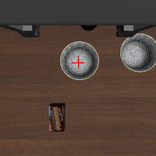
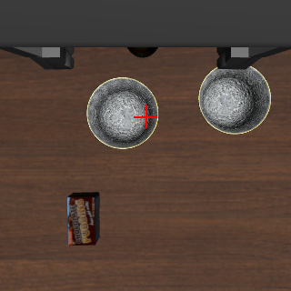

# 画像だけで Jev はロボットを動かせるか: System 1 モデルに何を補えばロボットを操作できるか

## 1. 概要と目的

System 1 モデルの Jev に、カメラ画像とロボット自身の状態だけを渡し、その答えでシミュレータ上のロボットアームを動かせるかを試した。Jev をロボットに使った公開事例は、どれも物体の位置などの真値を文で渡しており、画像は渡していない。本課題では、物体の位置の真値を方策に渡さず、画像から物体の位置を推定する処理も作らずに、同じタスクを終えられるかを確かめた。

答えたい問いは次の 2 つである。

1. Jev の画像への答えのうち、どの問い方の答えなら、ロボットの動きに使えるか
2. タスクを終えるまでに、Jev の答えのほかに何を人が補う必要があったか

後半では、前半で分かった Jev の使える問い方と、人が補った手順を、Code as Policies (CaP) の関数とプロンプトにまとめ、LLM に手順を書かせた。前半の知見が、LLM の書くプログラムの中でも使えるかを見た。

結果を先に示す。世界座標の軸の向きを問うと、Jev は手先の位置によらず同じ向きに偏った。画像に手先の印 (×) を描き、「× を行き先へ重ねるには画像の左右と上下のどちらへ動かせばよいか」と問うと、遠ざかる向きはほとんど答えず、動きに使えた。一方、下りる時機、指を閉じる時機、どの段階にいるかは、試した問い方では画像から決められなかった。これらと掴み方を人が書き、Jev には画像の中の位置関係だけを問うと、10 回中 9 回成功した。さらに、掴む縁をもう 1 つのボウルから離れた側に変え、縁へ寄せる量を人が決めた距離ではなく Jev の答えで決めると、10 回とも成功した。CaP と組み合わせ、9/10 だった版までの知見を渡して手順を LLM に書かせると 2/10 だった。下がった分の大部分は LLM が Jev に渡した行き先の言い方によるもので、関数の中で言い方をそろえると、同じ 10 本のプログラムで 7/10 になった。言い方の傾向と 010 の掴み方をプロンプトに書いてプログラムを書かせ直すと、LLM は 10 本ともその掴み方を手順に取り入れ、9/10 で掴むはずのボウルの縁を掴んだ。ただし掴んだ後に 3 回トレイでない所に置き、成功は 6/10 だった。

## 2. 背景

### Jev

Jev は TypeSafe AI が 2026-09-15 に公開した System 1 モデルである。状態と型付きの問いを受け取り、型付きの答えと確率を返す。文章もコードも生成しない。本課題では、選択肢から 1 つを選ぶ Choice と、真である確率を返す Noul を使った。1 回の呼び出しのレイテンシは数百 ms で、006 と 010 の 1 回の判断 (Jev を 2〜3 回呼ぶ) は平均 0.7〜0.8 秒だった。`typesafe/jev-1.14` は、OpenRouter 経由で画像を data URL で渡すと受け付ける。

### 公開事例は画像を渡していない

Jev をロボットに使った公開事例は、どれもシミュレータが作った構造化した状態を渡し、Jev が選んだ行動を別のコードが実行している。作者自身が「No images go to Jev」「Jev doesn't accept images, it gets simplified geometry and contacts as text here」などと書いている。OpenRoboto の例は、軸ごとの「目標 − 手先」の差を問いの文に書き、選択肢の説明に「差が正なら positive」と選び方まで書いている。この形では、Jev は数値の符号を読めば答えられる。

## 3. 実験設計

### タスクと環境

LIBERO の libero_90 の task 60「pick up the black bowl on the left and put it in the tray」を使った。Franka Panda が、2 つある黒いボウルのうち左のものを木のトレイに入れる。2 つのボウルは y に約 18 cm 離れており、同じ形である。ボウルは指を最大に開いた幅 (8 cm) より大きいので、中心の上から指を閉じても掴めず、縁を指で挟んで掴む。

シミュレータ、方策、評価を dora-rs の別々のノードに分けた。方策ノードが受け取るのは、指示文、カメラ画像 (斜め上の固定カメラと手首カメラ、320 px)、ロボットの状態 (手先の位置と向き、指の開き) だけである。基準の 001 を除き、物体の位置の真値は評価ノードだけが受け取り、採点と分析に使う。方策は手先の相対移動、目標位置への移動、指の開閉を命令として送り、シミュレータの制御器がそれを実行する。

### 評価

各条件を init state 0〜9 の 10 エピソードで回し、LIBERO の判定 (終わったときにボウルがトレイの中にあるか) で成功を数えた。判定が成功でも、離した後にトレイが持ち上がったまま終わるものがあったので、「掴むはずのボウルだけを持ち上げてトレイに入れ、指が開いていて、トレイが元の高さにある」ものを**きれいに終えた**エピソードとして別に数えた。

エピソードの中の答えは、指を閉じる時機や手順の失敗と混ざって評価しにくい。そこで、手先を掴むボウルの周りの決まった位置 (x に 3 通り、y に 7 通りの 21 か所) に置いた静止画で Jev に向きを問い、真値と比べる**静止画の問い**も行った。各位置で 10 の init、3 回ずつ問う。向きの答えは、軸ごとの手先から行き先への差が 2 cm 以上の場合に、近づく、動かさない、遠ざかるの 3 つに分けて数えた。

### 実験の一覧

リポジトリでは 001〜011 の番号で実験を記録している。本レポートでは次のものを、行った順ではなく論理の順に並べて使う。番号はおおむね行った順で、008 は 007 の失敗を受けて、004-2 は 009 の後に行った。

| 節 | 実験 | 内容 | 成功 |
| --- | --- | --- | --- |
| 4.1 | 001 | 基準: 物体の位置の真値を文で渡す (公開事例の問いの形) | 10/10 |
| 4.2 | 002 | 画像だけを渡し、世界座標の軸の向きを問う | 0/10 |
| 4.2 | 003 | 画像に手先の印を描き、画像の中の向きを問う | 0/10 |
| 4.2 | 008 | 静止画の問い: 問い方と行き先の言い方を比べる | (静止画) |
| 4.2 | 004-2 | 静止画の問い: ボウルの縁を行き先にする | (静止画) |
| 4.3 | 006 | 手順と掴み方を人が書き、Jev には画像の中の位置関係だけを問う | 9/10 |
| 4.3 | 010 | 006 で、掴む点を Jev の答えで決める | 10/10 |
| 4.4 | 007 | 006 の手順を LLM に書かせる (CaP) | 2/10 |
| 4.4 | 009 | 007 のプログラムのまま、行き先の言い方だけを 006 にそろえる | 7/10 |
| 4.4 | 011 | 010 までの知見をプロンプトに足し、プログラムを書かせ直す | 6/10 |

004 (003 の前に段階を選ばせる。0/10) は段階を Jev に選ばせても時機が直らなかった例として、005 (006 の前の版。8/10) は 004 から多くを同時に変えた版として、本文で必要な所だけ触れる。

## 4. 結果

### 4.1 基準: 真値を文で渡せば終えられる (001)

公開事例の形にならい、真値から作った目標と手先の差、条件の真偽 (位置が合っているか、ボウルを持っているか) を文で渡し、意図 (近づく、下ろす、掴むなど) を選ぶ呼び出しと、軸ごとの向きと指を選ぶ呼び出しの 2 回で判断した。10 回とも成功し、行き先から 2 cm 以上ずれた軸で遠ざかる向きを選んだことは無かった。

ただしこの形では、行き先、条件の真偽、意図を選ぶ条件をすべてコードが真値から計算して渡している。Jev は文に書かれた符号と真偽を読んでおり、知覚は担っていない。以降の実験では、この入力を画像に替えたときに Jev が何を答えられるかを調べた。

### 4.2 画像だけで Jev が答えられること

#### 世界座標の軸の向きは答えられない (002)

001 の真値を外し、2 枚の画像と座標系の説明 (例: 手首の画像の右が +y) を渡して、x、y、z のどちらへ動くかを問うと、10 回とも失敗した。002 では入力のほかに、意図を選ぶ呼び出しと条件、真値から計算した行き先と歩幅も外し、掴み方も伝えていない。このため 001 との差は画像に替えた効果だけを表すものではなく、002 で主に測ったのは向きの答えである。どのエピソードも最初か 2 回目の判断で指を閉じ、z は 1200 回中 1177 回で下を選び、テーブルに押し付けたまま横に引きずった。左右は、ボウルが左にある 1001 回のうち 803 回で右を選んだ。

エピソードの中では、指を閉じてテーブルに押し付けたことが答えに影響した可能性がある。そこで指を開いた手先を決まった位置に置いた静止画で、同じ問いを試した (008)。静止画でも、y は手先の位置によらず 83〜90% が −y、x は 69〜95% が −x を選び、ずれていない軸で「動かさない」と答えたことは一度も無かった。問いの文に行き先 (「to get directly above the center of the bowl to pick up」) を書いても変わらなかった。002 の向きの失敗は、エピソードの中の事情ではなく、問い方そのものによる。ただし、画像と世界座標の対応を説明した文が読まれなかったのか、入力の多さが原因なのかは分けていない。

#### 画像に印を描き、画像の中の向きで問うと答えられる (003、008)

手首の画像を 180° 回して手先の真下の点に赤い × を描き、「× を行き先に重ねるには、× を画像の左右 (上下) のどちらへ動かせばよいか」と問うた。答えから世界座標の向きへの変換はコードが受け持つ (画像の右が +y、下が +x)。固定カメラの画像には、カメラの校正値を使って、手先の真下にある高さ 0.44 m の平面上の点に黄色い点を描き、同じように問うた。この高さはテーブルの面ではなく、このタスクでボウルとトレイの中心がある高さとして人が決めた。003 では行き先を「次に手先が行くべき所」とし、何が行き先かも Jev に任せた。静止画の問い (008) と 005 以降では、行き先を「the center of the bowl to pick up」のように明示した。

| 手首の画像 (ずれなし) | 手首の画像 (+y に 4 cm) |
| --- | --- |
|  |  |

静止画の問い (008) では、手首の画像への答えのうち、差が 2 cm 以上の軸の答え 870 (x 420、y 450) に遠ざかる向きは無かった。y (画像の左右) は、ずれが 4 cm 以上なら 90 問中 74〜90 問で近づく向きを答え、2 cm では半分以上が「動かさない」と答えた。2 cm ずつ動いてこの答えで止まると、y は 2 cm 程度ずれた所で止まる。x (画像の上下) は「動かさない」がより多く、4 cm ずれていても 210 問中 63〜115 問が「動かさない」だった。固定カメラの画像では、トレイへ寄せる向きは使えたが、ボウルへ寄せる向きは y の 71% が「動かさない」だった。

| 問い方 | x: 近づく / 動かさない / 遠ざかる | y: 近づく / 動かさない / 遠ざかる |
| --- | --- | --- |
| 世界座標の軸 (002 と同じ) | 44% / 0% / 56% | 58% / 0% / 42% |
| 手首の画像の × (行き先「the center of the bowl to pick up」) | 58% / 42% / 0% | 81% / 19% / 0% |
| 手首の画像の × (行き先「the black bowl on the left」) | 14% / 61% / 25% | 27% / 68% / 5% |
| 固定カメラの画像の黄色い点 (ボウルの中心へ) | 34% / 66% / 0% | 28% / 71% / 0% |

表の 3 行目のとおり、同じ画像でも行き先の言い方で答えは大きく変わった。「the black bowl on the left」と問うと、手先が +y に 4 cm ずれていても 90 問中 83 問が「動かさない」と答えた。この違いは 4.4 節の CaP の結果に効く。

#### 下りる時機と指を閉じる時機は決められない (003)

003 では、× を描いた画像で、横の向き、高さ、指の開閉、終わったかを Jev に 1 回の呼び出しで問うた。手先はボウルの上へ寄った (掴む点への最短距離は 002 の 3.1〜18.3 cm から 0.4〜6.3 cm になった) が、10 回とも失敗した。9 エピソードで、ボウルを指の間に入れる前に指を閉じた。閉じたのはテーブルから 7〜25 cm の高さで、手先はボウルの中心から水平に 5〜16 cm 離れていた。高さは 1190 回中 1137 回で下を選んだ。001 と同じく先に段階を選ばせても (004)、指を閉じる時機は改善しなかった。

#### ボウルの縁を行き先にすると前後の向きを答えない (004-2)

このボウルは縁を挟んで掴むので、掴む縁そのものを行き先にして問えれば、掴む点まで Jev の答えで決められる。静止画の問いで、行き先を「the left edge of the bowl to pick up」などボウルの縁にすると、x (画像の上下) に 4 cm ずれていても 97〜100% が「動かさない」と答えた。y (画像の左右) の向きは答え、もう 1 つのボウルから離れる側 (−y) の縁では、近づく 84%、動かさない 16%、遠ざかる 0% だった。縁は画像の中で上下に延びた線なので、上下の位置が決まらないと扱われている可能性があるが、確かめていない。

この静止画の問いは 009 の後に行った。005 で「中心に合わせてから縁へ決まった距離ずらす」形にしたのは、それより前の予備試行 (+y の縁を 9 か所で問い、上下の向きが合ったのは 3/9) による。004-2 はその判断を数を増やして確かめ、y の向きは答えることを見つけて、010 の掴み方につなげた。

### 4.3 人が手順を補えば終えられるか

#### 人が手順と掴み方を書く (006)

4.2 節で Jev が決められなかったこと (下りる時機、指を閉じる時機、段階) を人が手順として書き、Jev には画像の中の位置関係 (向き、写っているか、トレイの中にボウルがあるか) だけを問うた。手順は、開始の高さで手首の画像の答えでボウルの中心の上へ寄る、縁の方へ +y に 6 cm ずらす、3 cm ずつ当たるまで下ろす、1.5 cm 上げて指を閉じる、持ち上げる、固定カメラの画像の答えでトレイの上へ運ぶ、手首の画像で合わせる、下ろして離す、である。

この形の最初の版 (005) では、004 から次のものを同時に変えた。成功がどの変更によるかは分けていない。

- 段の並びと、各段の動き (縁へずらす量、3 cm ずつ下ろす、閉じる前に上げる量、運ぶ高さ) をコードで決める
- 段を選ぶ条件の真偽をコードが計算して渡す
- 行き先を「the center of the bowl to pick up」「the center of the tray」と明示する
- 手首の画像と固定カメラの画像を別の呼び出しで問う
- ボウルの上に合わせるのを、× の位置を測った開始の高さで行う

段階は 001 と同じく Jev に選ばせたが、選ぶ条件の真偽 (× がボウルの上にあるか、ボウルを持っているかなど) は Jev の画像への答えとロボットの状態からコードが計算して渡した。条件が 1 つでも成り立つ判断では、005 と 006 の 1088 回すべてで条件どおりの段階を選び、コードの表引きと同じ結果になった。どの条件も成り立たない判断は 14 回あり、そこでは Jev の選んだ段階が動きを決めた (006 の init 5 は、指を閉じたまま finish を選んで終えた)。それ以外の判断で Jev の答えが動きを変えているのは、画像への問いだけである。

10 回中 9 回成功した。005 では運ぶ段の向きを決める画像を「トレイが手首の画像に写っているか」の答えで切り替え、その答えが揺れて 2 エピソードが運ぶ段から抜けられなかった (8/10)。006 は運ぶ段の向きをまず固定カメラの画像の答えで決め、その答えが左右も上下も「動かさない」になってから手首の画像で合わせるようにした。この失敗は無くなった。

残った失敗 (init 9) は、掴み方による。手首の画像の答えでボウルの中心に合わせ終えた所は、真値で +y の側 (もう 1 つのボウルの側) に 0.5〜3.0 cm ずれていた。init 9 では 2.3 cm ずれた所から +y に 6 cm ずらし、2 つのボウルの間に下りて、もう 1 つのボウルを掴んで運んだ。成功した 9 回のうち 4 回も、離した後にトレイが約 22 cm 持ち上がったまま終わったり、指を閉じたまま終えたりしており、きれいに終えたのは 5/10 だった。

#### 掴む点を Jev の答えで決める (010)

006 の掴み方では、中心に合わせたときのずれに、人が決めた 6 cm を足して掴む点が決まる。004-2 の結果から、x は中心に合わせたままにし、y だけを縁への問いで合わせ直した。中心に合わせた後、「× を the left edge of the bowl to pick up へ寄せるには、左右のどちらへ動かせばよいか」を問い、「動かさない」と答えるまで y に 2 cm ずつ動かしてから下ろす。掴む縁は、もう 1 つのボウルから離れる −y の側にした。

| init | 中心に合わせ終えた所の y | 縁への答え | 下ろし始めた所の y |
| --- | --- | --- | --- |
| 0 | +3.1 cm | left ×4 | −4.9 cm |
| 2 | +0.5 cm | left ×2 | −3.5 cm |
| 5 | +3.0 cm | left ×4 | −5.1 cm |
| 9 | +0.3 cm | left ×2 | −3.7 cm |

(ボウルの中心からの差、真値。10 回分は 010 の README にある)

10 回とも成功し、10 回ともきれいに終えた。中心に合わせ終えた所のずれ (+0.3〜+3.1 cm) は 006 と同じ範囲だったが、ずれが大きいエピソードほど「left」の答えが多く、下ろし始めた所は −3.4〜−5.1 cm にそろった。指を閉じた所は、もう 1 つのボウルから 22〜29 cm 離れていた。トレイが持ち上がったまま終わったエピソードも無かった。

006 から変えたのは、縁へ寄せる量を Jev の答えで決めることと、掴む縁の側 (+y から −y。それに合わせてトレイに下ろす前のずらしの向き) である。成功の増加とトレイが持ち上がらなくなったことが、どちらの変更によるかは分けていない。006 で失敗した init 9 は、010 では中心に合わせ終えた所が +0.3 cm で、縁への問いでずれが直った例ではない。

| | 006 | 010 |
| --- | --- | --- |
| 成功 | 9/10 | 10/10 |
| きれいに終えた | 5/10 | 10/10 |
| 掴む点の決め方 | 中心に合わせ、+y に 6 cm ずらす | 中心に合わせ、縁への問いで y を合わせ直す |

### 4.4 CaP と組み合わせる

CaP (Liang ら、arXiv 2209.07753) は、使える API と数個の例を LLM に与え、自然言語の指示から制御プログラムを生成させる手法である。ここでは、4.2 節と 4.3 節で分かったことを、LLM に渡す関数とプロンプトにまとめた。

- 関数: 4.2 節で使えた問い方を関数にした。`wrist_direction(target)` は手首の画像に × を描いて画像の中の向きを Jev に問い、答えを世界座標の向きに直して返す。固定カメラの画像の黄色い点への問いも同じ形にした。行き先 `target` の言い方は LLM が決める
- プロンプトの事実: カメラの仕様と校正、4.3 節で人が決めた掴み方、測った答えの傾向。007 には 006 までに分かったこと (縁は中心から +y に 6 cm、1 歩 2 cm ほどで動いて問い直す、固定カメラの画像でボウルへ寄せる向きはよく外れる、など) を渡し、011 で 008、004-2、010 で分かったことを足した

手順の組み立て (探す、合わせる、確かめる、やり直す) は LLM に任せた。LLM が手順を組み、Jev が画像への問いに答える分担になる。プロンプトは init によらず同じで、init ごとに 1 本ずつプログラムを書かせ、その init で 1 回動かした。実行結果を見せて書き直させることはしない。このため CaP の成功の数は、10 本の別々のプログラムをそれぞれ 1 回動かした結果で、1 つのプログラムを 10 の init で評価した値ではない。

#### 手順を LLM に書かせる (007)

LLM (`deepseek/deepseek-v4.1-flash-1017`) に、上の関数とプロンプトで、init ごとに 1 本のプログラムを書かせた。例のコードは渡していない。

10 本とも、006 とほぼ同じ流れのプログラムになり、最後まで動いたが、成功は 2/10 だった。失敗の多くは、ボウルの中心に合わせる所で決まった。多くのエピソードで、手首の画像の答えが「動かさない」になった所は +y に 2.6〜5.1 cm ずれており (006 は 0.5〜3.0 cm)、そこから縁へ 6 cm ずらすと 2 つのボウルの間に下りた。手順の側にも失敗の原因があり、init 8 のプログラムは 2 回掴み損ねた後も運ぶ段へ進んだ。どのプログラムも、何を掴んだかを確かめなかった。

#### 下がった分の大部分は行き先の言い方による (009)

006 と 007 では、手順を書いたのが人か LLM かのほかに、Jev に渡す行き先の言い方が違った。006 は「the center of the bowl to pick up」、007 の多くのプログラムは「the black bowl on the left」を渡した。4.2 節の静止画の問いでは、後者は 4 cm ずれていても多くが「動かさない」と答える。007 を行った時点では、言い方で答えが変わることは測っておらず (008 は 007 の失敗を受けて行った)、関数にもプロンプトにも入れていなかった。006 の言い方は、人が手順を書くときに選んだもので、その理由は CaP に渡していなかった。

007 の 10 本のプログラムを変えずに同じ init で動かし直し、関数の中で Jev に渡す言い方だけを 006 にそろえると (関数の側で言い方を固定する)、成功は 2/10 から 7/10 になり、合わせる所のずれは −0.5〜+3.1 cm と 006 (0.5〜3.0 cm) と同程度になった。007 と 006 の差の大部分は行き先の言い方によるもので、手順による失敗も残った。残った失敗は、プログラムの探し方で先にもう 1 つのボウルを見つけたもの (init 1) と、006 の init 9 と同じく縁へ 6 cm ずらして 2 つのボウルの間に下りたもの (init 0、9) である。

#### 010 までの知見をプロンプトに入れる (011)

009 は知見を関数の側に固定した。011 では、関数は 007 のまま、008、004-2、010 で分かったことをプロンプトに足し、プログラムを書かせ直した。足したのは、掴む縁の側 (−y、手首の画像では左の縁) と、測った傾向 4 つである: 遠ざかる向きはほぼ答えず 2 cm 以内の軸は 0 と答えることが多い、「the center of the bowl to pick up」と「the black bowl on the left」で答えが変わる、中心に合わせると 0〜3 cm ずれて止まる、縁を行き先にすると y は答え x はほぼ答えない。縁が中心から何 cm かと、問いを使う順は書いていない。ただし、掴んでいる間のボウルの中心が手先から +y に約 6 cm にあることは、トレイに下ろす位置を決めるための事実として残した。

LLM は 10 本とも、「the center of the bowl to pick up」で中心に合わせた後、「the left edge of the bowl to pick up」で y だけを合わせ直す手順を書いた。4 本は先に決まった距離 (5〜6 cm) −y へ動いてから縁への問いで合わせた。この距離は、掴んでいる間のボウルの中心について書いた 6 cm を、中心から縁へ移る距離にも使ったものである。残る 6 本は縁への問いの答えだけで動いた。10 エピソードのうち 9 回で掴むはずのボウルの −y の縁を掴み (指を閉じた所は中心から y に −4.1〜−6.6 cm)、もう 1 つのボウルを掴んだエピソードは無かった。残る 1 回 (init 2) は、先にトレイへ動いてからボウルを探したプログラムで、中心への問いがもう 1 つのボウルの上で止まった。そこから縁への問いで −y に約 24 cm 動き、掴むはずのボウルの縁の近くまで戻ったが、x が 5.8 cm ずれたままで (縁への問いは x の向きをほぼ答えず、プログラムもその答えを使わない)、掴み損ねた。

成功は 6/10、きれいに終えたのは 5/10 だった。掴んだ後の失敗が 3 回あり、いずれもトレイでない所に置いた。トレイが手首の画像に写っていないのに写っていると答えた位置をトレイとして覚えたもの、固定カメラの画像で寄せる繰り返しを途中で打ち切ったもの、トレイの中心から 14 cm ずれた所で離したものである。運ぶ高さ、固定カメラの画像の答えの傾向、トレイが写っているかの答えの傾向は、007 と同じものを書いた。掴む縁の側を変えたので、掴んでいる間のボウルの中心の向き (007 は手先から −y、011 は +y) と、それに基づくトレイに下ろす前のずらしの向きは変わった。

| | 006 (人) | 007 (LLM) | 009 (LLM、言い方をそろえる) | 011 (LLM、010 までの知見) |
| --- | --- | --- | --- | --- |
| 成功 | 9/10 | 2/10 | 7/10 | 6/10 |
| きれいに終えた | 5/10 | 1/10 | 4/10 | 5/10 |
| 掴む点の決め方 | 中心 + 6 cm | 中心 + 6 cm | 中心 + 6 cm | 中心に合わせ、縁への問いで y を合わせ直す |
| 主な失敗 | もう 1 つのボウルを運んだ | 2 つのボウルの間に下りた | もう 1 つのボウルを掴んだ | トレイでない所に置いた |

009 と 011 は、プログラムを書かせ直したこと、言い方を関数の側で固定するのをやめたこと、掴み方の 3 つが違う。6/10 と 7/10 は構成どうしの比較で、差を掴み方の違いだけに帰することはできない。

## 5. 工夫した点

### 真値を評価だけに使う構成

シミュレータ、方策、評価を dora-rs のノードに分け、基準の 001 を除き、物体の位置の真値は評価ノードだけに配線した。方策ノードが真値を参照していないことは、dataflow の配線で確かめられる。真値は、答えの採点と失敗の分析 (どこで指を閉じたか、どちらのボウルを掴んだか) に使った。

### 画像に印を描いて、画像の中の向きで問う

Jev に座標系を読ませるのをやめ、画像の中で × をどちらへ動かすかを問い、世界座標への変換をコードに任せた。手首の画像は 180° 回して、画像の右が世界の +y、下が +x に固定で対応するようにした。× の位置は、開始の高さで掴む高さの点が写る位置として測り、横の位置合わせはその高さで行う。

### 静止画の問いで、答えのよしあしを他の失敗から分ける

エピソードの成功率だけでは、向きの答えの誤りと、時機や手順の誤りを分けられない。手先を決まった位置に置いた静止画で 1 条件あたり 630 回 (21 か所、10 の init、3 回ずつ) 問い、002 の失敗が問い方によることや、007 のずれが行き先の言い方によることを示した。

### 人が補ったものを書き分ける

各実験で、Jev が決めたことと、コードや人が書いたルールが決めたことを分けて記録した。例えば段階を Jev に選ばせた 005、006 でも、条件の真偽をコードが計算しており、条件が成り立つ判断では段階の選択が表引きと同じ結果だったことを数えて示した。

## 6. 考察と限界

### Jev に問えたこと

動きに使えたのは、画像に描いた印を行き先へ寄せる、画像の中の向きの答えだった。この答えは遠ざかる向きをほとんど含まないが、ずれが小さいと「動かさない」と答える。静止画では、y は 2 cm、x は 4 cm のずれでも「動かさない」が多かった。エピソードでは、中心に合わせ終えた所が y に +0.3〜+3.1 cm (006、010)、x に −2.3〜+2.4 cm (010) ずれていた。行き先の言い方 (「the center of the bowl to pick up」と「the black bowl on the left」) や、行き先が点か線か (中心か縁か) で答えは大きく変わった。言い方のうちどの語が効いたかは分けていない。Jev を知覚に使うときは、問いの言い方も方策の一部として測って決める必要がある。

### 人が補ったこと

タスクを終えるまでに、人が次のものを補った。

- カメラの校正値、× を描く画像の位置、黄色い点を描く平面の高さ (ボウルとトレイの中心がある高さ)
- 手順 (寄る、下ろす、掴む、持ち上げる、運ぶ、下ろす、離す) と、下りる時機、指を閉じる時機の決め方 (当たるまで下ろす、指の開きで掴めたかを見る)
- 掴み方 (どちらの縁を掴むか、閉じる前に上げる量、トレイに下ろす前のずらし)
- 問いの行き先の言い方

手順の流れは物を運ぶタスクに共通するが、掴み方の数値と言い方はこのボウルとこの場面に合わせて決めた。006 から 010 では、人が決めた 6 cm のずらしを Jev の答えに置き換え、掴む縁の側も変えた。中心に合わせ終えた所のずれは縁へ寄せる歩数で吸収され、下ろし始めた所がそろった。成功の増加がどちらの変更によるかは分けていないが、人が決めた値を Jev の答えに置き換えられる所を探すことは、この形の方策を改善する方向の 1 つになる。

### CaP と組み合わせるとき

CaP の関数とプロンプトは、前半で分かった Jev の使える問い方と、人が補った手順をまとめたものである。それらを渡すと、LLM は 006 とほぼ同じ流れの手順を書いた。成功率が下がった分の大部分は、人が手順を書くときに暗に選んでいて、CaP には渡していなかったこと (行き先の言い方) によるもので、008 で測ってから関数の側で言い方を固定すると 006 に近い成功率に戻った。011 では、言い方と縁への問いの性質を測った傾向としてプロンプトに書くと、LLM はそれを読んで、010 で人が書いたのと同じ形の掴み方を組み立てた。Jev を CaP の関数として使うときは、問いの文のうち答えを大きく変える部分と、問いごとに答えられる軸を静止画の問いなどで測り、関数の側に固定するか、プロンプトに書いて渡す必要がある。

ただし、知見を手順に取り入れることと、タスクを終えることは別だった。011 では 2 つのボウルの間に下りる失敗は無くなったが、成功は 6/10 にとどまった (4.4 節)。運ぶ段についての答えの傾向 (固定カメラの画像の傾向、トレイが写っているかの答えが写っていなくても高く出ること) は、プロンプトに書いてあった。失敗したプログラムは、写っているかの答えを低いしきい値で使う、寄せる繰り返しを上限で打ち切った後に合わせ直さない、といった扱い方をしていた。006 で人が選んだ運ぶ段の手順 (固定カメラの画像の答えで寄せ、その答えが左右も上下も「動かさない」になってから手首の画像で合わせる) とその理由をプロンプトに足せば、これらが減るかは試していない。

### 限界

- タスクは 1 つ (libero_90 の task 60) で、評価は init state 0〜9 の各 1 回である。Jev の答えには同じ入力でも揺れがあり、同じ init でも実験によって中心に合わせ終えた所が変わった (006 と 010 の init 9 は +2.3 cm と +0.3 cm)
- 一連の実験は、前の実験の失敗を見て方策を変えた探索の記録で、1 つの実験で変えたことが 1 つとは限らない (005 は多くを同時に変えた)。結論は「試した構成ではできた、できなかった」の範囲にとどまる
- 007、009、011 は init ごとに別のプログラムで動いており、1 つの方策を 10 の init で評価した値ではない
- 掴む縁の側 (010、011 の −y) は人が決めた。もう 1 つのボウルがどちらにあるかを画像から決めてはいない
- トレイが持ち上がる終わり方 (005、006、009、011) の原因は確かめていない
