# 骨組みと CaP の方策が 1 回の判断で行うこと

アウトラインの実験 4 (人が書いた骨組み、017、018、023〜025) と実験 5 (LLM が書いたプログラム、019〜022) の方策が、どう動くかを説明する。どちらも同じ実装 `s1cap.cap.CaPPolicy` (`src/s1cap/cap.py`) でプログラムを動かし、プログラムの中で Jev に画像を問う。違うのはプログラムを誰が書いたかだけなので、1 回の判断の流れは共通である。

例には、017 の init 0 (骨組み、task 61、成功)、023 の init 0 (Jev が下ろす、閉じる、開くも選ぶ骨組み、task 61、成功)、021 の init 0 (LLM が書いたプログラム、task 61、成功) の記録を使う。

## 動画

判断ごとの Jev の問いと答え、送った命令を下に書いた動画である。上の左が固定カメラ、右が手首カメラで、Jev に渡すのと同じ印 (固定カメラの手先の赤い丸と黄色い点、手首カメラの赤い ×) を描いている。手首カメラの画像は Jev に渡すときと同じく 180° 回してあり、画像の右が +y、下が +x である。

- [017-init0.mp4](017-init0.mp4): 骨組み。809 step (40 秒)
- [023-init0.mp4](023-init0.mp4): 下ろす、閉じる、開くも Jev が選ぶ骨組み。924 step (46 秒)
- [021-init0.mp4](021-init0.mp4): LLM が書いたプログラム。731 step (37 秒)

<video src="017-init0.mp4" controls width="100%"></video>

下の欄の読み方:

- `decision #N (image of step S)`: N 番目の判断と、その判断で Jev に渡した画像の step
- `asking Jev`: プログラムが Jev に問うている間。欄には、この間に問うた問いと返った答えを先に書いている
- `moving`: 命令を sim が動かしている間。`[reached]` や `[timeout]` は命令の結果
- `fixed_direction("the center of the tray")  => (0, 1)`: 問いの行き先と、世界座標の向きに直した値。その下の horizontal、vertical (と `wrist_step` の action) の行は、問いごとの選択肢と確率で、選んだ選択肢を濃くしている。確率を記録していない 022 までの実験は、`wrist_direction("the box"): h=left, v=none => (0, -1)` のように選んだ選択肢だけを書く
- `cmd  move_by(+0.000, -0.020, +0.000)`: その判断で送った命令

動画と画像は、記録した sim の状態 (`sim_states.npz`) から描き直したもので、実験のときに Jev へ送った画像そのものではない。作り直すには次を実行する。

```sh
uv run --env-file .env scripts/render_cycles.py experiments/017-skeleton/runs/init0-20261031-182333 \
    --out docs/walkthrough/017-init0.mp4 --stills docs/walkthrough/017-init0 --decisions 3,14,15,16,22,35,37,47,49
uv run --env-file .env scripts/render_cycles.py experiments/023-skeleton-jev-phases/runs/init0-20261101-053435 --cross-by-height \
    --out docs/walkthrough/023-init0.mp4 --stills docs/walkthrough/023-init0 --decisions 13,21,22,49,58
uv run --env-file .env scripts/render_cycles.py experiments/021-cap-task61-full/runs/init0-20261031-185729 \
    --out docs/walkthrough/021-init0.mp4 --stills docs/walkthrough/021-init0 --decisions 6,24,44
```

## 1 回の判断の流れ

3 つの dora ノードが 20 Hz で動く。sim ノードは 50 ms ごとに LIBERO を 1 step 進め、画像 2 枚とロボットの状態を流す。policy ノードは命令を作り、evaluator ノードは記録を書く。sim は policy の答えを待たずに進み続け、命令が無い間はアームはその場に止まっている。

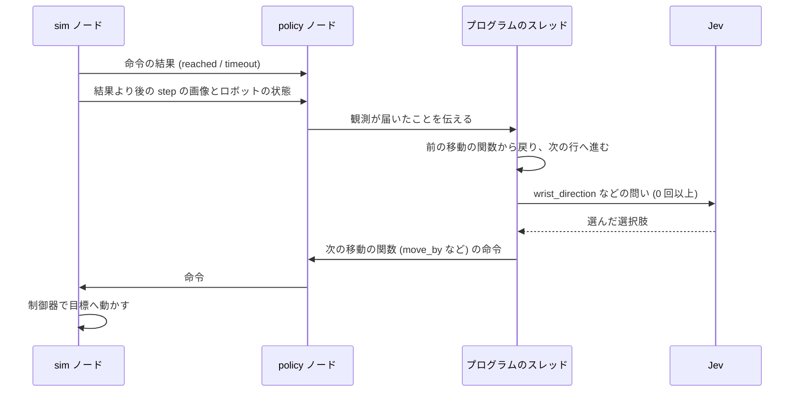

1. policy ノードは、前の命令の結果と、その結果より後の step の画像とロボットの状態が揃うまで待つ (`nodes/jev_policy.py`)
2. 揃ったら `CaPPolicy.decide(obs)` を呼ぶ。プログラムのスレッドは、前の移動の関数の中で止まっている。`decide` は観測を渡してスレッドを起こし、スレッドが次の命令を出すまで待つ
3. プログラムは、移動の関数から戻って次の行へ進む。`gripper_position()` などは、この観測の値を返す。`wrist_direction` などを呼ぶと、この観測の画像で Jev を呼ぶ。同じ判断の中で何回問うても、画像は同じものを使う
4. プログラムが次の移動の関数 (`move_by`、`move_to`、`open_gripper`、`close_gripper`) を呼ぶと、それが 1 つの命令になり、policy ノードから sim に送られる。プログラムはその関数の中で、結果が届くまで止まる
5. sim は手先の位置を目標へ動かす。目標から 5 mm 以内に入れば `reached`、上限の step 数を過ぎれば `timeout` でその場に止まる。下ろす命令は上限を 40 step (2 秒) にしてあり、テーブルや物に当たって止まると `timeout` になる。移動の関数は `reached` のとき True を返す
6. 結果と次の観測が届くと、1 に戻る

1 回の判断で Jev を何回呼ぶかは、プログラムしだいである。017 の init 0 では 64 回の判断で Jev を 38 回呼び、下ろす、指を閉じるなどの判断では Jev を呼ばなかった。プログラムが終わる (最後の行まで進む) か、上限 (Jev 360 回、移動 120 回) を超えると、エピソードを終える。

かかる時間の例として、017 の判断 #3 を挙げる。step 3 の観測で Jev を 1 回呼び (634 ms)、step 16 に命令を出した。2 cm の移動は step 21 に `reached` になり、step 21 の観測で次の判断に入った。観測から次の観測まで 18 step (0.9 秒) で、そのうち 13 step は Jev を呼んで命令を出すまでの時間である。

## Jev への入力と応答

### 入力

1 回の呼び出しで、`state` (文と画像の並び) と `questions` を送る。前の判断の画像や答えは渡さないので、Jev は毎回その時点の画像だけで答える。

`wrist_direction("the chocolate pudding box")` の入力は次のとおりである。

```python
state = [
    "Task: pick up the chocolate pudding and put it in the tray",
    "Wrist camera, looking straight down from the gripper. "
    "The red cross marks the point directly below the gripper:",
    <手首カメラの画像 448 x 448 px、PNG の data URL>,
]
questions = {
    "h": Choice(
        instructions="Task: pick up the chocolate pudding and put it in the tray. In the wrist camera "
        "image, to move the red cross onto the chocolate pudding box, which way should it move horizontally?",
        criteria={"left": None,
                  "none": "the red cross is already horizontally at the chocolate pudding box",
                  "right": None},
    ),
    "v": Choice(  # 同じ形で、vertically、up / none / down
        ...
    ),
}
```

`fixed_direction` では、画像が固定カメラ (手先に赤い丸、真下のテーブルの点に黄色い点) になり、説明文と問いの印が「yellow dot」に替わる。`in_wrist_view` と `check` は、はい/いいえの確率を答えさせる問い (`Noul`) を 1 つ送る。`check` だけは固定カメラと手首カメラの両方の画像を渡す。

### 応答

Jev は問いごとに選んだ選択肢と、各選択肢の確率を返す。022 までの CaP の記録には、選んだ選択肢と、レイテンシ、トークン数だけを残しており、確率は残していない。023 からは確率も `answers` の `p` に残す (023 の例は「wrist_step への入力と応答」)。017 の判断 #3 の記録は次のとおりである。

```json
{"fn": "fixed_direction", "args": ["the center of the tray"],
 "answers": {"h": "right", "v": "down"}, "result": [0, 1]}
{"fixed_direction_1": {"latency_ms": 634, "input_tokens": 1050, "output_tokens": 73}}
```

1 回の呼び出しの入力は、向きの問いで約 1,020〜1,050 トークン、`in_wrist_view` で約 880 トークンだった。出力は、向きの問いで 73 トークン、`in_wrist_view` で 20 トークンである。

### 答えを世界座標の向きに直す

手首カメラは真下を向いているので、画像の向きと世界座標の向きの対応は決まっている。

| 答え | right | left | down | up |
| --- | --- | --- | --- | --- |
| 世界座標 | +y | -y | +x | -x |

固定カメラは斜め上から見下ろしているので、画像の向きと世界座標の向きの対応は場所によって変わる。そこで、黄色い点の位置で、テーブルの面の上の動きが画像の上でどう動くか (射影のヤコビアン) を求め、その逆で画像の向きを世界座標の向きに直す (`src/s1cap/marks.py`)。大きい方の成分を 1 にそろえ、0.4 より小さい成分の軸は動かさない。

| 判断 | 答え (h, v) | 直した向き (x, y) | 返す値 |
| --- | --- | --- | --- |
| 017 #3 | right, down | (0.18, 1.00) | (0, 1) |
| 017 #22 | left, none | (1.00, -1.00) | (1, -1) |

返す値は各軸 -1、0、1 の符号だけである。何 cm 動くかはプログラムが決める。骨組みは 1 回 2 cm、021 の init 0 のプログラムは段によって 1.5〜4 cm 動いた。

## 実験 4: 骨組みの例 (017、init 0)

骨組み (`experiments/017-skeleton/programs/skeleton.py`) の前に、タスクに固有の値 (`task61.py`) をつないだプログラムを動かす。

```python
OBJECT = "the chocolate pudding box"
PLACE = "the center of the tray"
GRASP_SHIFT = (0.0, 0.0)
GRASP_RISE = 0.015
DONE_QUESTION = "Is the chocolate pudding box in the tray?"
```

骨組みは、何も持たずにトレイに合わせて位置を覚え、箱を掴み、覚えた位置へ運んで置く。位置合わせは、固定カメラの答えで 2 cm ずつ寄せ (最大 30 回)、(0, 0) と答えたら手首カメラの答えで 2 cm ずつ合わせる (最大 15 回)。

| 判断 | 段 | Jev |
| --- | --- | --- |
| #1、#2 | 手先を下向きにそろえ、始めの高さにする | 呼ばない |
| #3〜#15 | トレイに合わせて、位置を覚える | 固定カメラ 12 回、手首カメラ 2 回 |
| #16〜#37 | 箱に合わせる | 固定カメラ 20 回、手首カメラ 3 回 |
| #38〜#49 | 当たるまで 3 cm ずつ下ろし、1.5 cm 上げて指を閉じる | 呼ばない |
| #50〜#51 | 持ち上げ、覚えた位置へ動く | 呼ばない |
| #52〜#63 | 下ろし、3 cm 上げて指を開き、上げる | 呼ばない |
| #64 | 置けたかを問う | `check` 1 回 |

### #3: 固定カメラでトレイへ寄せる

| 固定カメラ | 手首カメラ (この判断では渡さない) |
| --- | --- |
| 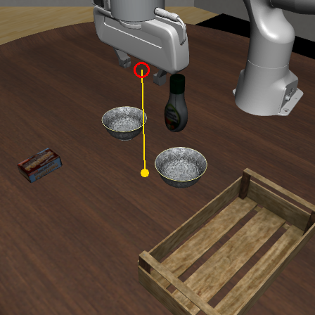 | 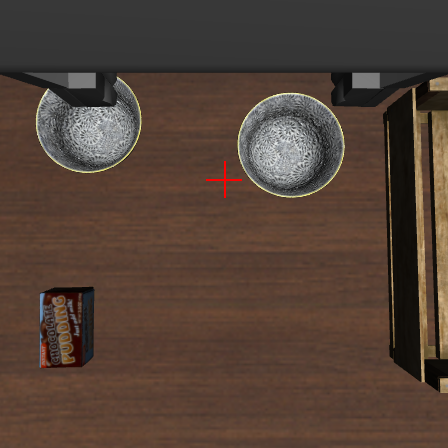 |

- 入力: 固定カメラの画像と「to move the yellow dot onto the center of the tray」
- 応答: h=right、v=down
- 直した向き: (0.18, 1.00) から (0, 1)
- 動作: `move_by(0, 0.02, 0)` で +y に 2 cm。step 21 に `reached`

#3〜#13 の 11 回とも同じ答えで、手先は +y に 22 cm 動いた。

### #14、#15: 手首カメラに替えて合わせ、位置を覚える

| #14 の手首カメラ | #15 の手首カメラ |
| --- | --- |
| 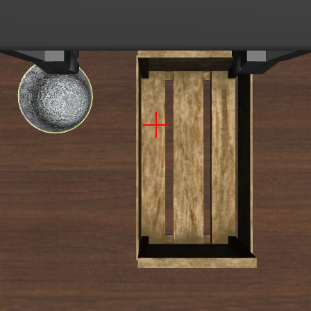 | 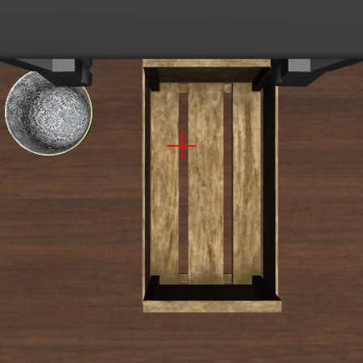 |

- #14: 固定カメラは h=none、v=none で (0, 0)。骨組みは手首カメラでの合わせに移り、同じ判断の中で、同じ観測の手首の画像に問う。手首カメラは h=right、v=none で (0, 1)。`move_by(0, 0.02, 0)`
- #15: 手首カメラは h=none、v=none で (0, 0)。骨組みはこの手先の位置 (x -0.056、y 0.235) を、トレイの位置として覚える。そこから箱に合わせる段に移り、`move_to` で始めの高さを保つ (動かない)

### #16〜#35: 箱へ寄せる

| #16 の固定カメラ | #22 の固定カメラ |
| --- | --- |
| 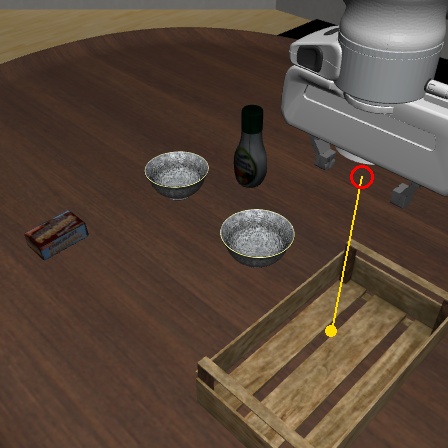 | 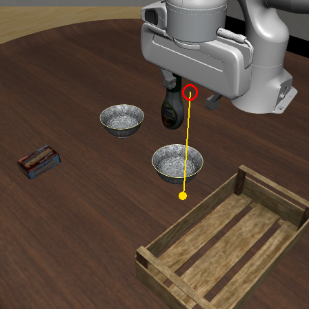 |

- #16: h=left、v=up で (0, -1)。`move_by(0, -0.02, 0)`
- #22: h=left、v=none で (1, -1)。固定カメラは斜めに見ているので、画像の左は世界座標では +x と -y の両方を含む。`move_by(0.02, -0.02, 0)`

### #35〜#37: 手首カメラで箱に合わせる

| #35 の手首カメラ | #37 の手首カメラ |
| --- | --- |
|  | 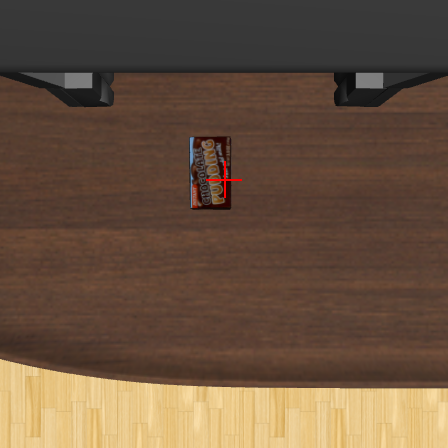 |

- #35: 固定カメラは (0, 0)。手首カメラは、箱が × の左にあり h=left、v=none で (0, -1)。`move_by(0, -0.02, 0)`
- #36: 同じく (0, -1)
- #37: h=none、v=none で (0, 0)。合わせを終え、`GRASP_SHIFT` (0, 0) だけずらす命令 `move_by(0, 0, 0)` を出す

### #38〜#49: 下ろして掴む (Jev を呼ばない)

| #47 の手首カメラ (下りた所) | #49 の手首カメラ (閉じる前) |
| --- | --- |
| 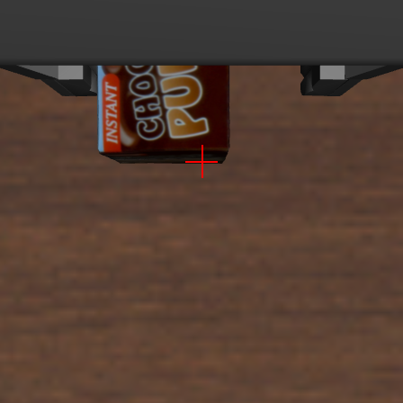 | 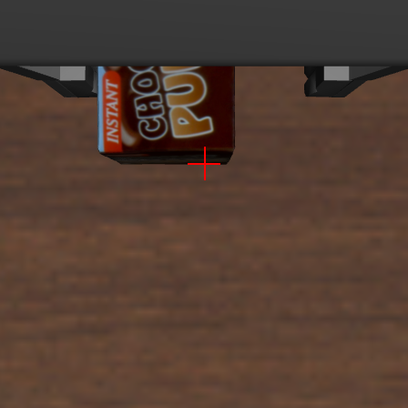 |

- #38〜#46: `move_by(0, 0, -0.03)` を 9 回。どれも `reached`
- #47: 10 回目の下ろす命令は、指が箱かテーブルに当たって届かず、40 step で `timeout`。骨組みはここで下ろすのをやめる
- #48: `move_by(0, 0, 0.015)` で 1.5 cm 上げる
- #49: `close_gripper()`。閉じた後の指の開きが 3 mm より大きいので、持っていると判断する

### #50〜#64: 運んで置く (Jev は最後の 1 回だけ)

- #50: `move_to` で始めの高さへ持ち上げる。指の開きを再び確かめる
- #51: `move_to(-0.056, 0.235, 0.691)`。#15 で覚えたトレイの位置へ、Jev に問わずに動く
- #52〜#60: 3 cm ずつ下ろし、#60 で `timeout`
- #61〜#63: 3 cm 上げてから `open_gripper()`、始めの高さへ上げる
- #64: `check("Is the chocolate pudding box in the tray?")` は 0.97。骨組みはこの値を print するだけで、プログラムを終える

LIBERO の判定は、箱を下ろしている途中の step 708 (#58) で成功になった。1 エピソードで Jev を 38 回呼び (平均 408 ms)、入力は 4.0 万トークンだった。

## 実験 4 の作り直し: 下ろす、閉じる、開くも Jev が選ぶ骨組み (023、init 0)

017 の骨組みでは、Jev が決めるのは行き先へ寄せる向きだけで、下ろす、閉じる、開くはコードが決めていた。023 の骨組み (`experiments/023-skeleton-jev-phases/programs/skeleton.py`) は、置き場所の位置を覚えずに運ぶ物へ向かい、掴む段と置く段では次の動作も 1 回ごとに Jev に選ばせる。タスクに固有の値は次のとおりである。

```python
OBJECT = "the chocolate pudding box"          # 始めの高さで寄せる行き先
GRASP_SHIFT = (0.0, 0.0)                       # 合わせた後、掴む場所までずらす量
GRASP_TARGET = "the chocolate pudding box"     # 掴む段の行き先
HELD = "chocolate pudding box in the gripper"  # 置く段で、置き場所へ寄せる印
PLACE = "the center of the tray"
DONE_QUESTION = "Is the chocolate pudding box in the tray?"
```

動画: [023-init0.mp4](023-init0.mp4)。924 step (46 秒)。下の欄には、`wrist_step` の 3 つの問い (horizontal、vertical、action) の選択肢ごとの確率を棒で描き、選んだ選択肢を濃くしている。

<video src="023-init0.mp4" controls width="100%"></video>

| 判断 | 段 | Jev |
| --- | --- | --- |
| #1 | 手先を下向きにそろえ、始めの高さにする | 呼ばない |
| #2〜#12 | 箱へ寄せる | 固定カメラ 9 回、手首カメラ 3 回 |
| #13〜#22 | 掴む段。#22 で閉じる | `wrist_step` 10 回 |
| #23 | 指の開きで掴めたかを確かめ、持ち上げる | 呼ばない |
| #24〜#48 | 持ったまま、固定カメラでトレイへ寄せる | 固定カメラ 25 回 |
| #49〜#58 | 置く段。#58 で開く | `wrist_step` 10 回 |
| #59 | 上げる | 呼ばない |
| #60 | 置けたかを問う | `check` 1 回 |

### wrist_step への入力と応答

掴む段と置く段の 1 回の判断では、`wrist_step` で Jev を 1 回呼ぶ。手首カメラの画像 1 枚と、手先の高さ、指の開閉、直前の下ろす命令が止まったかを書いた文を渡し、向き 2 つと次の動作を 1 回の呼び出しで問う。#22 の入力は次のとおりである。

```python
state = [
    "Task: pick up the chocolate pudding and put it in the tray",
    "The gripper is 1 cm above the table. The fingers are open. The last downward move was blocked.",
    "Wrist camera, looking straight down from the gripper. "
    "The red cross marks the point on the table directly below the gripper:",
    <手首カメラの画像 448 x 448 px>,
]
questions = {
    "h": Choice(...),  # wrist_direction と同じ。"to move the red cross onto the chocolate pudding box"
    "v": Choice(...),
    "action": Choice(
        instructions="Task: pick up the chocolate pudding and put it in the tray. What should the gripper do next?",
        criteria={
            "close": "the fingers are open, around the chocolate pudding box, and low enough to grip it",
            "open": "the fingers are closed, and the held object is on the chocolate pudding box",
        },
    ),
}
```

action の選択肢は、ふだんは move、lower、close、open の 4 つである。

| 動作 | 選ぶ条件 | コードが行うこと |
| --- | --- | --- |
| move | the {mark} is not over {target} yet | h、v の向きへ 2 cm 動く |
| lower | the {mark} is over {target}, and the gripper can still go down | 真下へ 3 cm 下ろす |
| close | the fingers are open, around {target}, and low enough to grip it | 指を閉じる |
| open | the fingers are closed, and the held object is on {target} | 指を開く |

`{mark}` と `{target}` は、掴む段では「red cross」と `GRASP_TARGET`、置く段では `HELD` と `PLACE` になる。#22 のように直前の下ろす命令が止まったときだけ、close と open の 2 つに絞る。それ以上は下りられず、横に動くと当たっている物を引きずるためである。

応答の記録は次のとおりで、選んだ選択肢に加えて、問いごとに各選択肢の確率 (`p`) を残す。

```json
{"fn": "wrist_step", "args": ["the chocolate pudding box", "red cross"],
 "answers": {"h": "none", "v": "none", "action": "close",
             "p": {"h": {"left": 0.06, "none": 0.82, "right": 0.12},
                   "v": {"up": 0.08, "none": 0.82, "down": 0.1},
                   "action": {"close": 0.99, "open": 0.01}}},
 "result": [0, 0, "close"]}
{"wrist_step_22": {"latency_ms": 365, "input_tokens": 1150, "output_tokens": 101}}
```

1 回の呼び出しの入力は約 1,150〜1,240 トークン、出力は 4 つの選択肢で 115 トークン、2 つに絞ると 101 トークンである。

### #13〜#22: 掴む段

| #13 の手首カメラ (26 cm) | #21 の手首カメラ (2 cm) | #22 の手首カメラ (下りきった所) |
| --- | --- | --- |
| 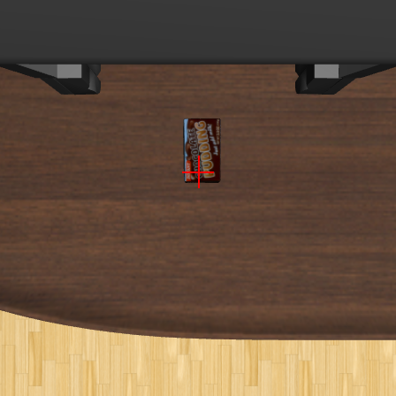 | 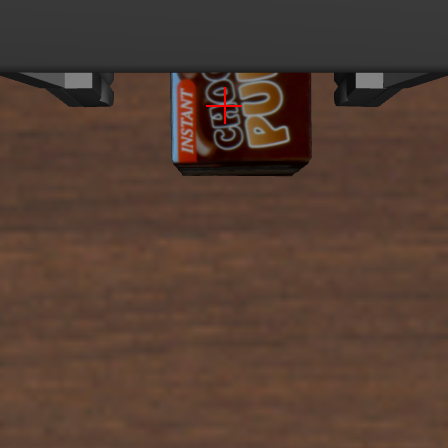 | 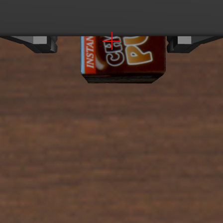 |

赤い × は、手先の高さごとに真下のテーブルの点に描く。高さが変わると、画像の中の × の位置も変わる。

- #13: 手首カメラで箱に合わせた直後。h=none、v=none、action は lower 0.99。`move_by(0, 0, -0.03)`
- #14〜#21: 8 回とも lower (0.91〜0.99)。close の確率は高さが下がるほど少しずつ上がり、#21 (テーブルから 2.4 cm) で 0.08 だった
- #22: #21 の下ろす命令は箱に当たって届かず、40 step で `timeout` になった。選択肢を close と open に絞り、close 0.99。`close_gripper()`
- #23: 閉じた後の指の開きが 3 mm より大きいので、持っていると判断して持ち上げる

### #49〜#58: 置く段

| #49 の手首カメラ (25 cm) | #58 の手首カメラ (7 cm、開く直前) |
| --- | --- |
| 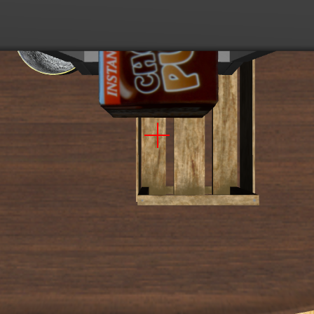 | 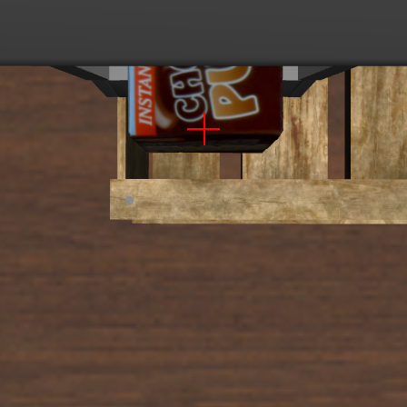 |

箱を持っていると、手首カメラの画像の多くを箱が隠す。

- #49: 固定カメラは (0, 0)。action は lower 0.73、open 0.22
- #50〜#57: lower を 5 回、move を 3 回選んだ。move のときの向きは v=down (+x) が続いた
- #58: テーブルから 6.7 cm の高さで、open 0.36、lower 0.34、move 0.27。僅差で open を選び、`open_gripper()`。箱はトレイの中に落ちた
- #60: `check` は 0.94

1 エピソードで Jev を 58 回呼び (平均 416 ms)、入力は 6.4 万トークンだった。023 の 10 回では、close は 10 回とも #22 と同じく、下りきって選択肢を絞った直後に選んだ。open は 8 回が #58 のように 4 つの選択肢から下ろす途中で選び、2 回は当たって止まった直後に選んだ (結果は `experiments/023-skeleton-jev-phases/README.md`)。

## 実験 5: LLM が書いたプログラムの例 (021、init 0)

### プログラムを書かせてから動かすまで

プログラムはエピソードを始める前に書かせ、ファイルに置いてから動かす。書かせるのは `scripts/generate_programs.py`、動かすのは `scripts/run_experiment.py` である。


1. `generate_programs.py` は、実験の `dataflow.yml` から、タスク (`SUITE`、`TASK`)、知見の版 (`KNOWLEDGE`)、上限 (`JEV_BUDGET`、`MAX_MOVES`)、モデル (`CODE_MODEL`) を読み、`s1cap.cap.prompt` でプロンプトを組み立てる。プロンプトにはタスクの指示文、座標系、始めの姿勢、部品の説明、知見、上限を入れ、お手本のコードは入れない
2. プロンプトは init state によらず同じ文である。init ごとに同じプロンプトで 1 回ずつ書かせるので、10 本のプログラムの違いは LLM の答えのばらつきから来る
3. 答えのコードブロックを取り出して `initN.py` に書く。自動の検査は、答えが空なら書かせ直すことだけで、構文、使う関数、ループの上限は調べない。人が読んで真値を使っていないことを確かめてから動かす
4. `run_experiment.py` は、init ごとに dataflow の `PROGRAM` をそのプログラムに書き換えて dora を起動する。policy ノードは sim からタスクを受けて方策を作るときに `compile` し (構文の誤りはここで止まる)、最初の判断で手先を下向きにそろえた後、builtins を絞った名前空間でプログラムを動かす
5. エピソードは、プログラムが終わるか、上限 (Jev 360 回、移動 120 回) を超えるか、例外が出るか、命令が 300 秒出ないと終わる。終わり方は記録に残すが、LLM には返さない。実行の結果から書き直させる仕組みは無い

### init 0 のプログラム

LLM には骨組みを渡さず、指示文、部品の説明、知見 (`KNOWLEDGE "017"`) だけを渡してプログラム全体を書かせた (プロンプトは `experiments/021-cap-task61-full/programs/prompt.md`)。init 0 のプログラム (`programs/init0.py`、生成に出力 1.1 万トークン) は、箱に合わせる段を次のように書いた。

```python
def align_pudding():
    # Coarse approach with the fixed camera.
    for i in range(20):
        sx, sy = fixed_direction("the chocolate pudding box")
        if sx != 0 or sy != 0:
            step = 0.04 if i < 8 else 0.02
            move_by(sx * step, sy * step, 0)
            continue

        if in_wrist_view("the chocolate pudding box") > 0.5:
            break
        ...

    # Fine alignment at start height using the wrist camera.
    stable = 0
    for _ in range(15):
        sx, sy = wrist_direction("the box")
        if sx == 0 and sy == 0:
            stable += 1
            if stable >= 2:
                break
        ...
```

骨組みとの違いは、段の順 (先に箱を掴み、持ったままトレイへ寄せる)、1 回に動く量 (4 cm、3 cm、1.5 cm)、手首カメラへの行き先の言い方 (`"the box"`)、(0, 0) を 2 回続けて受けたら止まることである。Jev への問いの形と、答えを世界座標の向きに直す仕組みは同じである。

### #6: 1 回の判断で Jev を 3 回呼ぶ

| 固定カメラ | 手首カメラ |
| --- | --- |
| 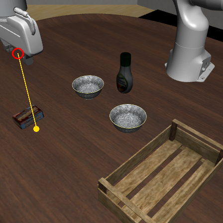 | 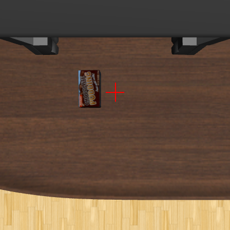 |

step 70 の観測 1 つで、次の 3 回を続けて問うた。

1. `fixed_direction("the chocolate pudding box")`: h=none、v=none で (0, 0)
2. `in_wrist_view("the chocolate pudding box")`: 0.98。0.5 より大きいので、固定カメラで寄せる段を終える
3. `wrist_direction("the box")`: h=left、v=none で (0, -1)

命令は `move_by(0, -0.015, 0)`。3 回の呼び出しで step 70 から 94 までかかった。

### #24: 箱を持ったまま固定カメラでトレイへ寄せる

| 固定カメラ | 手首カメラ |
| --- | --- |
| 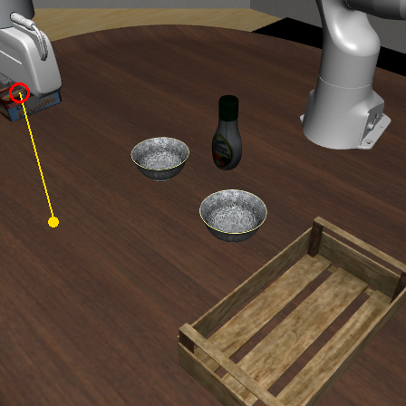 | 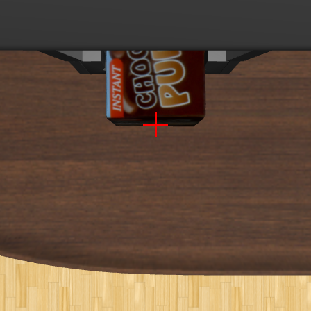 |

h=right、v=down で (0, 1)。プログラムは最初の 10 回を 3 cm、その後を 1.5 cm で動かし、#24〜#43 の 20 回で上限に達した。

### #44: 持っている間は手首カメラの x を使わない

| 固定カメラ | 手首カメラ |
| --- | --- |
| 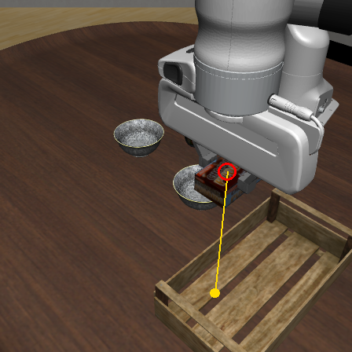 | 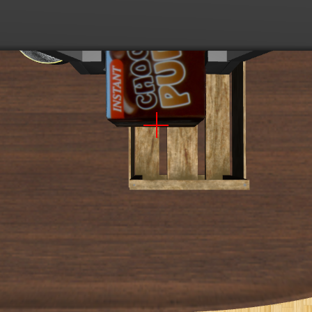 |

手首の画像では、持っている箱が × の上側 (-x 側) に写っている。

1. `wrist_direction("the center of the tray")`: h=none、v=down で (1, 0)。プログラムは y だけを見るので、y が 0 として数える
2. 同じ問いをもう一度: 同じ答え。y が 0 の答えが 2 回続いたので、手首カメラでの合わせを終える
3. `fixed_direction("the center of the tray")`: h=right、v=none で (-1, 1)。最後の補正として `move_by(-0.015, 0.015, 0)`

x の答えを使わないことは、プログラムのコメント (`Ignore wrist x answers while holding.`) に書かれている。プロンプトの知見 (箱を持つと手首カメラの x の答えは 102 回中 71 回がトレイから離れる向き) に沿った書き方である。#45 で固定カメラが (0, 0) と答え、その後は下ろし、3 cm 上げて開き、上げてプログラムを終えた。LIBERO の判定は、箱を下ろしている途中の step 632 (#50) で成功になった。1 エピソードで Jev を 35 回呼び (平均 402 ms)、入力は 3.6 万トークンだった。

## 他の実験との違い

018〜022、024、025 も同じ実装で動く。違うのはプログラムと、手首カメラの × の描き方だけである。

| 実験 | タスク | プログラム |
| --- | --- | --- |
| 017 | 61 | 骨組み + `task61.py` |
| 018 | 60 | 同じ骨組み + `task60.py` (`OBJECT` が `"the center of the bowl to pick up"`、`GRASP_SHIFT` が (0, -0.06)) |
| 019、020 | 61、60 | LLM が `KNOWLEDGE "016"` で書いた 10 本 |
| 021、022 | 61、60 | LLM が `KNOWLEDGE "017"` で書いた 10 本 |
| 023 | 61 | 作り直した骨組み + `task61.py`。手首カメラの × は手先の高さごとに描く (`CROSS: height`)。022 までは始めの高さに合わせた固定の位置 |
| 024 | 60 | 023 の骨組み + `task60.py` |
| 025 | 64 | 023 の骨組み + `task64.py`。値は `task60.py` と同じで、置き場所だけ「the center of the other black bowl」。右のボウルを掴むかを指示文だけで決める |

結果は各実験の README にある。
