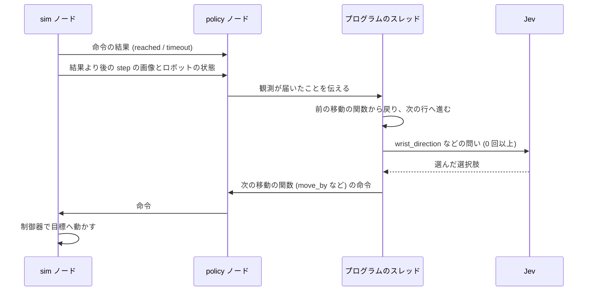
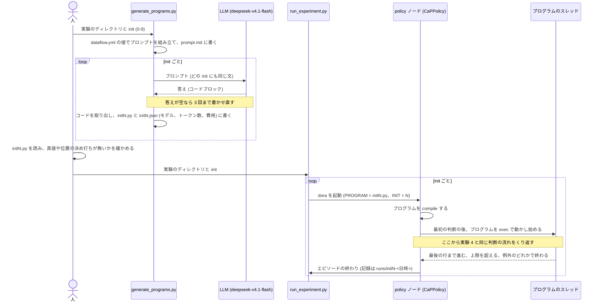

# 実験の流れと Jev への入出力

実験 1〜6 で、方策が Jev に何を渡し、何を受け取り、それをどう動作に変えたかを、実験の流れに沿って説明する。例は各実験の記録から取った。結果の詳しい数値は各実験の README にある。

## 実験の一覧

タスクはすべて LIBERO の同じ居間のシーンで、卓の上の物をアームで掴んで運ぶ。

- 条件決め: 画像を何 px で Jev に渡すかを、静止画 1 枚の大きさを変えて測り、448 px にした ([012](../../experiments/012-image-resolution/))
- 実験 1: プリンの箱をトレイへ。物の位置の真値を文で渡し、意図と軸ごとの向きを選ばせる。10/10 ([013](../../experiments/013-text-baseline/))
- 実験 2: プリンの箱をトレイへ。真値を渡さず画像だけを渡し、世界座標の軸の向きを選ばせる。0/10 ([014](../../experiments/014-image-direction/))
- 実験 3: タスクを通さず、段ごとの小さな作業を調べる。手先を物の上に合わせて下ろせば掴めるか、どれだけずれてよいか (Jev は使わない、[015](../../experiments/015-grasp-tolerance/))。行き先の言い方で、手首カメラの画像の向きの答えがどう変わるか ([016](../../experiments/016-target-wording/))
- 実験 4: 人が書いた手順の骨組みの中で、Jev に画像の中の向きと次の動作を問う。プリンの箱をトレイへ 10/10 ([023](../../experiments/023-skeleton-jev-phases/))。骨組みを変えず値だけ替えて、左の黒いボウルをトレイへ 8/10 ([024](../../experiments/024-skeleton-jev-phases-task60/))
- 実験 5: 骨組みを渡さず、LLM にプログラム全体を書かせる (Code as Policies)。プリンの箱は 5/10、知見を足して 8/10。左の黒いボウルは 6/10、知見を足して 4/10 ([019](../../experiments/019-cap-task61/)〜[022](../../experiments/022-cap-task60-full/))
- 実験 6: 実験 4 の骨組みを、計画になかった別のタスクへ転用する。右のボウルを左のボウルに重ねる。右のボウルを掴んだのは 10/10、重ねたのは 4/10 ([025](../../experiments/025-skeleton-bowl-left-right/))

## タスク、カメラ、画像の大きさ

| タスク | LIBERO の指示文 | 使った実験 |
| --- | --- | --- |
| プリンの箱をトレイへ (libero_90 61) | pick up the chocolate pudding and put it in the tray | 1〜5 |
| 左の黒いボウルをトレイへ (libero_90 60) | pick up the black bowl on the left and put it in the tray | 3〜5 |
| 右のボウルを左のボウルに重ねる (libero_90 64) | stack the right bowl on the left bowl and place them in the tray | 6 (トレイへ運ぶ所は行わない) |
| ドレッシングの瓶をトレイへ (libero_90 62) | pick up the salad dressing and put it in the tray | 3 だけ |

プリンの箱は場面に 1 つしかなく、y の幅 4.6 cm が指の開き 8 cm より小さいので、箱への向きがほぼ掴む場所への向きになる。黒いボウルは直径 10.7 cm で指より大きく、縁しか掴めない。同じ形のボウルがもう 1 つあり、指示文の「左」「右」で区別する。

カメラは 2 つ使う。固定カメラ (quarterview) は卓を斜め上から見下ろし、運ぶ物と置き場所が両方写る。手首カメラは手先から真下を向いている。どちらの画像も 448 px の正方形にして渡す。448 px では、画像 1 枚と短い問い 2 つの入力が約 870 トークンで、プリンの箱は約 65 × 40 px に写り、「箱が写っているか」の確信度は 0.92〜0.94 だった (012)。大きくしても箱の形と位置の見え方はほとんど変わらず、入力トークンは画素数にほぼ比例して増える。

真値 (物の位置と姿勢) は、実験 1 で方策に渡す以外は評価にだけ使う。方策は画像から物の位置を推定せず、Jev の答えから直接動作を決める。

## 実行のしくみ

3 つの dora ノードが 20 Hz で動く。sim ノードは 50 ms ごとに LIBERO を 1 step 進め、画像 2 枚とロボットの状態を流す。policy ノードは命令を作り、evaluator ノードは記録を書く。sim は policy の答えを待たずに進み続け、命令が無い間はアームはその場に止まっている。

policy ノードは、前の命令の結果と、その結果より後の step の画像とロボットの状態が揃うと、方策の `decide(obs)` を呼ぶ (`nodes/jev_policy.py`)。方策は Jev を呼んで答えを受け取り、次の命令を 1 つ返す。この 1 回を判断と呼ぶ。sim は命令の目標へ手先を動かし、目標から 5 mm 以内 (実験 1 は 2 mm、実験 2 は 1 mm) に入れば `reached`、上限の step 数を過ぎれば `timeout` を返す。

Jev への 1 回の呼び出しでは、`state` (文と画像の並び) と `questions` (選択肢の問い `Choice` と、はい/いいえの確率を答える問い `Noul`) を送る。Jev は問いごとに選んだ選択肢と各選択肢の確率を返す。前の判断について渡すのは、実験 1 では直前の意図と命令の結果、実験 2 では直前 5 回の命令と結果だけである。実験 4〜6 では何も渡さないので、Jev は毎回その時点の画像と文だけで答える。

実験ごとに違うのは、何を `state` に入れ、何を問い、答えをどう命令に変えるかである。

| 実験 | 方策 | Jev に渡すもの | 1 回の判断の呼び出し |
| --- | --- | --- | --- |
| 1 | `s1cap.jev_text.JevTextPolicy` | 真値から作った状態 (JSON)。画像は渡さない | 2 回 (意図、動き) |
| 2 | `s1cap.jev_policy.JevDirectionPolicy` | 固定カメラと手首カメラの画像、手先の座標、直前 5 回の命令と結果 | 1 回 |
| 4〜6 | `s1cap.cap.CaPPolicy` | 固定カメラか手首カメラの画像 (印を描く)。問いによって手先の高さと指の状態の文 | プログラムしだいで 0 回以上 |

## 実験 1: 物の位置の真値を文で渡す

公開事例 (OpenRoboto の jev-robot-control の `incremental_policy`) の問いの形を、プリンの箱をトレイへ運ぶタスクに置き換えた。1 回の判断で Jev を 2 回呼ぶ。

1. 意図を問う。状態を渡し、approach、grasp、lift、carry、lower、release、withdraw、finish の 8 つから選ばせる。選択肢ごとに、それを選ぶ条件を書いている (grasp なら「箱を持っておらず、指が開いていて、`grasp_pose_reached` が真」)
2. 動きを問う。選んだ意図を足した状態を渡し、x、y、z を別々の問いにして negative、hold、positive を選ばせ、指の open、hold、close も選ばせる。各軸の問いの文には、その軸の今の座標、目標の座標、差 [mm] を書いている

状態は、物とトレイの位置の真値からコードが作る。位置合わせができたか (`grasp_pose_reached` など) もコードが真値で判定して渡す。Jev が決めるのは意図と、軸ごとの向きと、指である。1 歩の大きさは目標までの距離からコードが決める (遠いと 2 cm、近いと 8 mm、4 mm)。

init 0 の 4 回目の判断で渡した状態の一部は次のとおりである。

```json
{"task": "pick up the chocolate pudding and put it in the tray",
 "source": "LIBERO simulator ground-truth object positions, not camera vision",
 "units": "millimetres; robot base coordinates; +Z is up",
 "tcp_mm": [-15.7, -42.7, 690],
 "pudding_box_mm": [103.5, -181.4, 449.8],
 "tray_center_mm": [5.2, 264.9, 437.4],
 "pudding_box_grasp_minus_tcp_mm": [119.2, -138.7, -240.2],
 "alignment": {"grasp_pose_reached": false, "over_tray": false, "at_travel_height": true, ...},
 "gripper_command": "open", "finger_width_mm": 79.8, "held": false,
 "previous_intent": "approach", "feedback": "move_delta reached"}
```

- 意図: approach (確率 1.0)。入力 1,287 トークン、480 ms
- 動き: x positive、y negative、z hold、指 hold。入力 2,437 トークン、401 ms
- 命令: `move_delta(+0.02, -0.02, 0)`。差の符号どおりの向きである

掴む所では、コードが `grasp_pose_reached` を真にした判断で grasp を 0.9 で選び、動きの問いで指の close を選んで閉じた。10 回とも箱をトレイに置き、送った移動の向きが掴む点や離す点から遠ざかったことは一度も無かった。1 エピソードで Jev を平均 164 回呼び、入力は 30.2 万トークンだった。

動画: [013 init 0](013-init0.mp4) (Jev には画像を渡していない)。

## 実験 2: 画像だけを渡し、世界座標の軸の向きを問う

実験 1 から真値を抜き、固定カメラと手首カメラの画像を渡した。1 回の判断で Jev を 1 回呼び、x、y、z の軸ごとに plus、stay、minus、指の open、closed、タスクが終わったか (`Noul`) を問う。

軸は、ロボットの正面に立ってロボットを向いた人から見た向きで文に書いた (右が +x、手前が +y、上が +z)。Jev の x、y は世界座標の y、x にあたり、コードが入れ替えて命令にする。画像には印を描かず、各カメラの画像でどちらが +x、+y かを文で添えた。

```python
state = [
    "Task: pick up the chocolate pudding and put it in the tray\n"
    "Coordinate system, as seen by a viewer standing in front of the robot and facing it: "
    "+x points to the viewer's right (the robot's left), ... +z points up ...\n"
    "Robot state (meters, in the coordinate system above): gripper position [...], "
    "finger opening [...] m (0.08 fully open, 0 closed).",
    # 2 回目からは "Previous steps (oldest first): close fingers -> reached; ..." が続く
    "Fixed camera, looking down diagonally at the table from the viewer's right (the robot's front left). "
    "In this image, +x points to the lower right, +y points to the lower left, and +z points up:",
    <固定カメラの画像 448 x 448 px>,
    "Wrist camera, looking straight down (-z) from the gripper. In this image, +x points right and +y points down:",
    <手首カメラの画像 448 x 448 px>,
]
questions = {
    "x": Choice(instructions="Task: ... The robot moves its gripper 2.0 cm per step. "
                "Which way should the gripper move along the x axis in the next step?",
                criteria={"plus": "+x: move to the viewer's right (the robot's left)",
                          "stay": "do not move along x",
                          "minus": "-x: move to the viewer's left (the robot's right)"}),
    "y": ..., "z": ...,
    "gripper": Choice(..., criteria={"open": ..., "closed": ...}),
    "done": Noul(instructions="Task: ... Is the task complete?", ...),
}
```

コードは、指の答えが今の指と違い確率が 0.7 以上なら指の命令だけを送り、そうでなければ各軸 2 cm の移動を送る。`done` が 0.8 以上ならエピソードを終える。

init 0 の最初の判断の答えは次のとおりである。

```json
{"choices": {"x": "minus", "y": "minus", "z": "minus", "gripper": "closed"},
 "probabilities": {"x": {"plus": 0.19, "stay": 0.14, "minus": 0.67},
                   "y": {"plus": 0.33, "stay": 0.14, "minus": 0.53},
                   "z": {"plus": 0.12, "stay": 0.05, "minus": 0.83},
                   "gripper": {"open": 0.25, "closed": 0.75}},
 "done": 0.06,
 "command": {"type": "gripper", "closed": true}}
```

箱は始めの手先から世界座標の +x、-y にある。Jev の x minus は世界座標の -y で箱へ向かうが、y minus は世界座標の -x で箱から離れる。指は closed を 0.75 で選んだので、最初の命令で指を閉じた。10 回とも同じ形で、最初に指を閉じ、z は 1200 回中 1197 回 minus を選んで卓に押し付け、x は 76%、y は 71% が箱から遠ざかる向きだった。

動画: [014 init 0](014-init0.mp4)。

## 実験 3: 段ごとの小さな作業で、Jev が働く問い方を探す

実験 2 で失敗した世界座標の向きに代えて、画像の中の向きを問う。手首カメラの画像には手先の真下の点に赤い × を描き、「× を行き先に重ねるには、横 (left、none、right) と縦 (up、none、down) のどちらへ動かすか」を問う。手首カメラは真下を向いているので、画像の向きは世界座標の向きに決まった対応で直せる (下の「答えを世界座標の向きに直す」)。この問いがどの言い方で働くかと、合わせた後に掴めるかを、エピソードを回さずに調べた。

### 掴めるか (Jev は使わない)

真値で手先を物の真上から決まった量だけずらして置き、3 cm ずつ下ろして当たって止まった所から 1.5 cm 上げ、指を閉じて持ち上げた。物ごとに 35 か所 × init 5 つを試した。

- プリンの箱: y のずれが -2〜+1 cm ならほぼ掴め、±3 cm では一度も掴めなかった。x は ±4 cm ずれても掴めた。箱の中心に合わせてそのまま下ろせばよい
- 黒いボウル: 中心から y に -6 cm の縁を基準にすると、そこから x に ±2 cm、y に ±3 cm ずれても 105 回中 102 回掴めた。ボウルの中心に合わせてから -y に 6 cm ずらして下ろす
- ドレッシングの瓶: 瓶の位置では、物が無くても手先が卓から約 18 cm 上で止まり、上から掴めなかった (175 回中 11 回)

### 行き先の言い方

手先を物から決まった量ずらした静止画で、実験 4〜6 の `wrist_direction` と同じ問いを、行き先の言い方だけを替えて問うた。入力は次の形である。

```python
state = [
    "Task: pick up the chocolate pudding and put it in the tray",
    "Wrist camera, looking straight down from the gripper. "
    "The red cross marks the point directly below the gripper:",
    <手首カメラの画像 448 x 448 px、PNG の data URL>,
]
questions = {
    "h": Choice(
        instructions="Task: pick up the chocolate pudding and put it in the tray. In the wrist camera "
        "image, to move the red cross onto the chocolate pudding box, which way should it move horizontally?",
        criteria={"left": None,
                  "none": "the red cross is already horizontally at the chocolate pudding box",
                  "right": None},
    ),
    "v": Choice(  # 同じ形で、vertically、up / none / down
        ...
    ),
}
```

下の図は、手先を物から +y に 4 cm ずらしたときの画像で、左から、プリンの箱、ドレッシングの瓶、黒いボウルのタスクの手首カメラの画像と、プリンの箱のタスクの固定カメラの画像である。手首カメラの画像の右が +y なので、物は × の左に写り、正しい答えは h=left である。


init 0 で同じずらし方のときの答えは次のとおりだった。

| タスク | 言い方 | h の確率 (left / none / right) |
| --- | --- | --- |
| プリンの箱 | the chocolate pudding box | 0.81 / 0.18 / 0.01 |
| 左の黒いボウル | the black bowl on the left | 0.12 / 0.85 / 0.03 |
| 左の黒いボウル | the center of the bowl to pick up | 0.46 / 0.52 / 0.02 |

21 か所 × init 5 つでまとめると、プリンの箱は「the chocolate pudding box」で、y に 2 cm 以上ずれた軸の 93% で箱へ向かい、1 cm 未満の軸の 87% で動かさなかった。左の黒いボウルは、「the black bowl on the left」「the left black bowl」では 4 cm ずれていても多くは none と答え、「the center of the bowl to pick up」では 83% がボウルへ向かった。固定カメラの画像では、手先が箱から 4〜6 cm の所で 9 割が動かさないと答えたので、固定カメラは物が手首カメラの画像に入るまで粗く寄せる段にだけ使う。

ここで決めた言い方、掴み方、カメラの使い分けが、実験 4 でタスクごとに埋める値になる。

## 実験 4: 人が書いた骨組みの中で Jev に問う

物を運ぶタスクに共通の骨組み (`experiments/023-skeleton-jev-phases/programs/skeleton.py`) を人が 1 度書き、その前にタスクに固有の値をつないだプログラムを `CaPPolicy` で動かす。プリンの箱の値 (`task61.py`) は次のとおりである。

```python
OBJECT = "the chocolate pudding box"          # 始めの高さで寄せる行き先
GRASP_SHIFT = (0.0, 0.0)                       # 合わせた後、掴む場所までずらす量
GRASP_TARGET = "the chocolate pudding box"     # 掴む段の行き先
HELD = "chocolate pudding box in the gripper"  # 置く段で、置き場所へ寄せる印
PLACE = "the center of the tray"
DONE_QUESTION = "Is the chocolate pudding box in the tray?"
```

骨組みは次の順に進む。

1. 始めの高さで、固定カメラの答えで運ぶ物へ 2 cm ずつ寄せ、固定カメラが (0, 0) と答えたら手首カメラの答えで合わせる
2. `GRASP_SHIFT` だけずらし、掴む段に入る。掴む段では 1 回ごとに `wrist_step` で、向きと次の動作 (move、lower、close、open) を Jev に選ばせる
3. 閉じた後の指の開きで掴めたかを確かめ、始めの高さへ持ち上げる
4. 持ったまま、固定カメラの答えで置き場所へ 2 cm ずつ寄せる
5. 置く段に入る。掴む段と同じく `wrist_step` で、向きと次の動作を選ばせる。開いたら上げる
6. `check(DONE_QUESTION)` を問い、値を記録して終える

置き場所の位置はどこにも覚えない。行き先へ寄せるのは毎回その時点の画像への答えで、下ろす、閉じる、開くの時機も Jev が選ぶ。コードが決めるのは、段の順、1 回に動く量 (横に 2 cm、下に 3 cm)、各段の上限、掴めたかの判定である。

### プログラムと 1 回の判断の流れ

プログラムは policy ノードの中の別のスレッドで動く。移動の関数 (`move_by`、`move_to`、`open_gripper`、`close_gripper`) を 1 回呼ぶと 1 つの命令になり、プログラムはその関数の中で結果が届くまで止まる。



1. policy ノードは、結果と観測が揃うと `CaPPolicy.decide(obs)` を呼ぶ。`decide` は観測を渡してスレッドを起こし、スレッドが次の命令を出すまで待つ
2. プログラムは移動の関数から戻って次の行へ進む。`gripper_position()` などは、この観測の値を返す。`wrist_direction` などを呼ぶと、この観測の画像で Jev を呼ぶ。同じ判断の中で何回問うても、画像は同じものを使う
3. プログラムが次の移動の関数を呼ぶと、それが命令として sim に送られる。下ろす命令は上限を 40 step (2 秒) にしてあり、卓や物に当たって止まると `timeout` になる。移動の関数は `reached` のとき True を返す

1 回の判断で Jev を何回呼ぶかはプログラムしだいである。init 0 では 60 回の判断で Jev を 58 回呼んだ。持ち上げる判断などでは呼ばず、#10 では 2 回呼んだ。プログラムが最後の行まで進むか、上限 (Jev 360 回、移動 120 回) を超えると、エピソードを終える。

かかる時間の例として #2 を挙げる。step 2 の観測で固定カメラに 1 回問い (451 ms)、step 11 に命令を出した。2 cm の移動は step 19 に `reached` になり、step 19 の観測で次の判断に入った。観測から次の観測まで 17 step (0.85 秒) で、そのうち 9 step は Jev を呼んで命令を出すまでの時間である。

### 向きの問いへの入力と応答

`wrist_direction(target)` は、実験 3 と同じ問いを手首カメラの画像に送る。`fixed_direction(target)` は、固定カメラの画像に手先の赤い丸と、手先の真下の卓の点に黄色い点を描き、黄色い点を行き先に重ねる向きを問う。

```python
state = [
    "Task: pick up the chocolate pudding and put it in the tray",
    "Fixed camera, looking down diagonally at the table. The red circle marks the gripper. "
    "The yellow dot marks the point on the table directly below the gripper "
    "(the yellow line connects them):",
    <固定カメラの画像 448 x 448 px>,
]
questions = {
    "h": Choice(instructions="Task: ... In the fixed camera image, to move the yellow dot onto "
                "the chocolate pudding box, which way should it move horizontally?", ...),
    "v": Choice(...),
}
```

応答の記録には、選んだ選択肢、各選択肢の確率、世界座標の向きに直した値を残す。#2 の記録は次のとおりである。

```json
{"fn": "fixed_direction", "args": ["the chocolate pudding box"],
 "answers": {"h": "left", "v": "none",
             "p": {"h": {"left": 1, "none": 0, "right": 0},
                   "v": {"up": 0.17, "none": 0.61, "down": 0.22}}},
 "result": [1, -1]}
{"fixed_direction_1": {"latency_ms": 451, "input_tokens": 1044, "output_tokens": 73}}
```

1 回の呼び出しの入力は約 1,030〜1,050 トークン、出力は 73 トークンである。`in_wrist_view(target)` と `check(question)` は `Noul` を 1 つ問い、確率を返す。`check` だけは固定カメラと手首カメラの両方の画像を渡す。

### 答えを世界座標の向きに直す

手首カメラは真下を向いているので、画像の向きと世界座標の向きの対応は決まっている。

| 答え | right | left | down | up |
| --- | --- | --- | --- | --- |
| 世界座標 | +y | -y | +x | -x |

固定カメラは斜め上から見下ろしているので、対応は場所によって変わる。黄色い点の位置で、卓の面の上の動きが画像の上でどう動くか (射影のヤコビアン) を求め、その逆で画像の向きを世界座標の向きに直す (`src/s1cap/marks.py`)。大きい方の成分を 1 にそろえ、0.4 より小さい成分の軸は動かさない。

| 判断 | 行き先 | 答え (h, v) | 直した向き (x, y) | 返す値 |
| --- | --- | --- | --- | --- |
| #2 | the chocolate pudding box | left, none | (1.00, -1.00) | (1, -1) |
| #4 | the chocolate pudding box | left, down | (1.00, 0.25) | (1, 0) |
| #24 | the center of the tray | right, down | (0.05, 1.00) | (0, 1) |

返す値は各軸 -1、0、1 の符号だけで、何 cm 動くかはプログラムが決める。

### 例: プリンの箱をトレイへ (init 0)

動画: [023-init0.mp4](023-init0.mp4)。924 step (46 秒)。上の左が固定カメラ、右が手首カメラで、Jev に渡すのと同じ印を描いている。手首カメラの画像は Jev に渡すときと同じく 180° 回してあり、画像の右が +y、下が +x である。下の欄には判断ごとの問いと答え、選択肢ごとの確率、送った命令を書いている (読み方は「動画と画像の作り方」)。

<video src="023-init0.mp4" controls width="100%"></video>

| 判断 | 段 | Jev |
| --- | --- | --- |
| #1 | 手先を下向きにそろえ、始めの高さにする | 呼ばない |
| #2〜#12 | 箱へ寄せる | 固定カメラ 9 回、手首カメラ 3 回 |
| #13〜#22 | 掴む段。#22 で閉じる | `wrist_step` 10 回 |
| #23 | 指の開きで掴めたかを確かめ、持ち上げる | 呼ばない |
| #24〜#48 | 持ったまま、固定カメラでトレイへ寄せる | 固定カメラ 25 回 |
| #49〜#58 | 置く段。#58 で開く | `wrist_step` 10 回 |
| #59 | 上げる | 呼ばない |
| #60 | 置けたかを問う | `check` 1 回 |

#### #2〜#12: 箱へ寄せる

| #2 の固定カメラ | #10 の手首カメラ |
| --- | --- |
|  |  |

- #2〜#9: 固定カメラの答えは、#4 (left、down で (1, 0)) を除いて left、none の (1, -1) で、+x と -y へ 2 cm ずつ寄せた
- #10: 固定カメラは none、none (0.95、0.92) で (0, 0)。骨組みは同じ判断の中で、同じ観測の手首カメラの画像に問う。箱は × の左にあり、h=left 0.97 で (0, -1)。`move_by(0, -0.02, 0)`
- #11: 手首カメラは h=left 0.79 で (0, -1)
- #12: 手首カメラは none、none (0.72、0.83) で (0, 0)。`GRASP_SHIFT` (0, 0) だけずらし、掴む段に入る

#### wrist_step への入力と応答

掴む段と置く段の 1 回の判断では、`wrist_step` で Jev を 1 回呼ぶ。手首カメラの画像 1 枚と、手先の高さ、指の開閉、直前の下ろす命令が止まったかを書いた文を渡し、向き 2 つと次の動作を 1 回の呼び出しで問う。#22 の入力は次のとおりである。

```python
state = [
    "Task: pick up the chocolate pudding and put it in the tray",
    "The gripper is 1 cm above the table. The fingers are open. The last downward move was blocked.",
    "Wrist camera, looking straight down from the gripper. "
    "The red cross marks the point on the table directly below the gripper:",
    <手首カメラの画像 448 x 448 px>,
]
questions = {
    "h": Choice(...),  # wrist_direction と同じ。"to move the red cross onto the chocolate pudding box"
    "v": Choice(...),
    "action": Choice(
        instructions="Task: pick up the chocolate pudding and put it in the tray. What should the gripper do next?",
        criteria={
            "close": "the fingers are open, around the chocolate pudding box, and low enough to grip it",
            "open": "the fingers are closed, and the held object is on the chocolate pudding box",
        },
    ),
}
```

action の選択肢は、ふだんは move、lower、close、open の 4 つである。

| 動作 | 選ぶ条件 | コードが行うこと |
| --- | --- | --- |
| move | the {mark} is not over {target} yet | h、v の向きへ 2 cm 動く |
| lower | the {mark} is over {target}, and the gripper can still go down | 真下へ 3 cm 下ろす |
| close | the fingers are open, around {target}, and low enough to grip it | 指を閉じる |
| open | the fingers are closed, and the held object is on {target} | 指を開く |

`{mark}` と `{target}` は、掴む段では「red cross」と `GRASP_TARGET`、置く段では `HELD` と `PLACE` になる。#22 のように直前の下ろす命令が止まったときだけ、close と open の 2 つに絞る。それ以上は下りられず、横に動くと当たっている物を引きずるためである。

応答の記録は次のとおりである。

```json
{"fn": "wrist_step", "args": ["the chocolate pudding box", "red cross"],
 "answers": {"h": "none", "v": "none", "action": "close",
             "p": {"h": {"left": 0.06, "none": 0.82, "right": 0.12},
                   "v": {"up": 0.08, "none": 0.82, "down": 0.1},
                   "action": {"close": 0.99, "open": 0.01}}},
 "result": [0, 0, "close"]}
{"wrist_step_22": {"latency_ms": 365, "input_tokens": 1150, "output_tokens": 101}}
```

1 回の呼び出しの入力は約 1,150〜1,240 トークン、出力は 4 つの選択肢で 115 トークン、2 つに絞ると 101 トークンである。

#### #13〜#22: 掴む段

| #13 の手首カメラ (26 cm) | #21 の手首カメラ (2 cm) | #22 の手首カメラ (下りきった所) |
| --- | --- | --- |
|  |  |  |

赤い × は、手先の高さごとに真下の卓の点に描く。高さが変わると、画像の中の × の位置も変わる。

- #13: h=none、v=none、action は lower 0.99。`move_by(0, 0, -0.03)`
- #14〜#21: 8 回とも lower (0.91〜0.99)。close の確率は高さが下がるほど少しずつ上がり、#21 (卓から 2.4 cm) で 0.08 だった
- #22: #21 の下ろす命令は箱に当たって届かず、40 step で `timeout` になった。選択肢を close と open に絞り、close 0.99。`close_gripper()`
- #23: 閉じた後の指の開きが 3 mm より大きいので、持っていると判断して持ち上げる

#### #24〜#48: 持ったままトレイへ寄せる

| #24 の固定カメラ |
| --- |
|  |

固定カメラに「the center of the tray」への向きを問うた。#24〜#47 の 24 回のうち 20 回は right、down で (0, 1)、4 回 (#42、#44、#46、#47) は right、up で (-1, 0) だった。+y へ寄せ、#48 で none、none の (0, 0) と答えたので置く段に入った。

#### #49〜#58: 置く段

| #49 の手首カメラ (25 cm) | #58 の手首カメラ (7 cm、開く直前) |
| --- | --- |
|  |  |

箱を持っていると、手首カメラの画像の多くを箱が隠す。

- #49: action は lower 0.73、open 0.22
- #50〜#57: lower を 5 回、move を 3 回選んだ。move のときの向きは v=down (+x) が続いた
- #58: 卓から 6.7 cm の高さで、open 0.36、lower 0.34、move 0.27。僅差で open を選び、`open_gripper()`。箱はトレイの中に落ちた
- #60: `check` は 0.94

1 エピソードで Jev を 58 回呼び (平均 416 ms)、入力は 6.4 万トークンだった。10 回とも成功し、close は 10 回とも #22 と同じく、下りきって選択肢を絞った直後に選んだ。open は 8 回が #58 のように 4 つの選択肢から下ろす途中で選び、2 回は当たって止まった直後に選んだ。

### 運ぶ物を左の黒いボウルに替える

骨組みを変えず、タスクに固有の値だけを実験 3 の結果で埋め直した (`experiments/023-skeleton-jev-phases/programs/task60.py`)。

```python
OBJECT = "the center of the bowl to pick up"    # 「the black bowl on the left」ではボウルの近くで向きを答えない
GRASP_SHIFT = (0.0, -0.06)                      # 中心から -y に 6 cm の縁を挟む
GRASP_TARGET = "the left edge of the bowl to pick up"  # 手首カメラの画像の左が -y
HELD = "black bowl in the gripper"
PLACE = "the center of the tray"
DONE_QUESTION = "Is the black bowl in the tray?"
```

掴む段は 10 回とも 1 回目で掴み、LIBERO の判定は 8/10 だった。このうち 2 回はトレイがボウルごと持ち上がったまま終わり、ボウルを手放してトレイに入れたのは 6/10 である。置く段では、当たった直後に開いて指がトレイを押す、閉じている指に close を選んで横へ動く、運ぶ途中に落としたことに骨組みが気付かない、の 3 つの失敗が残った。

動画: [024 init 0](024-init0.mp4) (成功)、[024 init 8](024-init8.mp4) (閉じた指に close を選んだ後、トレイを押した)。

## 実験 5: 骨組みを渡さず、LLM にプログラム全体を書かせる

実験 4 と同じ `CaPPolicy` で動かすが、プログラムは人ではなく LLM (deepseek-v4.1-flash) が書く。LLM には骨組みもタスクに固有の値も渡さず、指示文、座標系、始めの姿勢、動作の部品と Jev に問う関数の説明、知見、上限だけを渡す。お手本のコードは渡さない。

渡す知見は 2 通りにした。

- 実験 3 の結果だけ: 行き先の言い方ごとの答えの正しさ、固定カメラは物の近くでは (0, 0) と答えること、物ごとの掴めるずれの範囲。プリンの箱 5/10 ([019](../../experiments/019-cap-task61/))、左の黒いボウル 6/10 ([020](../../experiments/020-cap-task60/))
- それに、骨組みをタスクの最後まで回して分かったことを足したもの: 当たった所で開くと指がトレイを押して持ち上げる、物を持つと向きの答えがずれる。プリンの箱 8/10 ([021](../../experiments/021-cap-task61-full/))、左の黒いボウル 4/10 ([022](../../experiments/022-cap-task60-full/))

実験 5 は実験 4 の骨組みより前に回した。足した知見は、実験 4 より前の版の骨組みで測ったもので、実験 4 の骨組みもその結果も LLM には渡していない。そのため、実験 4 の成功の数と並べても、同じ知見で比べたことにはならない。

### プログラムを書かせてから動かすまで

プログラムはエピソードを始める前に書かせ、ファイルに置いてから動かす。書かせるのは `scripts/generate_programs.py`、動かすのは `scripts/run_experiment.py` である。



1. `generate_programs.py` は、実験の `dataflow.yml` から、タスク、知見の版 (`KNOWLEDGE`)、上限 (`JEV_BUDGET`、`MAX_MOVES`)、モデル (`CODE_MODEL`) を読み、`s1cap.cap.prompt` でプロンプトを組み立てる
2. プロンプトは init state によらず同じ文である。init ごとに同じプロンプトで 1 回ずつ書かせるので、10 本のプログラムの違いは LLM の答えのばらつきから来る
3. 答えのコードブロックを取り出して `initN.py` に書く。自動の検査は、答えが空なら書かせ直すことだけで、構文、使う関数、ループの上限は調べない。人が読んで真値を使っていないことを確かめてから動かす
4. `run_experiment.py` は、init ごとに dataflow の `PROGRAM` をそのプログラムに書き換えて dora を起動する。policy ノードは方策を作るときに `compile` し (構文の誤りはここで止まる)、最初の判断で手先を下向きにそろえた後、builtins を絞った名前空間でプログラムを動かす
5. エピソードは、プログラムが終わるか、上限 (Jev 360 回、移動 120 回) を超えるか、例外が出るか、命令が 300 秒出ないと終わる。終わり方は記録に残すが、LLM には返さない。実行の結果から書き直させる仕組みは無い

### 例: プリンの箱をトレイへ、知見を足した版 (021 の init 0)

プロンプトは `experiments/021-cap-task61-full/programs/prompt.md`、プログラムは `programs/init0.py` (生成に出力 1.1 万トークン) である。プログラムは、箱に合わせて掴み、持ったままトレイへ寄せて置く。箱に合わせる段は次のように書かれた。

```python
def align_pudding():
    # Coarse approach with the fixed camera.
    for i in range(20):
        sx, sy = fixed_direction("the chocolate pudding box")
        if sx != 0 or sy != 0:
            step = 0.04 if i < 8 else 0.02
            move_by(sx * step, sy * step, 0)
            continue

        if in_wrist_view("the chocolate pudding box") > 0.5:
            break
        ...

    # Fine alignment at start height using the wrist camera.
    stable = 0
    for _ in range(15):
        sx, sy = wrist_direction("the box")
        if sx == 0 and sy == 0:
            stable += 1
            if stable >= 2:
                break
        ...
```

段の順 (箱を掴んでから、持ったままトレイへ寄せる) は実験 4 の骨組みと同じである。違うのは、1 回に動く量 (4 cm、3 cm、1.5 cm)、手首カメラへの行き先の言い方 (`"the box"`)、(0, 0) を 2 回続けて受けたら止まること、下ろす、閉じる、開くの時機をコードが決めること (`wrist_step` を使わない) である。Jev への問いの形と、答えを世界座標の向きに直す仕組みは実験 4 と同じである。

動画: [021-init0.mp4](021-init0.mp4)。731 step (37 秒)。確率を記録していないので、下の欄には選んだ選択肢だけを書いている。

<video src="021-init0.mp4" controls width="100%"></video>

#### #6: 1 回の判断で Jev を 3 回呼ぶ

| 固定カメラ | 手首カメラ |
| --- | --- |
|  |  |

step 70 の観測 1 つで、次の 3 回を続けて問うた。

1. `fixed_direction("the chocolate pudding box")`: h=none、v=none で (0, 0)
2. `in_wrist_view("the chocolate pudding box")`: 0.98。0.5 より大きいので、固定カメラで寄せる段を終える
3. `wrist_direction("the box")`: h=left、v=none で (0, -1)

命令は `move_by(0, -0.015, 0)`。3 回の呼び出しで step 70 から 94 までかかった。

#### #24: 箱を持ったまま固定カメラでトレイへ寄せる

| 固定カメラ | 手首カメラ |
| --- | --- |
|  |  |

h=right、v=down で (0, 1)。プログラムは最初の 10 回を 3 cm、その後を 1.5 cm で動かし、#24〜#43 の 20 回で上限に達した。

#### #44: 持っている間は手首カメラの x を使わない

| 固定カメラ | 手首カメラ |
| --- | --- |
|  |  |

手首カメラの画像では、持っている箱が × の上側 (-x 側) に写っている。

1. `wrist_direction("the center of the tray")`: h=none、v=down で (1, 0)。プログラムは y だけを見るので、y が 0 として数える
2. 同じ問いをもう一度: 同じ答え。y が 0 の答えが 2 回続いたので、手首カメラでの合わせを終える
3. `fixed_direction("the center of the tray")`: h=right、v=none で (-1, 1)。最後の補正として `move_by(-0.015, 0.015, 0)`

x の答えを使わないことは、プログラムのコメント (`Ignore wrist x answers while holding.`) に書かれている。足した知見 (箱を持つと、手首カメラの x の答えは 102 回中 71 回がトレイから離れる向き) に沿った書き方である。#45 で固定カメラが (0, 0) と答え、その後は下ろし、3 cm 上げて開き、上げてプログラムを終えた。LIBERO の判定は、箱を下ろしている途中の step 632 (#50) で成功になった。1 エピソードで Jev を 35 回呼び (平均 402 ms)、入力は 3.6 万トークンだった。

10 本では、足した知見 (開く前に 3 cm 上げる、持っている間は手首カメラの x の答えを使わない) を 10 本とも取り入れた。失敗した 2 本は、ループの上限が箱からトレイまでの距離に足りなかった。

## 実験 6: 骨組みを異なるタスクへ転用する (右のボウルを左のボウルに重ねる)

実験 4 の骨組みを変えずに、計画になかった「stack the right bowl on the left bowl and place them in the tray」で回した。同じ形の黒いボウルが 2 つあり、右のボウルを掴んで左のボウルに重ねる。骨組みは 1 回運んで置く手順なので、トレイへは運ばない。タスクに固有の値 (`experiments/025-skeleton-bowl-left-right/programs/task64.py`) は左の黒いボウルのタスクと同じ言い方にし、左右を書いていない。

```python
OBJECT = "the center of the bowl to pick up"          # 左の黒いボウルのタスクと同じ
GRASP_SHIFT = (0.0, -0.06)
GRASP_TARGET = "the left edge of the bowl to pick up"
HELD = "black bowl in the gripper"
PLACE = "the center of the other black bowl"          # 掴んでいない方のボウル
DONE_QUESTION = "Is one black bowl stacked on the other?"
```

どちらのボウルかを Jev に伝えるのは、問いごとに渡す指示文 (`Task: stack the right bowl on the left bowl and place them in the tray`) だけである。

動画: [025-init7.mp4](025-init7.mp4)。右のボウルを左のボウルに重ねた回。870 step (44 秒)。

<video src="025-init7.mp4" controls width="100%"></video>

### #2: 同じ言い方、違う指示文

最初の判断で、固定カメラに「the center of the bowl to pick up」への向きを問う。左の黒いボウルのタスク (実験 4) とシーンもボウルの置き方もほぼ同じで、違うのは指示文だけである。

| 左の黒いボウルのタスク、init 0 #2 | 右のボウルを重ねるタスク、init 7 #2 |
| --- | --- |
|  |  |
| h: left 0.76、none 0.09、right 0.15 | h: left 0.19、none 0.14、right 0.67 |

2 枚の画像はほぼ同じで、黄色い点 (手先の真下の卓の点) は右のボウル (画像の右下) のすぐ脇にある。左のボウルは画像の左上の方にある。同じ画像と同じ行き先の言い方に、左の黒いボウルのタスクでは左へ、右のボウルを重ねるタスクでは右へ答えた。

10 回の init で比べると、左の黒いボウルのタスクは 10 回とも h=left (0.55〜0.95) と答え、10 回とも左のボウルを掴んだ。右のボウルを重ねるタスクは h=right が 7 回 (0.42〜0.77)、left が 2 回 (0.41、0.48)、none が 1 回で、10 回とも右のボウルを掴んだ。手先の始めの位置は、どの init でも右のボウルから 3〜7 cm、左のボウルから 13〜16 cm なので、右のボウルを重ねるタスクだけなら近い方へ向かっただけとも読める。左の黒いボウルのタスクが同じ配置で遠い左のボウルへ向かったので、掴む方は指示文で決まっている。

### 置く段: 重なった回 (init 7) と越えた回 (init 4)

掴んだ後は、実験 4 と同じく、持ったまま固定カメラで「the center of the other black bowl」へ寄せ、手首カメラで置く段に入る。

| init 7 #39 (置く段の始め) | init 7 #51 (開いた判断) |
| --- | --- |
|  |  |

- #24〜#38: 固定カメラで 15 回問い、#38 で (0, 0)。このとき右のボウルは左のボウルの中心から x に -15.3 cm の所にあった
- #39: 左のボウルは手首カメラの画像の下側に写る。h=right、v=down 0.89、move 0.76
- #40〜#50: move と lower を交互に選びながら +x へ寄せ、22.7 cm から 7.9 cm まで下ろした。v は 11 回とも down
- #51: #50 の下ろす命令は左のボウルに当たって止まり、選択肢を close と open に絞った。open 0.83 で開き、右のボウルは左のボウルの中心から 1.3 cm の所に乗った。`check` は 0.73

| init 4 #37 (置く段の始め) | init 4 #40 | init 4 #46 |
| --- | --- | --- |
|  |  |  |

- #36: 固定カメラの答えが (0, 0) になったとき、右のボウルは左のボウルの中心から x に -20.8 cm の所にあった
- #37: 左のボウルは画像の下に写っている。h=left 0.75、v=down 0.45、move。down は左のボウルへ向かう答えだった
- #38〜#40: left、down を続けて -y へも動き、#40 では左のボウルが画像の右下へずれた。#40 は h=right 0.53
- #46: 左のボウルは画像に写っていない (下に写っているのはプリンの箱)。それでも h=left 0.61、v=down 0.50 と答え、lower 0.53 を選んだ
- その後も left、down を続け、左のボウルから 46 cm 離れた所で卓に当たり、開いた

10 回のうち重なったのは init 7 を含む 4 回である。重ならなかった回は、init 4 のように置き場所を越えて進んだ。トレイ (x に 29.7 cm) なら行き過ぎても中に入るが、左のボウル (直径 10.7 cm) は小さく、同じ行き過ぎで外れる。

## 計画から変えたこと、行わなかったこと

- ドレッシングの瓶をトレイへ運ぶタスクは、実験 3 で、瓶の位置では手先が卓まで下りられず上から掴めないと分かったので、実験 4、5 から外した
- 実験 5 は、計画では骨組みの中のタスクに固有の値を LLM に埋めさせるはずだった。実際には骨組みを渡さず、プログラム全体を書かせた
- 計画の実験 6 (引き出しを開けてクリームチーズを入れる) は行っていない。それに伴う、固定カメラの置き直しと、骨組みにない段を LLM が組めるかの確かめも行っていない。代わりに、実験 4 の骨組みを右のボウルを左のボウルに重ねるタスクへ転用した

## 動画と画像の作り方

動画と画像は、記録した sim の状態 (`sim_states.npz`) から描き直したもので、実験のときに Jev へ送った画像そのものではない。実験 4〜6 の動画の下の欄は次のように読む。

- `decision #N (image of step S)`: N 番目の判断と、その判断で Jev に渡した画像の step
- `asking Jev`: プログラムが Jev に問うている間。欄には、この間に問うた問いと返った答えを先に書いている
- `moving`: 命令を sim が動かしている間。`[reached]` や `[timeout]` は命令の結果
- `fixed_direction("the center of the tray")  => (0, 1)`: 問いの行き先と、世界座標の向きに直した値。その下の horizontal、vertical (と `wrist_step` の action) の行は、問いごとの選択肢と確率で、選んだ選択肢を濃くしている。確率を記録していない実験 5 は、`wrist_direction("the box"): h=left, v=none => (0, -1)` のように選んだ選択肢だけを書く
- `cmd  move_by(+0.000, -0.020, +0.000)`: その判断で送った命令

作り直すには次を実行する。

```sh
uv run --env-file .env scripts/render_cycles.py experiments/023-skeleton-jev-phases/runs/init0-20261101-053435 --cross-by-height \
    --out docs/walkthrough/023-init0.mp4 --stills docs/walkthrough/023-init0 --decisions 2,10,13,21,22,24,49,58
uv run --env-file .env scripts/render_cycles.py experiments/024-skeleton-jev-phases-task60/runs/init0-20261101-052503 --cross-by-height \
    --out experiments/024-skeleton-jev-phases-task60/videos/init0.mp4 --stills docs/walkthrough/024-init0 --decisions 2
uv run --env-file .env scripts/render_cycles.py experiments/021-cap-task61-full/runs/init0-20261031-185729 \
    --out docs/walkthrough/021-init0.mp4 --stills docs/walkthrough/021-init0 --decisions 6,24,44
uv run --env-file .env scripts/render_cycles.py experiments/025-skeleton-bowl-left-right/runs/init7-20261101-055309 --cross-by-height \
    --out docs/walkthrough/025-init7.mp4 --stills docs/walkthrough/025-init7 --decisions 2,39,51
uv run --env-file .env scripts/render_cycles.py experiments/025-skeleton-bowl-left-right/runs/init4-20261101-054804 --cross-by-height \
    --out experiments/025-skeleton-bowl-left-right/videos/init4.mp4 --stills docs/walkthrough/025-init4 --decisions 37,40,46
```

## 実験ごとの設定

| 実験 | タスク | 方策とプログラム |
| --- | --- | --- |
| 1 ([013](../../experiments/013-text-baseline/)) | プリンの箱をトレイへ | `JevTextPolicy`。真値の文 |
| 2 ([014](../../experiments/014-image-direction/)) | プリンの箱をトレイへ | `JevDirectionPolicy`。画像 2 枚、世界座標の軸の向き |
| 3 ([015](../../experiments/015-grasp-tolerance/)、[016](../../experiments/016-target-wording/)) | 箱、瓶、左の黒いボウル | エピソードを回さない (`scripts/probe_grasp.py`、`scripts/probe_targets.py`) |
| 4 ([023](../../experiments/023-skeleton-jev-phases/)) | プリンの箱をトレイへ | `CaPPolicy`。骨組み + `task61.py`。手首カメラの × は手先の高さごとに描く (`CROSS: height`) |
| 4 ([024](../../experiments/024-skeleton-jev-phases-task60/)) | 左の黒いボウルをトレイへ | 同じ骨組み + `task60.py` |
| 5 ([019](../../experiments/019-cap-task61/)、[020](../../experiments/020-cap-task60/)) | プリンの箱、左の黒いボウル | `CaPPolicy`。LLM が実験 3 の知見で書いた 10 本 (`KNOWLEDGE: "016"`)。× は始めの高さに合わせた固定の位置 |
| 5 ([021](../../experiments/021-cap-task61-full/)、[022](../../experiments/022-cap-task60-full/)) | プリンの箱、左の黒いボウル | 同じ。知見を足した版で書いた 10 本 (`KNOWLEDGE: "017"`) |
| 6 ([025](../../experiments/025-skeleton-bowl-left-right/)) | 右のボウルを左のボウルに重ねる | 実験 4 の骨組み + `task64.py`。置き場所だけ「the center of the other black bowl」 |
