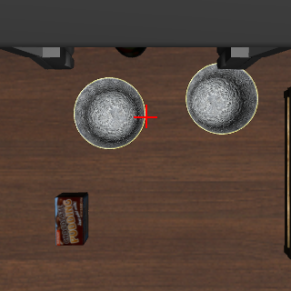
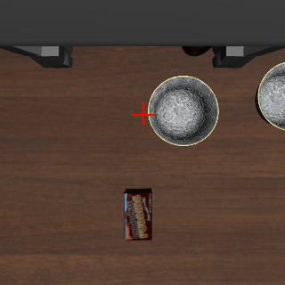
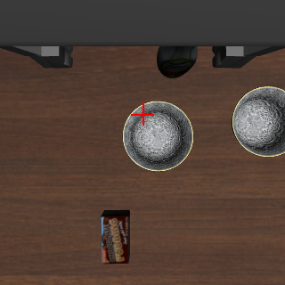

# 004-2 静止画で、ボウルの縁を行き先にした向きの答えを調べる

## 課題

このボウルは指の開き (約 8 cm) より大きいので、中心では掴めず、縁を指で挟んで掴む。005 以降は、手首の画像でボウルの中心の上に合わせ、そこから縁の方へ決まった距離 (+y に 6 cm、`s1cap.jev_staged.RIM_OFFSET`) ずらしている。この 6 cm はボウルの大きさから決めた値で、知覚からは得ていない。

005〜009 の残った失敗の多くは、このずらし方から来ている。中心に合わせた所が +y に 2〜3 cm ずれたまま (+y はもう 1 つのボウルの側) さらに +y に 6 cm ずらすと、2 つのボウルの間に下りるか、もう 1 つのボウルを掴む (006 の init 9、009 の init 0、9)。

掴む縁そのものを Jev に行き先として問えれば、決まった距離のずらしは要らなくなる。中心に合わせたときのずれも、縁に合わせ直すときに直る。

## 仮説

- 手首の画像で「ボウルの縁」を行き先にして問えば、中心を問うたとき (008 の `wrist_center`) と同じ程度に、ずれに合った向きを答える
- もう 1 つのボウルから離れる側の縁 (−y) を問えば、ずれの向きによらず、もう 1 つのボウルの側へは寄らない

10/26 に、+y の側の縁 (画像で最も右の点) で 9 か所を問うたことがある。左右は 6/9、上下 (x) は 3/9 しか合わず、上下はほとんど「動かさない」を選んだ ([wiki](../../wiki/findings/jev-c2-direction-policy.md) の「× を寄せる先: 縁と中心」)。このため 005 では中心に合わせてからずらす形にした。ただし、このときの数は 9 か所と少なく、+y の側の縁だけを、1 つの言い方で問うていた。ここでは、008 と同じ数の位置と init で、両側の縁と 2 つの言い方を比べる。

## 方法

[008](../008-direction-probe/README.md) と同じ `scripts/probe_directions.py` で、エピソードを回さずに静止画で問う。画像、× の位置、採点は 008 の `wrist_center` と同じで、違うのは行き先だけである。

- 手先の位置: 始めの高さ (テーブルの約 24 cm 上) で、掴む縁の点 (ボウルの中心から y に +6 cm または −6 cm) から x に −4、0、+4 cm、y に −6〜+6 cm (2 cm おき) ずらした 21 か所。init state 0〜9。各 3 回
- 行き先 (手首の画像の × を寄せる先)

| 名前 | 行き先の言い方 | 縁の点 |
| --- | --- | --- |
| `wrist_rim_right_edge` | the right edge of the bowl to pick up | 中心から +y に 6 cm (もう 1 つのボウルの側。005〜009 が掴む側) |
| `wrist_rim_right_rim` | the right rim of the bowl to pick up | 同上 |
| `wrist_rim_left_edge` | the left edge of the bowl to pick up | 中心から −y に 6 cm |
| `wrist_rim_left_rim` | the left rim of the bowl to pick up | 同上 |

手首の画像は 180° 回してあるので、画像の右は世界の +y である。

- 採点: 答えを世界座標の水平の向きに直し、手先から縁の点への差 (真値) と比べる。数え方は 008 と同じ (差が 2 cm 以上の軸は近づく / 動かさない / 遠ざかる、1 cm 未満の軸は動かさないを正しいとする)。真値は採点にだけ使う

```sh
uv run --env-file .env scripts/probe_directions.py run experiments/004-2-rim-probe \
    --center-dy 0.06 --conditions wrist_rim_right_edge,wrist_rim_right_rim --name rim_plus
uv run --env-file .env scripts/probe_directions.py run experiments/004-2-rim-probe \
    --center-dy -0.06 --conditions wrist_rim_left_edge,wrist_rim_left_rim --name rim_minus
```

問いの数は 2520 (4 通り × 21 か所 × 10 init × 3 回)。記録は [probe/rim_plus.jsonl](probe/rim_plus.jsonl) と [probe/rim_minus.jsonl](probe/rim_minus.jsonl)、表は [probe/rim_plus.md](probe/rim_plus.md) と [probe/rim_minus.md](probe/rim_minus.md)。

この実験は 009 の後に行った。実験の流れの中では、005 の「中心に合わせてからずらす」形の根拠にあたるので、004 の次に置く。

| 手先が +y の縁の上 | 手先が −y の縁の上 | −y の縁から x に −4 cm、y に +4 cm |
| --- | --- | --- |
|  |  |  |

## 結果

### 軸ごとの答え (差が 2 cm 以上の軸)

| 行き先 | x: 近づく / 動かさない / 遠ざかる | y: 近づく / 動かさない / 遠ざかる | ずれていない軸で動かさない (x、y) |
| --- | --- | --- | --- |
| `wrist_center` (008) | 58% / 42% / 0% | 81% / 19% / 0% | 100%、100% |
| `wrist_rim_right_edge` | 2% / 97% / 0% | 69% / 31% / 0% | 100%、98% |
| `wrist_rim_right_rim` | 2% / 98% / 0% | 57% / 41% / 2% | 100%、100% |
| `wrist_rim_left_edge` | 0% / 100% / 0% | 84% / 16% / 0% | 100%、83% |
| `wrist_rim_left_rim` | 3% / 97% / 0% | 95% / 5% / 0% | 99%、42% |

数は x が 420、y が 450。ずれていない軸は x が 210、y が 90。

### x の答え (x のずれごと、各 210 問)

| 行き先 | −4 cm | 0 | +4 cm |
| --- | --- | --- | --- |
| `wrist_center` (008) | 95 / 115 / 0 | 0 / 210 / 0 | 147 / 63 / 0 |
| `wrist_rim_right_edge` | 11 / 199 / 0 | 0 / 210 / 0 | 3 / 207 / 0 |
| `wrist_rim_left_edge` | 0 / 210 / 0 | 0 / 210 / 0 | 0 / 210 / 0 |

近づく / 動かさない / 遠ざかる。縁を行き先にすると、x に 4 cm ずれていても、ほぼすべて「動かさない」と答えた。

### y のずれごとの y の答え (近づく / 動かさない / 遠ざかる、各 90 問)

| 行き先 | −6 cm | −4 cm | −2 cm | +2 cm | +4 cm | +6 cm |
| --- | --- | --- | --- | --- | --- | --- |
| `wrist_center` (008) | 90/0/0 | 74/16/0 | 38/52/0 | 14/76/0 | 74/16/0 | 89/1/0 |
| `wrist_rim_right_edge` | 90/0/0 | 69/21/0 | 22/68/0 | 23/66/1 | 52/37/1 | 77/13/0 |
| `wrist_rim_right_rim` | 90/0/0 | 58/24/8 | 13/77/0 | 11/79/0 | 43/46/1 | 52/38/0 |
| `wrist_rim_left_edge` | 80/10/0 | 80/10/0 | 57/33/0 | 21/69/0 | 71/19/0 | 90/0/0 |
| `wrist_rim_left_rim` | 90/0/0 | 90/0/0 | 87/3/0 | 15/68/7 | 69/21/0 | 90/0/0 |

y のずれは縁の点からの差で、+ はもう 1 つのボウルの側。

- −y の縁 (`left_edge`、`left_rim`) は、中心を問うたときと同じか、より多く近づく向きを答えた。y の遠ざかる向きは `left_edge` で 0 だった
- `left_rim` は、手先が縁の上 (y のずれ 0) でも、90 問のうち 52 問で y に動けと答えた。+y (ボウルの中心の側) が 37 問で、x が 4 cm ずれている位置に多い。−y (ボウルの外) が 15 問で、x のずれが 0 の位置だけに出た。`left_edge` で動けと答えたのは 15 問だった
- +y の縁 (`right_edge`、`right_rim`) は、中心より近づく向きが少なかった。+4、+6 cm (もう 1 つのボウルの側にずれている) で動かさない答えが 13〜37/90 ある

### x がそろっているとき (x のずれ 0)

中心に合わせた後に縁へ寄せる使い方を想定し、x のずれが 0 の位置だけを見た。各 30 問。

| 行き先 | −6 cm | −4 cm | −2 cm | +2 cm | +4 cm | +6 cm |
| --- | --- | --- | --- | --- | --- | --- |
| `wrist_center` (008) | 30/0/0 | 23/7/0 | 0/30/0 | 0/30/0 | 16/14/0 | 30/0/0 |
| `wrist_rim_left_edge` | 29/1/0 | 30/0/0 | 26/4/0 | 1/29/0 | 30/0/0 | 30/0/0 |
| `wrist_rim_right_edge` | 30/0/0 | 30/0/0 | 15/15/0 | 0/30/0 | 1/28/1 | 18/12/0 |

ボウルの中心は、−y の縁から見て +6 cm、+y の縁から見て −6 cm の所にある。

- 中心の上から −y の縁へ問うと (`left_edge` の +6 cm)、30/30 が近づく向きを答え、+4 cm でも 30/30、+2 cm で 29/30 が動かさないと答えた。2 cm ずつ動くと、縁から +2 cm (中心から −y に 4 cm) で止まる
- 中心の上から +y の縁へ問うと (`right_edge` の −6 cm)、30/30 が近づく向き、−4 cm で 30/30、−2 cm で 15/30 が動かさない。縁から −2〜−4 cm で止まる

## 結論

- 縁を行き先にすると、x (画像の上下) の向きはほとんど答えなかった。4 cm ずれていても 97〜100% が動かさないと答えた。10/26 の 9 か所での結果 (上下 3/9) と同じで、言い方 (edge と rim) や縁の側によらなかった。縁だけを行き先にして合わせると、x が合わないまま下りる。中心に合わせてから縁へ移る形 (005〜009) は、この点で理由がある
- y の向きは、縁を行き先にしても答えた。もう 1 つのボウルから離れる側 (−y) の縁では、中心と同じか、より多く近づく向きを答えた。`left_edge` は遠ざかる向きが 0 だった。`left_rim` は近づく向きが最も多いが、縁の上でも動けと答えることが多く、止まる所が定まりにくい
- x がそろった所から −y の縁へ問うと、中心から −y に約 4 cm の所で止まった。これは静止画の数え方からの見込みで、010 のエピソードでは、下ろし始めた所が中心から −y に 3.4〜5.1 cm だった
- 縁を問うと x の向きを答えない理由は確かめていない。縁は画像の中で上下に延びた線なので、上下の位置が決まらないと Jev が扱っている可能性がある (推測)

## 次へ

この結果から、エピソードで次の形を試す ([010](../010-rim-target/README.md)、10/10)。

- 中心に合わせて x と y をそろえた後、決まった距離 (+y に 6 cm) ずらす代わりに、「the left edge of the bowl to pick up」を行き先にして y だけを合わせる。もう 1 つのボウルから離れる側の縁を掴むので、中心に合わせたときの +y のずれは、縁に合わせ直すときに直る
- 掴む縁を −y に変えると、005〜009 で決めていた掴み方 (+y の縁) も変わる。010 では −y の縁で掴んで持ち上げられた
