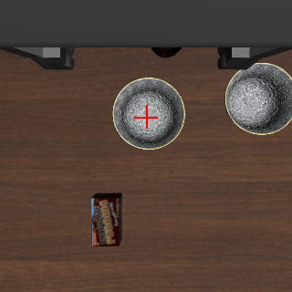
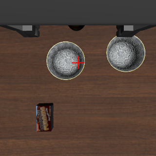
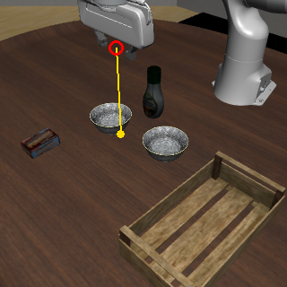

# 008 静止画で、問い方ごとの向きの答えを比べる

## 課題

002〜007 の向きの答えの評価は、どれもエピソードの中で数えたものだった。エピソードでは、指を閉じる時機、下りる時機、手順も同時に変わるので、向きの答えのよしあしと、ほかの判断の失敗を分けられない。

- 002 の向きの失敗は、世界座標の軸で問うたことによるのか、最初に指を閉じてテーブルに押し付けたことによるのか
- 003 で「手首の画像の向きは外さない」としたのは、エピソードの中の 292 回の判断からで、そのうち 192 回は動かさない答えだった。どれだけずれていれば向きを答えるのか
- 007 では、ボウルの上に合わせる所が 006 より 2〜3 cm 大きくずれた。原因は、手順 (LLM が書いたプログラム) か、Jev に渡す行き先の言い方か、1 回の呼び出しで問う数か

## 仮説

- 世界座標の軸の問い (002) は、手先がボウルからどちらにずれていても、ずれに合った向きを答えない
- 画像に × を描き、画像の中の向きで問えば (005、006)、遠ざかる向きは答えない。ただし、ずれが小さいと動かさないと答える
- 007 の合わせる所のずれは、行き先の言い方による。006 の言い方 (「the center of the bowl to pick up」) と 007 の言い方 (「the black bowl on the left」) では、同じ画像でも答えが違う

## 方法

`scripts/probe_directions.py` が、エピソードを回さずに、手先を決まった位置に置いた静止画で Jev に問う。

- タスクと場面: 002〜007 と同じ libero_90 60、quarterview の固定カメラと手首カメラ、320 px。init state 0〜9
- 手先の位置: reset した後の始めの高さ (テーブルの約 24 cm 上) で、掴むボウル (`akita_black_bowl_1`) の中心から x に -4、0、+4 cm、y に -6、-4、-2、0、+2、+4、+6 cm ずらした 21 か所。指は開いている。+y の側に、もう 1 つのボウル (`akita_black_bowl_2`、y に約 18 cm 離れている) がある
- 問い方 (同じ画像に、次の 7 通りで問う。それぞれ 3 回ずつ)

| 名前 | 画像と state | 問い | 使った実験 |
| --- | --- | --- | --- |
| `world_002` | 002 と同じ (座標系の説明、手先の位置と指の開き、固定カメラと手首カメラの画像。印なし) | 002 と同じ 5 問 (x、y、z の向き、指、終わったか) | 002 |
| `world_target` | 同上 | x、y の 2 問。「to get directly above the center of the bowl to pick up」と行き先を書く | なし (比較用) |
| `wrist_006` | 005、006 と同じ手首の画像 (180° 回し、× つき) | 006 の手首の画像への 5 問 (ボウルとトレイへの向き 4 問、トレイが写っているか) | 005、006 |
| `wrist_center` | 同上 | ボウルへの向き 2 問。行き先は「the center of the bowl to pick up」 | 007 の関数で 006 の言い方 |
| `wrist_left` | 同上 | 同上。行き先は「the black bowl on the left」 | 007 (多くのプログラム) |
| `wrist_left_center` | 同上 | 同上。行き先は「the center of the black bowl on the left」 | 007 (一部のプログラム) |
| `fixed_center` | 005〜007 と同じ固定カメラの画像 (手先の印つき) | 黄色い点をボウルの中心へ寄せる向き 2 問 | 007 の `fixed_direction` |

- 採点: 答えを世界座標の水平の向き (x、y の符号) に直し、軸ごとに、手先からボウルの中心への差 (真値) と比べる。差が 2 cm 以上の軸は近づく、動かさない、遠ざかるに分け、1 cm 未満の軸は動かさない答えを正しいとする。真値は採点にだけ使い、Jev には渡さない
- 高さを変えた追加: 始めの高さから 10 cm 下げた所で、`world_target` と `wrist_center` を同じように問う (`--dz 0.10`)。× は始めの高さで測った画像の位置 (`CROSS_UV`) に描いたままなので、この高さでは手先の真下の点から少しずれる

```sh
uv run --env-file .env scripts/probe_directions.py run experiments/008-direction-probe
uv run --env-file .env scripts/probe_directions.py run experiments/008-direction-probe \
    --dz 0.10 --conditions wrist_center,world_target --name low
```

問いの数は始めの高さで 4410 (7 通り × 21 か所 × 10 init × 3 回)、10 cm 下で 1260。記録は [probe/start.jsonl](probe/start.jsonl) と [probe/low.jsonl](probe/low.jsonl)、表は [probe/start.md](probe/start.md) と [probe/low.md](probe/low.md)。問いに使った画像は `outputs/probe_directions/` に書く (git に入れない)。代表的な画像を [images/](images/) に置いた。

| 手首の画像 (ずれなし) | 手首の画像 (+y に 4 cm) | 固定カメラの画像 (+y に 4 cm) |
| --- | --- | --- |
|  |  |  |

## 結果

### 軸ごとの答え (始めの高さ、差が 2 cm 以上の軸)

| 問い方 | x: 近づく / 動かさない / 遠ざかる | y: 近づく / 動かさない / 遠ざかる | ずれていない軸で動かさない (x、y) |
| --- | --- | --- | --- |
| `world_002` | 44% / 0% / 56% | 58% / 0% / 42% | 0%、0% |
| `world_target` | 49% / 0% / 51% | 53% / 1% / 46% | 0%、0% |
| `wrist_006` | 59% / 41% / 0% | 81% / 19% / 0% | 100%、100% |
| `wrist_center` | 58% / 42% / 0% | 81% / 19% / 0% | 100%、100% |
| `wrist_left` | 14% / 61% / 25% | 27% / 68% / 5% | 95%、81% |
| `wrist_left_center` | 25% / 56% / 19% | 55% / 43% / 2% | 99%、83% |
| `fixed_center` | 34% / 66% / 0% | 28% / 71% / 0% | 90%、94% |

数は x が 420、y が 450 (差が 2 cm 以上の軸)。ずれていない軸は x が 210、y が 90。

### y のずれごとの y の答え (近づく/動かさない/遠ざかる、各 90 問)

| 問い方 | -6 cm | -4 cm | -2 cm | +2 cm | +4 cm | +6 cm |
| --- | --- | --- | --- | --- | --- | --- |
| `world_002` | 27/0/63 | 41/0/49 | 19/0/71 | 85/0/5 | 87/0/3 | 89/0/1 |
| `wrist_center` | 90/0/0 | 74/16/0 | 38/52/0 | 14/76/0 | 74/16/0 | 89/1/0 |
| `wrist_left` | 49/37/4 | 9/77/4 | 4/80/6 | 6/81/3 | 1/83/6 | 58/31/1 |
| `wrist_left_center` | 75/12/3 | 26/64/0 | 2/83/5 | 6/81/3 | 59/31/0 | 87/3/0 |
| `fixed_center` | 9/81/0 | 6/84/0 | 8/82/0 | 7/82/1 | 42/47/1 | 63/26/1 |

+ は手先がもう 1 つのボウルの側にずれている。

### 10 cm 下げた所

| 問い方 | x: 近づく / 動かさない / 遠ざかる | y: 近づく / 動かさない / 遠ざかる |
| --- | --- | --- |
| `world_target` | 46% / 17% / 37% | 41% / 23% / 36% |
| `wrist_center` | 50% / 50% / 0% | 86% / 14% / 0% |

### 同じ問いを 3 回送ったときのぶれ

位置ごとに 3 回とも同じ向きを答えた割合は、`wrist_center` 85% (210 か所のうち 179)、`fixed_center` 87%、`wrist_left` 79%、`world_002` 51% だった。1 回の問いのレイテンシの中央値は 373〜419 ms。

## 結論

- 世界座標の軸の問い (`world_002`、`world_target`) は、手先の位置に合った向きを答えなかった。手先がどこにあっても、y は 83〜90% が −y (ロボットの右)、x は 69〜95% が −x を選び、ずれていない軸で動かさないと答えたことは一度も無かった。行き先を問いの文に書いても変わらなかった。002 の向きの失敗は、エピソードの中で指を閉じたことや下り続けたことの結果ではなく、静止画で問うても起きる
- 画像に × を描いて画像の中の向きで問うと (`wrist_center`)、870 問のうち遠ざかる向きは 0 だった。ずれが 4 cm 以上なら 74〜90/90 で近づく向きを答え、2 cm では半分以上が動かさないと答えた。2 cm ずつ動いてこの答えで止まると、2 cm 程度ずれた所で止まる。006 で合わせ終えたときのずれ (0.5〜3.0 cm) はこの範囲にある
- 1 回の呼び出しで問う数 (006 の 5 問と、2 問) は、ボウルへの向きの答えをほとんど変えなかった (`wrist_006` と `wrist_center`)
- 行き先の言い方で答えは大きく変わった。007 の多くのプログラムが使った「the black bowl on the left」では、+4 cm ずれていても 83/90 が動かさないと答え、遠ざかる向きも出た。007 で手先が +y の側 2.6〜5.1 cm で止まったことは、この答えで説明できる。「the center of ...」を付けると (`wrist_left_center`) 中間になった
- 固定カメラの画像でボウルへ寄せる向きを問うと、多くは動かさないと答え (y の 71%)、遠ざかる向きはほぼ無かった。手先の位置がボウルから 4 cm ずれていても、動かさない答えが半分ほどある
- 10 cm 下げた所でも、`wrist_center` が遠ざかる向きを答えたのは 870 問のうち 1 だった。× の位置のずれが向きの答えを逆にすることは、この高さでは見られなかった。x の動かさない答えは増えた (42% → 50%) が、× のずれによるのか、高さによるのかは分けていない

## 次へ

007 のずれの原因が行き先の言い方なら、プログラム (手順) を変えずに、関数の中の言い方を 006 にそろえれば、ボウルに合わせる精度は 006 に近づくはずである。これを [009](../009-cap-fixed-targets/README.md) で確かめる。
