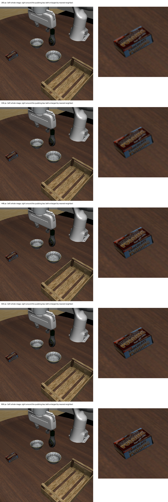

# 012 固定カメラの画像の大きさごとに、トークン数と答えを比べる

## 課題

予備実験 (001〜011) では、固定カメラと手首カメラの画像をどちらも 320 px で送っていた。320 px は、根拠を確かめずに置いた値である。Jev の画像の仕様は、一辺 280〜1,568 px、総画素数 78,400〜2,458,624 と報じられている。範囲外の画像は自動で縮められず、リクエスト全体が失敗する[^spec]。この範囲の中で画像を大きくしたとき、入力トークン数とレイテンシがどれだけ増え、答えがどう変わるかは分かっていなかった。トークン数の数え方も公開されていない。

## 仮説

- 入力トークン数は画素数に比例して増える
- レイテンシは、予備実験の 320 px と同じく 1 秒未満に収まる
- 画像を大きくすると、運ぶ物についての答えの確信度が上がり、ある大きさで頭打ちになる

## 方法

`scripts/probe_resolution.py` で、エピソードを回さずに 1 枚の静止画を大きさを変えて送った。

- タスクと場面: libero_90 61 (プリンの箱をトレイへ) の init state 0。quarterview の固定カメラを 1120 px で描画し、280、336、448、560、672、896、1120 px の正方形に縮めた (Lanczos)。手先の印は描かない
- state: 「Fixed camera image of a robot table scene:」の 1 文と画像 1 枚
- 問い: 次の 2 つを 1 回の呼び出しで問い、大きさごとに 3 回送った
  - `visible` (Noul): 「Is the chocolate pudding box visible in the image?」
  - `side` (Choice、left / right): 「Is the chocolate pudding box on the left or right half of the image?」
- 測ったもの: `usage` の入力トークン数、手元の Mac から測った往復のレイテンシ、答え

```sh
uv run --env-file .env scripts/probe_resolution.py experiments/012-image-resolution
```

記録は [probe/resolution.jsonl](probe/resolution.jsonl)、表は [probe/resolution.md](probe/resolution.md) にある。送った画像は `outputs/probe_resolution/` に書く (git に入れない)。

## 結果

| 一辺 | 入力トークン | レイテンシ [ms] | visible (Noul) | side (Choice) |
| --- | --- | --- | --- | --- |
| 280 px | 561〜564 | 361〜695 | 0.71〜0.75 | 3 回とも left |
| 336 px | 649〜651 | 396〜523 | 0.87 | 3 回とも left |
| 448 px | 873〜875 | 448〜551 | 0.92〜0.94 | 3 回とも left |
| 560 px | 1159〜1163 | 409〜787 | 0.98〜0.99 | 3 回とも left |
| 672 px | 1512〜1515 | 434〜609 | 0.98 | 3 回とも left |
| 896 px | 2407〜2412 | 571〜737 | 0.98 | 3 回とも left |
| 1120 px | 3561〜3562 | 740〜1032 | 0.98〜0.99 | 3 回とも left |

- 入力トークン数は画素数にほぼ比例した。約 360 + 画素数 / 392 で、どの大きさも数トークン以内に合う。画像 1 枚あたり、約 20 × 20 px ごとに 1 トークンにあたる。Qwen2.5-VL と Qwen3-VL は、28 px 四方と 32 px 四方をそれぞれ 1 トークンにまとめる。この数え方とは合わない
- レイテンシは 896 px まで 1 秒未満だった。1120 px では 740〜1032 ms になった
- `side` の左右は、どの大きさでも 3 回とも left (確信度 1.0) で、画像の箱の位置と合っていた
- `visible` の確信度は、280 px の 0.71〜0.75 から上がり、560 px で 0.98〜0.99 になった。それより大きくしても変わらなかった

大きさごとの見え方を並べた ([images/montage.png](images/montage.png))。左は画像全体、右はプリンの箱の周りを切り出したもので、どちらも同じ表示幅まで最近傍で拡大している。



- 280 px では、箱は茶色と青の塊で、文字は読めない
- 336 px で「PUDDING」の形が見え始める
- 448 px で箱の輪郭がはっきりし、「CHOCOLATE PUDDING」がほぼ読める。448 px の画像では、箱は約 65 × 40 px に写る
- 560 px と 896 px では文字がよりはっきりするが、箱の形と位置の見え方は 448 px とほとんど変わらない

## 結論

012 以降の実験では、固定カメラと手首カメラの画像をどちらも 448 px にする。理由は次の 3 つである。

- 448 px で、箱の形と位置が画像から分かり、`visible` の確信度が 0.92〜0.94 になる
- レイテンシは 320 px と変わらない
- 画像 2 枚を送っても、入力トークンは 1 回あたり約 1,400 である

確かめたのは、1 つの場面、1 つの物、2 つの問いだけである。向きの問いや手首カメラの画像、ほかの物で同じ傾向になるかは確かめていない。`visible` の確信度が上がることと、Jev が向きを正しく答えることは別の事柄である。トークン数の数え方は、測った値から推した式で、仕様として公開されたものではない。

## 次へ

引き出しのタスク (libero_goal task 3 の改変) では、取っ手がプリンの箱より小さい。固定カメラを置き直したら、取っ手が 448 px で見えるかを同じ方法で確かめる。見えにくければ 560 px にする。

[^spec]: [Jev 1.14 image input: box, TypeSafe warns](https://pasqualepillitteri.it/en/news/26048/jev-1-14-image-input-box-typesafe-warns)、[LiteLLM: TypeSafe images](https://docs.litellm.ai/docs/decisions/typesafe_images)
