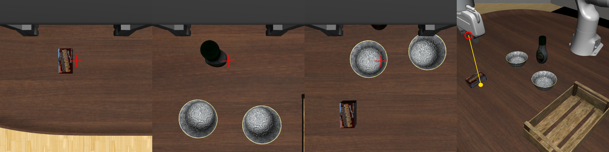

# 016 行き先の言い方ごとに、静止画での向きの答えを比べる

## 課題

手順の骨組み (017) と CaP は、`wrist_direction(target)` と `fixed_direction(target)` に渡す行き先の言い方 `target` で、Jev に手先を寄せる向きを問う。予備実験 008 では、task 60 のボウルについて、言い方によって答えが変わることが分かった。「the center of the bowl to pick up」では物へ向かう答えが多く、「the black bowl on the left」では動かさない答えが多かった。本筋の task 61 のプリンの箱と、物を替える task 62 のドレッシングの瓶で、どの言い方を使えばよいかは確かめていなかった。予備実験は 320 px の画像で問うていて、448 px (012) でも 008 と同じ傾向になるかも分かっていなかった。

## 仮説

- 箱と瓶は、名前で言えば手首の画像で物へ向かう向きを答える。色や形だけの言い方 (「the brown box」「the bottle」) でも、画像にほかに似た物が無ければ同じように答える
- task 60 の左右の言い方は、448 px でも 008 と同じく動かさない答えが多い
- 固定カメラの画像は、手先が物の近くにあると、ずれを見分けられない

## 方法

`scripts/probe_targets.py` が、エピソードを回さずに、手先を決まった位置に置いた静止画で Jev に問う。

- タスクと場面: libero_90 61、62、60、quarterview の固定カメラと手首カメラ、448 px。init state 0〜4
- 手先の位置: reset した後の始めの高さで、運ぶ物の位置 (真値) から x に -4、0、+4 cm、y に -6〜+6 cm (2 cm おき) ずらした 21 か所。008 と同じ格子
- 問い: `s1cap.cap.direction_questions` で、CaP と骨組みの `wrist_direction` と同じ問いを、言い方だけを替えて問う。`--camera fixed` では `fixed_direction` と同じ問い (固定カメラの画像の黄色い点を寄せる向き) を問う
- 採点: 答えを世界座標の水平の向きに直し、軸ごとに、手先から採点する物の位置 (真値) への差と比べる。差が 2 cm 以上の軸は近づく、動かさない、遠ざかるに分け、1 cm 未満の軸は動かさない答えを正しいとする (008 と同じ)。真値は手先を置くことと採点にだけ使い、Jev には渡さない

| 名前 | タスク | カメラ | 言い方 |
| --- | --- | --- | --- |
| `pudding` | 61 | 手首 | the chocolate pudding box、the chocolate pudding、the brown box、the box、the center of the chocolate pudding box |
| `pudding_fixed` | 61 | 固定 | the chocolate pudding box、the brown box |
| `dressing` | 62 | 手首 | the salad dressing bottle、the salad dressing、the bottle |
| `bowl_left_right` | 60 | 手首 | the black bowl on the left、the left black bowl、the black bowl on the right (右のボウルで採点)、the center of the bowl to pick up |

```sh
uv run --env-file .env scripts/probe_targets.py run experiments/016-target-wording --inits 0-4 --task 61 --name pudding \
    --phrases "the chocolate pudding box,the chocolate pudding,the brown box,the box,the center of the chocolate pudding box"
uv run --env-file .env scripts/probe_targets.py run experiments/016-target-wording --inits 0-4 --task 61 --name pudding_fixed \
    --camera fixed --phrases "the chocolate pudding box,the brown box"
uv run --env-file .env scripts/probe_targets.py run experiments/016-target-wording --inits 0-4 --task 62 --name dressing \
    --phrases "the salad dressing bottle,the salad dressing,the bottle"
uv run --env-file .env scripts/probe_targets.py run experiments/016-target-wording --inits 0-4 --task 60 --name bowl_left_right \
    --phrases "the black bowl on the left,the left black bowl,the black bowl on the right,the center of the bowl to pick up" \
    --score "akita_black_bowl_1,akita_black_bowl_1,akita_black_bowl_2,akita_black_bowl_1"
```

記録と表は [probe/](probe/) にある (`<名前>.jsonl`、`<名前>.md`)。問いに使った画像は `outputs/probe_targets/` に書く (git に入れない)。下の図は、手先を物から +y に 4 cm ずらしたときの画像で、左から task 61、62、60 の手首の画像と task 61 の固定カメラの画像である。手首の画像の右が +y なので、物は × の左に写る。



## 結果

差が 2 cm 以上の軸で物へ向かう答えの割合と、差が 1 cm 未満の軸で動かさない答えの割合 (x、y)。

| タスク | 言い方 | x: 近づく / 動かさない / 遠ざかる | y: 近づく / 動かさない / 遠ざかる | 合っている軸で動かさない (x、y) |
| --- | --- | --- | --- | --- |
| 61 | the chocolate pudding box | 67% / 33% / 0% | 93% / 7% / 0% | 100%、87% |
| 61 | the chocolate pudding | 69% / 31% / 0% | 93% / 7% / 0% | 100%、93% |
| 61 | the brown box | 53% / 47% / 0% | 92% / 8% / 0% | 100%、100% |
| 61 | the box | 57% / 43% / 0% | 93% / 7% / 0% | 100%、100% |
| 61 | the center of the chocolate pudding box | 73% / 27% / 0% | 100% / 0% / 0% | 100%、53% |
| 61 (固定) | the chocolate pudding box | 9% / 91% / 0% | 11% / 89% / 0% | 97%、100% |
| 61 (固定) | the brown box | 13% / 87% / 0% | 12% / 88% / 0% | 100%、87% |
| 62 | the salad dressing bottle | 49% / 41% / 10% | 89% / 8% / 3% | 54%、100% |
| 62 | the salad dressing | 44% / 34% / 21% | 88% / 8% / 4% | 34%、73% |
| 62 | the bottle | 59% / 39% / 3% | 91% / 8% / 1% | 77%、100% |
| 60 | the black bowl on the left | 23% / 39% / 39% | 35% / 60% / 5% | 83%、80% |
| 60 | the left black bowl | 6% / 70% / 24% | 21% / 65% / 13% | 91%、93% |
| 60 | the black bowl on the right (右のボウルで採点) | 4% / 80% / 15% | 100% / 0% / 0% | 100%、- |
| 60 | the center of the bowl to pick up | 66% / 34% / 0% | 83% / 17% / 0% | 100%、100% |

- task 61 の箱は、手首の画像では、どの言い方でも y は 92〜100% 近づき、遠ざかる答えは無かった。x の動かさない答えは、手先が箱から x に 4 cm ずれたときに出た (x に -4 cm で 35 問中 10、+4 cm で 13)。「the center of ...」は y で 100% 近づくが、合っているときにも 47% で動かす
- 固定カメラの画像では、手先が箱から 4〜6 cm の所では 9 割が動かさないと答えた
- task 62 の瓶は、y は 88〜91% 近づいた。x は言い方による差が大きく、「the salad dressing」は 21% で遠ざかった。「the bottle」が x、y とも最もよかった
- task 60 の左右の言い方は、448 px でも 008 と同じく、左のボウルから y に ±4 cm ずれていても多くは動かさないと答えた。右のボウルへの向きは、y では 100% 近づいた。手首の画像でも左のボウルは右のボウルより左 (-y) に写るので、画像の左右と言い方の左右は合っている。「the center of the bowl to pick up」は、008 と同じく物へ向かう答えが多かった
- レイテンシの中央値は手首の画像で 411〜434 ms、固定カメラの画像で 454〜493 ms。入力トークンは 1 問あたり約 1,020〜1,050 だった

## 結論

骨組みとタスクの値には、次の言い方を使う。

- task 61: 「the chocolate pudding box」。y の向きは 93% 近づき、合っているときに 87% 動かさない。「the center of ...」は合わせた後も動き続けるので使わない。x の動かさない答えは残るが、箱は x に 8 cm の長さがあり、015 の掴めるかの結果から害は小さいと見る
- task 62: 「the bottle」。ただし瓶の位置では手先が卓まで下りられず、上から掴めないことが分かったので ([015](../015-grasp-tolerance/README.md))、task 62 は骨組みと CaP では回さない
- task 60: 「the center of the bowl to pick up」。左右で言うと、ボウルの近くで向きを答えない

固定カメラの画像は物の近くのずれを見分けないので、骨組みでは、物が手首の画像に入るまで粗く寄せる段にだけ使う。これは予備実験 006 と同じ使い方である。

確かめたのは、始めの高さの 21 か所と init 0〜4 だけで、1 か所に 1 回ずつ問うた。運ぶ物が手首の画像に写らない遠さからの答えは確かめていない。

## 次へ

- 017 の骨組みに、ここで選んだ言い方を埋めて task 61 と 60 で回す
- CaP では、LLM に渡す知見にこの表を含め、LLM が選ぶ言い方と比べる
